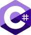

<p align="center">
  
</p>

<p align="center">
  <strong>Write once. Compile to every language.</strong><br>
  A programming language for problem solvers.
</p>

<p align="center">
  <a href="docs/README.md"><b>Docs</b></a> ·
  <a href="docs/guide/tour.md">Quick tour</a> ·
  <a href="docs/guide/getting-started.md">Tutorial</a> ·
  <a href="docs/language/README.md">Reference</a> ·
  <a href="https://temperlang.github.io/tempest/c9cb414b4800a065953f72df4ab69943/playground/"><b>Playground</b></a>
</p>

---

**Temper** lets a developer or a small team solve a problem once, for
every programming language community. It's a language designed for one
purpose: to translate well to all the others. You write a library in
Temper, and get idiomatic, semantically equivalent libraries in each
language, with their tests.

```temper
export let half(x: Int): Int {
  x / 2
}
```

becomes, in Python,

```py
from temper_core import int_div as _int_div

def half(x: int, /) -> int:
    return _int_div(x, 2)
```

and likewise in each of these[\*](#not-endorsed-or-affiliated):

<table>
  <tr valign="bottom">
    <td align="center"><a href="docs/backends/README.md#c-cpp"><br>C++</a></td>
    <td align="center"><a href="docs/backends/README.md#c-csharp"><br>C#</a></td>
    <td align="center"><a href="docs/backends/README.md#java-java"><br>Java</a></td>
    <td align="center"><a href="docs/backends/README.md#javascript-js"> <br>JS / TS</a></td>
  </tr>
  <tr valign="bottom">
    <td align="center"><a href="docs/backends/README.md#lua-lua"><br>Lua</a></td>
    <td align="center"><a href="docs/backends/README.md#python-py"><br>Python</a></td>
    <td align="center"><a href="docs/backends/README.md#rust-rust"><br>Rust</a></td>
    <td align="center">&hellip;<br>and more to come</td>
  </tr>
</table>

## This repository

This is **tempest**, Temper's compiler written from scratch in Rust
(edition 2024): the same language, behavior, and generated APIs as
Temper's first compiler, from a much smaller, simpler, and faster
code base. It's one small binary, `tempest`, and it also runs in the
browser.

- **The whole pipeline works:** parsing, the settle loop (names,
  macros, and types), an interpreter, tmpl (the backend IR), and seven
  backends.
- **Temper's functional tests** all pass on the interpreter and on
  every backend, and the generated code passes each language's strict
  checkers (clippy, `tsc --strict`, pyright and mypy, LuaLS, and
  compilers with warnings as errors).
- **Real libraries** (Hrefine, Chromarite, Ordable, Kelpto, and
  Wherewith) pass all their tests in all seven languages.
- **Editors:** a language server, `tempest lsp`, and a VS Code
  extension ([editors/vscode](editors/vscode/README.md)).
- **Coming:** the rest of the `temper` command line
  ([docs/tools/cli.md](docs/tools/cli.md)).

## Try it

- **In your browser:** the
  [playground](https://temperlang.github.io/tempest/c9cb414b4800a065953f72df4ab69943/playground/)
  runs the whole compiler as wasm: type Temper and see every
  language's output, errors, and test results as you type.
- **From source,** with [Rust](https://rustup.rs/) 1.85 or later:

      cargo build --release -p tempest
      target/release/tempest test DIR        # run a library's tests
      target/release/tempest build -w DIR    # write temper.out/LANGUAGE/…

  A library is a directory with a `config.temper.md`; the
  [getting started guide](docs/guide/getting-started.md) makes one.
  Temper's standard library is built in, so the binary needs nothing
  beside it.

## Documentation

Everything lives under [docs/](docs/README.md):

- [Guide](docs/guide/README.md): why Temper, a quick tour, getting
  started, and a tutorial.
- [Language reference](docs/language/README.md): types, builtins,
  syntax, and modules.
- [Standard library](docs/std/README.md): JSON, regular expressions,
  dates, testing, and networking.
- [Backends](docs/backends/README.md): what each target language gets.
- [Tools](docs/tools/README.md): the command line, editors, and the
  playground.
- [Contributing](docs/contributing/README.md), and
  [how tempest works](docs/internals/README.md), stage by stage.
- [Release notes](docs/release-notes/README.md).

## Community

- **Discord:** [the Temper Language Discord](https://discord.gg/TY3Be6fzwu)
- **Stack Overflow:** the [`temper`](https://stackoverflow.com/questions/tagged/temper) tag
- **Issues:** [report bugs or request features](https://github.com/temperlang/temper/issues)

## License

[COPYRIGHT](COPYRIGHT) has the details: code is dual licensed as
[Apache 2.0](LICENSE-APACHE) or [MIT](LICENSE-MIT), and documentation
as [CC BY-SA 4.0](LICENSE-CC-BY-SA-4.0). Third-party materials are
listed in [NOTICE](NOTICE).

### Not endorsed or affiliated

We use other programming language projects' logos and names with
permission, but don't imply any official relationship with, or
endorsement by, those projects' contributors or sponsors. (We refer to
them because we love them, as we love all programming languages, their
contributors, and their communities.) Where each logo comes from, and
its terms, is in [docs/images/lang-icons](docs/images/lang-icons/README.md).

Written with Claude Code and Opus 5.5.
