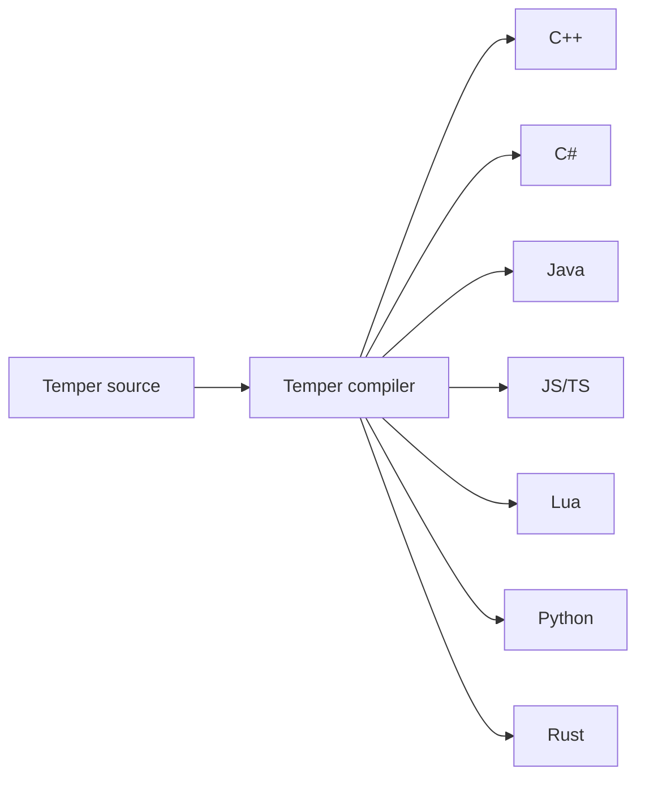
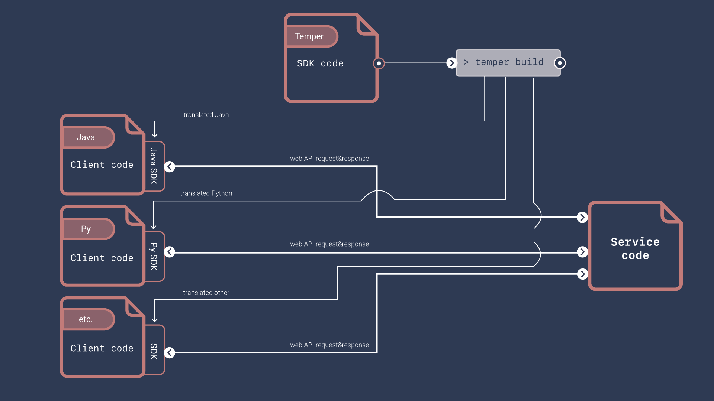
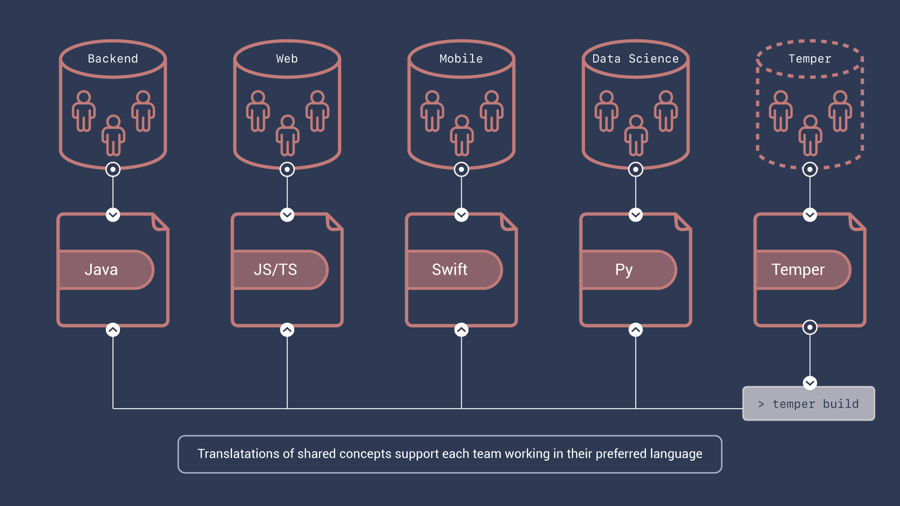
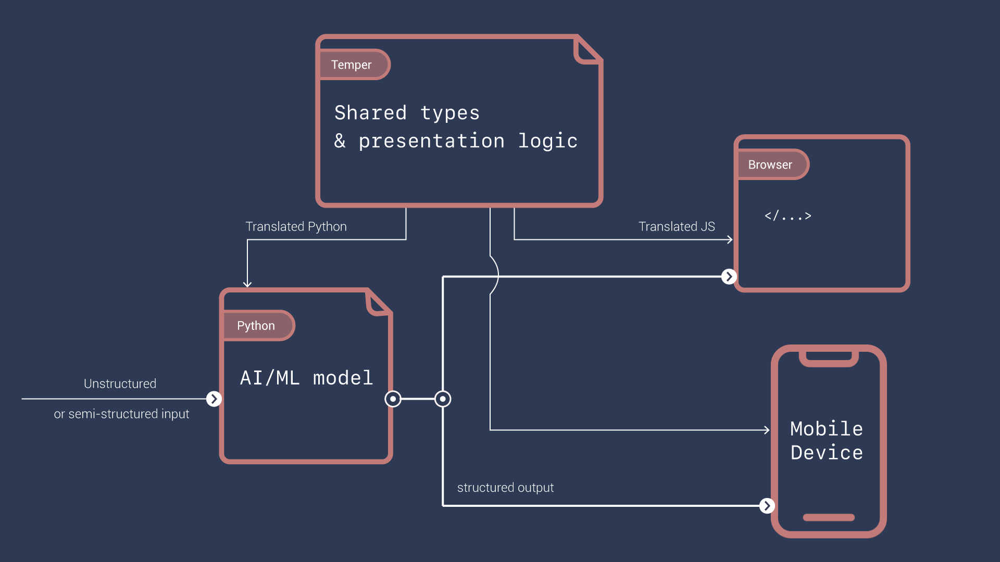
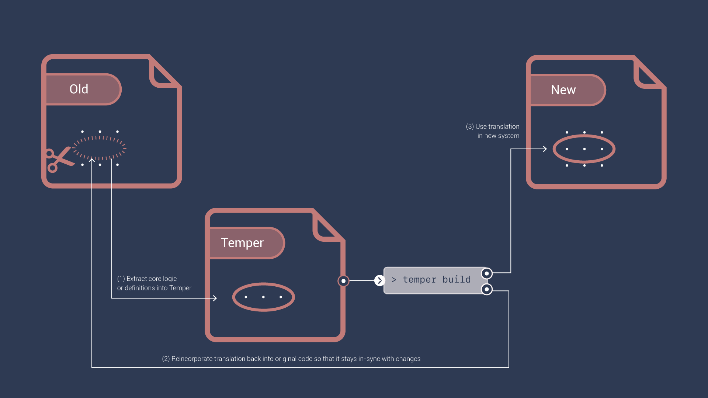
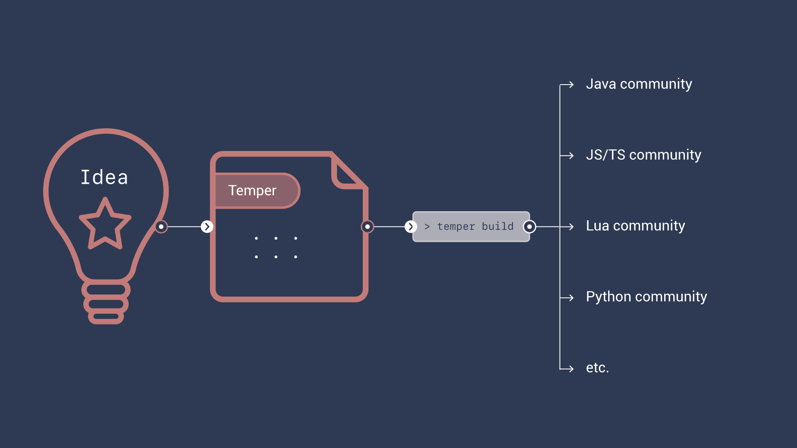

<p align="center">
  
</p>

# The Temper programming language

[Quick tour](tour.md) · [Getting started](getting-started.md) ·
[Reference](../language/README.md) · [Blog](https://temperlang.dev/blog/)

The *Temper* programming language translates to other programming
languages.



From a single definition, you get libraries that you can share with
many programming language communities.

```temper
export let half(x: Int): Int {
  x / 2
}
// ✅
```

<details open><summary>Python</summary>

```py
from temper_core import int_div as _int_div

__all__ = ('half',)

def half(x: int, /) -> int:
    return _int_div(x, 2)
```

</details>

<details><summary>C++</summary>

```cpp
namespace numerics {

int32_t half(int32_t x) {
  return x / 2;
}

}  // namespace numerics
```

</details>

<details><summary>C#</summary>

```cs
using TemperLang.Core;

namespace Numerics;

public static class NumericsGlobal
{
    public static int Half(int x)
    {
        return Core.DivSafe(x, 2);
    }
}
```

</details>

<details><summary>Java</summary>

```java
package numerics;

public final class NumericsGlobal {
    private NumericsGlobal() {}

    public static int half(int x) {
        return x / 2;
    }
}
```

</details>

<details><summary>JS / TS</summary>

```js
/**
 * @param {number} x
 * @returns {number}
 */
export function half(x) {
  return (x / 2) | 0;
}
```

</details>

<details><summary>Lua</summary>

```lua
local temper = require("temper-core")

---@param x integer
---@return integer
local function half(x)
  return temper.int32_div(x, 2)
end

return { half = half }
```

</details>

<details><summary>Rust</summary>

```rs
pub fn half(x: i32) -> i32 {
    x.wrapping_div(2)
}
```

</details>

Temper is designed from the ground up to translate well, so more
languages will follow.

Those libraries can include rich type definitions:

```temper
let { Date } = import("std/temporal");

/** Some minimal info about a person. */
export class Person(
  public name: String,
  public dateOfBirth: Date,
) {
  public ageAt(date: Date): Int {
    Date.yearsBetween(date, dateOfBirth)
  }
  /** The count of whole years between their DOB and today in UTC. */
  public get age(): Int { ageAt(Date.today()) }
}
// ✅
```

<details open><summary>Python</summary>

```py
from datetime import date as _date
from temper_core import (
    date_today as _date_today,
    years_between as _years_between,
)

__all__ = ('Person',)

class Person:
    __slots__ = ('_name', '_date_of_birth')
    _name: str
    _date_of_birth: _date

    def __init__(self, /, name: str, date_of_birth: _date) -> None:
        self._name = name
        self._date_of_birth = date_of_birth

    @property
    def name(self, /) -> str:
        return self._name

    @property
    def date_of_birth(self, /) -> _date:
        return self._date_of_birth

    def age_at(self, date: _date, /) -> int:
        return _years_between(date, self._date_of_birth)

    @property
    def age(self, /) -> int:
        return self.age_at(_date_today())
```

</details>

<details><summary>C++ (the header)</summary>

```cpp
namespace person {

struct Person : public std::enable_shared_from_this<Person> {
  std::string name;
  std::shared_ptr<temper_std::Date> dateOfBirth;
  static std::shared_ptr<Person> make(std::string name, std::shared_ptr<temper_std::Date> const & dateOfBirth);
  int32_t ageAt(std::shared_ptr<temper_std::Date> const & date) const;
  int32_t get_age() const;
  std::string get_name() const;
  std::shared_ptr<temper_std::Date> get_dateOfBirth() const;
};

}  // namespace person
```

</details>

<details><summary>C#</summary>

```cs
using System;
using TemperLang.Std.Temporal;

namespace Person;

public class Person
{
    private readonly string name;
    private readonly DateTime dateOfBirth;

    public Person(string name, DateTime dateOfBirth)
    {
        this.name = name;
        this.dateOfBirth = dateOfBirth;
    }

    public string Name
    {
        get
        {
            return this.name;
        }
    }

    public DateTime DateOfBirth
    {
        get
        {
            return this.dateOfBirth;
        }
    }

    public int AgeAt(DateTime date)
    {
        return TemporalSupport.YearsBetween(date, this.dateOfBirth);
    }

    public int Age
    {
        get
        {
            return this.AgeAt(TemporalSupport.Today());
        }
    }
}
```

</details>

<details><summary>Java (without its builder)</summary>

```java
package person;

import java.time.LocalDate;
import java.time.ZoneOffset;
import java.time.temporal.ChronoUnit;

public final class Person {
    public final String name;
    public final LocalDate dateOfBirth;

    public Person(String name, LocalDate dateOfBirth) {
        this.name = name;
        this.dateOfBirth = dateOfBirth;
    }

    public int ageAt(LocalDate date) {
        return (int) ChronoUnit.YEARS.between(date, this.dateOfBirth);
    }

    public int getAge() {
        return this.ageAt(LocalDate.now(ZoneOffset.UTC));
    }

    public String getName() {
        return this.name;
    }

    public LocalDate getDateOfBirth() {
        return this.dateOfBirth;
    }
}
```

</details>

<details><summary>JS / TS</summary>

```js
import { dateToday, dateYearsBetween, type } from "@temperlang/core";

export class Person extends type() {
  /** @type {string} */
  #name;
  /** @type {globalThis.Date} */
  #dateOfBirth;

  /**
   * @param {{ name: string, dateOfBirth: globalThis.Date }} props
   * @returns {Person}
   */
  static new(props) {
    return new Person(props.name, props.dateOfBirth);
  }

  /**
   * @param {string} name
   * @param {globalThis.Date} dateOfBirth
   */
  constructor(name, dateOfBirth) {
    super();
    this.#name = name;
    this.#dateOfBirth = dateOfBirth;
  }

  /** @returns {string} */
  get name() {
    return this.#name;
  }

  /** @returns {globalThis.Date} */
  get dateOfBirth() {
    return this.#dateOfBirth;
  }

  /**
   * @param {globalThis.Date} date
   * @returns {number}
   */
  ageAt(date) {
    return dateYearsBetween(date, this.#dateOfBirth);
  }

  /** @returns {number} */
  get age() {
    return this.ageAt(dateToday());
  }
}
```

</details>

<details><summary>Lua</summary>

```lua
local temper = require("temper-core")

---@class person.Person
---@field name string
---@field dateOfBirth std.temporal.Date
---@field ageAt fun(self: person.Person, date: std.temporal.Date): integer
---@field age integer

---@class person.Person.type: temper.Type
---@operator call: person.Person
local Person = temper.type("person.Person")

---@param this person.Person
---@param name string
---@param dateOfBirth std.temporal.Date
function Person.constructor(this, name, dateOfBirth)
  this.name = name
  this.dateOfBirth = dateOfBirth
end

---@param this person.Person
---@param date std.temporal.Date
---@return integer
function Person.methods.ageAt(this, date)
  return temper.date_yearsbetween(date, this.dateOfBirth)
end

---@param this person.Person
---@return integer
function Person.get.age(this)
  return this:ageAt(temper.date_today())
end

return { Person = Person }
```

</details>

<details><summary>Rust (without its builder)</summary>

```rs
use std::sync::Arc;
use temper_core::ToArcString;

struct PersonStruct {
    name: Arc<String>,
    date_of_birth: temper_std::temporal::Date,
}

#[derive(Clone)]
pub struct Person(Arc<PersonStruct>);

impl Person {
    pub fn new(name: impl ToArcString, date_of_birth: temper_std::temporal::Date) -> Person {
        let name = name.to_arc_string();
        Person(Arc::new(PersonStruct {
            name,
            date_of_birth,
        }))
    }

    pub fn age_at(&self, date: temper_std::temporal::Date) -> i32 {
        temper_std::temporal::Date::years_between(date.clone(), self.0.date_of_birth.clone())
    }

    pub fn age(&self) -> i32 {
        self.age_at(temper_std::temporal::today().unwrap())
    }

    pub fn name(&self) -> Arc<String> {
        self.0.name.clone()
    }

    pub fn date_of_birth(&self) -> temper_std::temporal::Date {
        self.0.date_of_birth.clone()
    }
}
```

</details>

These are tempest's translations, trimmed of package files; try your
own in the
[playground](https://temperlang.github.io/tempest/c9cb414b4800a065953f72df4ab69943/playground/).

## Types across the wire

Sharing type definitions extends type guardrails across network gaps
leading to more-reliable code, and simplifies data on the wire.

![Diagram consisting of several elements: A file marked "Temper" with code "class Person \{ ... public get age\(\): Int \{ ... \} \}" pointing into a box "> temper build" that fans out to two boxes labeled "Server" and "Client".  The Server box is a file marked "Java" and contains code "response.send\(new Person\(name, dateOfBirth\)\)".  The Client box is a file marked "JS/TS" and contains "let person: Person = Person.fromJSON\(resp\); f\(person.age\)".  Moving from Server to Client is a JSON file with content "\{ "name": "Firsty McLasty", "dateOfBirth": "2000-01-01" \}".  There are two speech bubbles with arrows too.  The first says "age not shipped but available via computation" and points to the JSON and points to "f\(person.age\)" in the Client code.  The second says "Type shared in request + response" and points to "new Person" in the Server code and "let person: Person" in the Client code.](../images/type-guard-rails.png)

## Plain functions and types

Temper meets other languages where they are.

Temper functions and types translate to regular functions and
types&mdash;no awkward native or foreign function interface.

```temper
// Temper

/**
 * The diff function compares two inputs,
 * and computes a [Patch]: the changes
 * from [left] required to derive [right].
 */
export let diff<T …>(
  left: List<T>,
  right: List<T>,
  /** Are two items the same? */
  eq: fn (T, T): Boolean =
      fn (a: T, b: T): Boolean { a == b }
): Patch<T> {…}
```

```sh
$ node
> let diffLib = await import(
      "./temper.out/diff-lib/js/myers-diff.js");
undefined
> diffLib.diff
[Function: diff]
> ^D

$ python3
>>> from difflib.myers_diff import diff
>>> type(diff)
<class 'function'>
>>> ^D
```

## Tested in every language

Temper enables deep supply-chain integration.  Translating both production **and** test code helps ensure the quality of the library and the translation.

![Diagram showing three groups of code on the left (Temper, Java, and Python) flowing to a CI/CD dashboard on the right.  From the Temper code, arrows flow into "> temper build" and then "> temper test" and through to the dashboard.  From the bottom of "> temper build" come two arrows labeled "translated Java" and "translated python."  The translated java flows with the Java code into "> junit" and then to the dashboard.  Similarly, the translated python joins with the Python code to flow into "> pyunit" and from there to the dashboard.](../images/ssp-integration.png)

## Where Temper fits

Most engineering organizations use multiple languages: Python for data science, others for mobile apps, JavaScript on the web, and a different language on the server.

Temper helps break down silos by letting a small team maintain core type definitions and logic to all the other silos.

### Software Development Toolkits \(SDKs\)

SDKs ease connecting to a service.
Client code gets responses as rich, well-typed values.

Letting the service maintainer run a bit of code before the request is
sent and right after the response is received, gives great flexibility
when deprecating and evolving application programming interfaces (APIs).



### Common Infrastructure Teams

A team using Temper can make many other teams more productive by
solving common problems once regardless of language silos.



### Artificial Intelligence/Machine Learning (AI/ML) Integration

Many AI/ML projects fail to provide value due to difficulty
integrating them with traditionally engineered systems.

Sharing type definitions and related computations, including
presentation logic, helps quickly integrate AI/ML deployments.



### Code Migration

Migrating old or acquired code is easier if you can extract key
definitions and business logic into Temper, and actively maintain it
while using it, via translation, in both the old and new systems.



### Language Agnostic Solutions

Some problems aren't about any programming language. For example,
turning untrusted HTML into trustworthy HTML is about HTML, not
whether the transformation happens on a server or a client. Written
in Temper, one solution can serve many language communities.



### Lightweight Standards

*Lightweight standards* documents help engineers and non-engineers
collaborate on solving a problem efficiently.

① Requirements in prose explain the why.  
② Code in Temper provides an implementation to all engineering stakeholders.  
③ Requirements can be checked by in-line test code.

The document stays relevant to engineers because they get libraries
they can use.  Non-engineering stakeholders have a single engineering
point of contact when requirements need to change, so many more
business policy changes happen without high-effort change management.


## Next steps

- Take the [quick tour](tour.md), or read [why Temper exists](why.md).
- [Get started](getting-started.md) writing a library.
- Browse the [language reference](../language/README.md).
