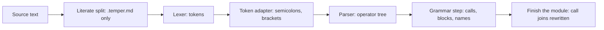

# 1. Syntax: from text to trees

[`temper-syntax`](../../crates/temper-syntax/src/lib.rs) turns source text
into the tree the rest of the compiler works on. It has no idea what
`let` or `if` mean. That comes later, from macros. Here, almost
everything is an operator, and a keyword is just a name.



## The steps

- **Literate split.** In a `.temper.md` file, only the indented or
  fenced code is Temper. The rest is prose.
- **Lexer.** A hand-written lexer cuts the text into tokens. Each has a
  kind and a byte span. Its text is just the source in that span.
- **Token adapter.** Small fix-ups the parser wants: drop spaces and
  comments, insert `;` after a `}` that ends a line, and mark where a
  block is followed by more words (`} else {`), the *call join*. When
  brackets don't balance, *bracket recovery* closes each one at the
  nearest plausible place, so a missing `)` is one error at the gap,
  not one that swallows the rest of the file.
- **Parser.** One table-driven operator-precedence parser. Calls and
  blocks are operators too, so `if (a) { } else { }` and
  `foo(x) { }` need no special cases.
- **Grammar step.** The operator tree becomes a tree of a few kinds:
  `Call`, `Block`, `Decl`, `Fun`, names, and values. `a + b` becomes a
  call of `desugarOperation`, and `"a${b}"` a call of `stringExpr`.

Errors are values all the way through. An operator with a missing
operand stays in the tree with an error attached, so the rest of the
file still parses and still gets checked.

Why each step is a port of Kotlin Temper's, and what that costs, is in
[the detailed page](detail/01-syntax.md#port-kotlins-front-end-step-by-step),
along with [bracket recovery](detail/01-syntax.md#bracket-recovery) and
[errors and depth limits](detail/01-syntax.md#errors-as-values-and-bounded-depth).

## Worked example

The lexer sees `triple.temper` as tokens. The first few:

```text
Word         0   3  let
Space        3   4
Word         4  10  triple
Punctuation 10  11  (
Word        11  12  n
...
```

The parser groups them by precedence. Note `Curly`: a block is an
operator applied to what comes before it.

```text
(Semi
  (Curly (HighColon (Paren [let triple] "(" (HighColon n : Int) ")") : Int) { (Star n * 3) })
  ;
  (Paren
    (Dot console . log)
    "("
    (ParenGroup
      "("
      (QuotedGroup "\"" "triple(14) = " (DollarCurly ${ (Paren triple "(" 14 ")") }) "\"")
      ")")
    ")")
  ;)
```

The grammar step makes calls of everything. `let` is just the callee
of a call, `*` is `desugarOperation`, and the string is `stringExpr`:

```text
(Block
  (Call
    let
    \word
    ^triple
    (Block \_complexArg_ n \type Int)
    \outType
    Int
    (Fun (Block (Call #desugarOperation * n 3))))
  (Call (Call %. console \log) (Call #stringExpr #null #false "triple(14) = " (Call triple 14)))
  #void)
```

`^triple` is a name being declared, `\word` a symbol naming the next
argument, and `#desugarOperation` a builtin. Nothing here knows yet
that `let` declares something. The [settle loop](02-settle-loop.md)
finds that out.

You can print these yourself with the crate's small tools:
`lex-tokens`, `parse-tree --pretty`, and `ast-tree --pretty`.

## One tree type

Both trees above use one type, [`Tree`](../../crates/temper-syntax/src/tree.rs):
flat arrays of node kinds, spans, data, and children, addressed by
`NodeId`. The parse tree is kept unchanged, for tools that care about
layout and comments. The settle loop works on a copy built by the
grammar step, whose nodes remember where they came from. Its
[`NodeKind`](../../crates/temper-syntax/src/tree.rs) already lists the
core constructs that macros will reduce everything to. The trade-offs
are in [one tree type](detail/01-syntax.md#one-tree-type-in-flat-arrays)
and [two copies](detail/01-syntax.md#two-copies-the-parse-tree-and-the-working-tree).

## Where in the code

- [`find_blocks`](../../crates/temper-syntax/src/literate.rs): the literate split.
- [`lex`](../../crates/temper-syntax/src/lex.rs) and its [`Token`](../../crates/temper-syntax/src/lex.rs).
- [`adapt`](../../crates/temper-syntax/src/adapt.rs): the token adapter, with bracket recovery in [`balance`](../../crates/temper-syntax/src/balance.rs).
- [`parse`](../../crates/temper-syntax/src/parse.rs), giving [`Parsed`](../../crates/temper-syntax/src/parse.rs), with the operator table in [`operators!`](../../crates/temper-syntax/src/operator.rs).
- [`build`](../../crates/temper-syntax/src/ast.rs), giving [`Ast`](../../crates/temper-syntax/src/ast.rs), with the productions in [`Grammar`](../../crates/temper-syntax/src/grammar.rs).
- [`build_module`](../../crates/temper-syntax/src/module.rs): metadata and call joins.
- [`write_ast`](../../crates/temper-syntax/src/print.rs): trees as text, for tests.
- [`add_file`](../../crates/temper-frontend/src/library.rs) in the frontend runs all of the above for each file and copies the result into the library's tree.
- Tests: `crates/temper-syntax/tests/parse/` and `tests/ast/` hold the
  cases, many of them taken from Temper's own tests ([all the tests](detail/01-syntax.md#tests)).

More: [notes/design.md](../../notes/design.md), sections 3 and 4.

**In detail:** [Syntax in detail](detail/01-syntax.md): each decision
with its alternatives and Kotlin Temper's way, the main types, the
tests, and known weaknesses.
