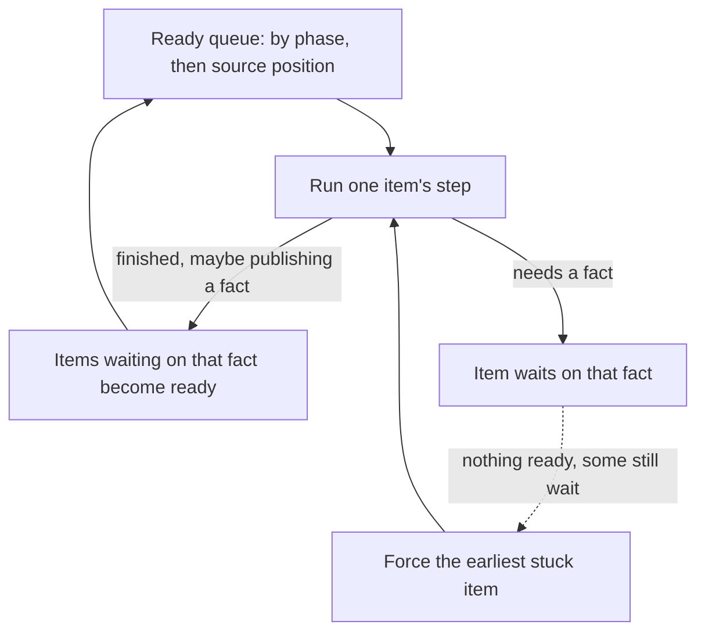

# 2. The settle loop: names and macros

Many compilers run fixed stages: resolve names, then expand macros,
then check types. Temper can't do that cleanly, because a macro may
declare a name that another statement needs, and a macro may need a
type before it knows what to produce. So instead of fixed stages, tempest
has one scheduler of small work items, and each item says what it's
waiting for. It runs in two rounds (names and macros, then typing),
with a few whole-tree passes between and after them.

## Work items and facts

Each piece of work is an *item*. Running an item's step either
finishes it or stops on one missing *fact*, such as "this scope's
declarations are all known" or "this declaration's type is known". The
item then waits on that fact, and only that fact.

When a step learns something, it *publishes* the fact, and exactly the
items waiting on it become ready again. Nothing else is revisited. Facts
are only ever added, never changed, so the loop always makes progress.



If nothing is ready but items still wait, something can't be known:
a name that's never declared, or two items waiting on each other. The
loop then *forces* the earliest stuck item to go on without its fact,
which usually makes an error node, and carries on. Forcing the earliest
first keeps follow-on errors down, and keeps the output the same from
run to run. A step budget, proportional to the tree's size, stops a
runaway macro.

The scheduler ([`Engine`](../../crates/temper-frontend/src/engine.rs))
knows nothing about Temper. It just orders items, records waits, and
wakes waiters. What the steps do is in [`settle`](../../crates/temper-frontend/src/settle.rs)
and the files it calls. Why it's built this way, and how Kotlin Temper's
stages compare, is in
[work items instead of stages](detail/02-settle-loop.md#work-items-waiting-on-facts-instead-of-stages)
and [forcing the earliest stuck item](detail/02-settle-loop.md#deterministic-order-and-forcing-the-earliest-stuck-item).

## The kinds of work

| Work | Phase | What it does |
|---|---|---|
| Read a block | 0 | Walks a block's statements in order, expanding each just far enough to see what it declares. Then the block's scope is complete. |
| Visit an expression | 1 | Resolves names and expands macro calls, callee first, then queues the parts. |
| Inherit | 1 | Fills a class's scope with what its supertypes give it. |
| Type a declaration | 2 | Works out `let x = f(1)`'s type from its initializer ([typing](03-typing.md)). |
| Decide an object literal | 2 | Picks an object literal's class from the type its place wants. |

The facts they wait on are the four cases of
[`Fact`](../../crates/temper-frontend/src/settle.rs): a scope is
complete, a class's scope is complete, a declaration's type is known,
and an object literal's class is decided.

## Macros

`let`, `if`, `while`, `class`, `+`, string templates, and so on are all
*builtin macros*. Each one rewrites its own call node in place into a
handful of *core constructs*: `Block`, `If`, `Loop`, `Let`, `Fn`,
`Call`, `Assign`, `Return`, `Class`, and a few more
([`core`](../../crates/temper-frontend/src/core.rs) lists them all, with
their layouts). Whatever a macro produces is visited afterwards, so
nothing under a macro call is touched before the macro runs. More on
[builtin macros](detail/02-settle-loop.md#builtin-macros-in-rust-rewriting-in-place)
and [decorators](detail/02-settle-loop.md#decorators-matched-by-name).

## Worked example

Recall the tree from [syntax](01-syntax.md):

```text
(Block
  (Call let \word ^triple (Block \_complexArg_ n \type Int) \outType Int
    (Fun (Block (Call #desugarOperation * n 3))))
  (Call (Call %. console \log) (Call #stringExpr #null #false "triple(14) = " (Call triple 14)))
  #void)
```

1. **Read the module's block.** The first statement calls `let`, which
   resolves to the builtin macro. It expands into a `Let` of a `Fn`,
   declares `triple` in the module's scope, and queues a visit. The
   second statement's callee isn't a macro, so it's just queued for a
   visit. The block is done: publish *the module's scope is complete*.
2. **Visit the function.** `desugarOperation` expands to a call of the
   builtin `*`, and `n` resolves to the parameter.
3. **Visit the `console.log` call.** `stringExpr` expands into `cat`,
   string concatenation, and `triple` resolves to the declaration from
   step 1, since the scope is complete.

After 20 steps in all, nothing is left. The settled tree, as
`run-temper --tree` prints it (`:0` and `:1` are resolved symbols):

```text
(Block
  (Let ^triple:0 (Fn (Let ^n:1 Int) Int (Block (Call * n:1 3))))
  (Call (Call . console \log) (Call cat "triple(14) = " (Call triple:0 14)))
  #void)
```

### Waiting, for real

Now use names before they're declared:

```temper
let x = y;
let y = triple(14);
let triple(n: Int): Int { n * 3 }
console.log("x = ${x}");
```

- **Names.** Visiting `y` and `triple(14)` needs the module's scope to
  be complete. It already is: reading the block (phase 0) declared all
  three names before any visit (phase 1) ran.
- **Types.** In the typing round, `x`'s item runs first, as it comes
  first in the source. Its type is `y`'s, which isn't known yet, so it
  waits on *`y`'s type is known*. `y`'s item then types `triple(14)`
  from `triple`'s annotations, gets `Int`, and publishes. That wakes
  `x`'s item, which finishes with `Int` too.
- **Order.** Top-level statements are put in dependency order
  ([`sort_top_levels`](../../crates/temper-frontend/src/order.rs)),
  so the settled module runs `triple`, then `y`, then `x`:

```text
(Block
  (Let ^triple:2 (Fn (Let ^n:3 Int) Int (Block (Call * n:3 3))))
  (Let ^y:1 (Call triple:2 14))
  (Let ^x:0 y:1)
  (Call (Call . console \log) (Call cat "x = " x:0))
  #void)
```

That took 27 steps, and no stage order was needed for the forward
references. How a block is read before it's visited is in
[the detailed page](detail/02-settle-loop.md#reading-a-block-before-visiting-it).

## Where in the code

- [`settle`](../../crates/temper-frontend/src/settle.rs): sets up one item per file, runs the loop twice (expansion, then typing), and orders top levels. Between the rounds, [`drop_dead_branches`](../../crates/temper-frontend/src/dead_branches.rs) keeps only the live branch of an `if (false)`. Why two rounds: [two rounds, and passes between and after](detail/02-settle-loop.md#two-rounds-and-passes-between-and-after).
- [`run`](../../crates/temper-frontend/src/settle.rs): the loop itself, dispatching each kind of work.
- [`read_block`](../../crates/temper-frontend/src/settle.rs) and [`head`](../../crates/temper-frontend/src/settle.rs): reading a block's statements.
- [`expr`](../../crates/temper-frontend/src/settle.rs): visiting an expression; [`lookup`](../../crates/temper-frontend/src/settle.rs) and [`resolve_name`](../../crates/temper-frontend/src/settle.rs) find what a name means.
- [`Engine`](../../crates/temper-frontend/src/engine.rs): [`next_step`](../../crates/temper-frontend/src/engine.rs), [`wait`](../../crates/temper-frontend/src/engine.rs), and [`publish`](../../crates/temper-frontend/src/engine.rs).
- [`Scopes`](../../crates/temper-frontend/src/scope.rs): scopes and symbols.
- [`expand`](../../crates/temper-frontend/src/macros.rs): dispatch to each macro, such as [`expand_let`](../../crates/temper-frontend/src/macros.rs) and [`desugar_operation`](../../crates/temper-frontend/src/macros.rs); the list is [`Macro`](../../crates/temper-frontend/src/builtins.rs).
- [`Library`](../../crates/temper-frontend/src/library.rs): the arena all of this rewrites, with diagnostics as values.
- Tests: `crates/temper-frontend/tests/settle/*.cases` ([all the tests](detail/02-settle-loop.md#tests)).

More: [notes/design.md](../../notes/design.md), section 5, and
[notes/history/milestone-3.md](../../notes/history/milestone-3.md).

**In detail:** [The settle loop in detail](detail/02-settle-loop.md):
each decision with its alternatives and Kotlin Temper's way, imports,
the main types, the tests, and known weaknesses.
