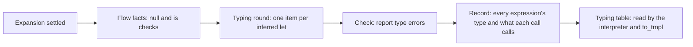

# 3. Typing

Once the macros are done, every node is a core construct, and tempest
works out types. It does that in the same settle loop, as a second
round, and then in a few passes over the settled tree. This page is
about where that happens; the rules themselves are in
[notes/typing.md](../../notes/typing.md).



## The steps

- **Flow facts.** One pass, in evaluation order and without a
  control-flow graph, finds the uses of a local that a null check or an
  `is` check narrows.
- **Infer, in the loop.** Each `let` without a declared type becomes a
  work item that publishes *this declaration's type is known*. It waits
  on the declarations its initializer reads. Declared types and
  functions' signatures need no waiting: they come from annotations. A
  cycle gets forced, and its type stays unknown. Object literals are
  typed in the same round, as they need the type their place wants.
- **Check.** A pass over each file reports what doesn't fit: a value of
  the wrong type, a call with the wrong arguments, a condition that isn't
  a `Boolean`. Deeper errors come first.
- **Record.** A last pass gives every expression its type and every
  call what it resolves to, so later stages never have to work it out
  again.

Types are interned: each distinct type is stored once and named by a
`TypeId`, so comparing types is comparing two numbers. An unknown type
never causes an error. Whatever typing can't work out simply goes
unchecked, rather than producing a cascade of complaints.

## Worked example

For `triple.temper`, the parameter `n` and the result are declared
`Int`, which is `Int32`. So `n * 3` is `Int32 * Int32`, and typing
resolves `*` to `Int32`'s multiplication. That choice is what
[tmpl](05-tmpl.md) later writes as `%Int32.mul(n#2, 3)`. In the string
template, `triple(14)` is an `Int32` too, so it's converted with
`Int32`'s `toString`.

Now a mistake:

```temper
let triple(n: Int): Int { n * 3 }
let s: String = triple(14);
console.log(s);
```

`run-temper --tree` prints the same kind of settled tree as before,
then the error, with its byte span:

```text
error 50..60: Cannot assign to String from Int32
```

The error is a value in the library's diagnostics, and the tree still
has every node. What happens next depends on where the code runs. The
value is only of the wrong type, so the interpreter runs it as written
and logs `42`, as JavaScript, Lua, and Python do. The statically typed
backends, whose compilers would reject it, fail there instead, with the
message. Either way, the rest of the library still builds and runs
([tmpl's errors](05-tmpl.md#shared-lowerings)).

## Where typing lives

Typing has one table, [`Typing`](../../crates/temper-frontend/src/typing.rs),
and its steps are methods on the settle loop's state, split by topic
into [`typing/`](../../crates/temper-frontend/src/typing/). The types
themselves are [`TypeData`](../../crates/temper-frontend/src/types.rs)
values in [`Types`](../../crates/temper-frontend/src/types.rs).

| File | Topic |
|---|---|
| `signatures.rs`, `core_members.rs` | Builtin operators' and core types' members' signatures |
| `members.rs`, `overrides.rs`, `overloads.rs`, `fields_first.rs` | Classes, their members, overriding, and overloads |
| `connected.rs` | Checks of a user's `@connected` classes |
| `generic_calls.rs` | Generic calls, solved per call site |
| `targets.rs`, `object_literals.rs`, `fun_interfaces.rs` | The type a place wants: list literals, object literals, and `@fun` interfaces |
| `initializers.rs` | Locals typed from their first assignments |
| `bubbles.rs` | What may fail where it can't, and constant folding for divisions |
| `sealed.rs`, `rtti.rs` | Sealed types and `when`, and run-time type checks |
| `exprs.rs`, `resolve.rs` | Recording every expression's type and every call's target |

## Where in the code

- [`find_flow_facts`](../../crates/temper-frontend/src/flow.rs): flow facts.
- [`queue_typing`](../../crates/temper-frontend/src/typing.rs): starts the typing round.
- [`infer_decl`](../../crates/temper-frontend/src/typing.rs): one item's step; [`decl_type`](../../crates/temper-frontend/src/typing.rs) is where it waits.
- [`expr_type`](../../crates/temper-frontend/src/typing.rs): an expression's type.
- [`check_types`](../../crates/temper-frontend/src/typing.rs): the checks, then recording ([`type_all_exprs`](../../crates/temper-frontend/src/typing/exprs.rs)).
- [`Typing::expr`](../../crates/temper-frontend/src/typing.rs) and [`Typing::resolved`](../../crates/temper-frontend/src/typing.rs): what later stages read.
- [`coverage`](../../crates/temper-frontend/src/typing/exprs.rs): what's left untyped, for `run-temper --untyped`.
- Tests: `crates/temper-frontend/tests/settle/types.cases`, `flow.cases`, and `class-types.cases`.

More: [notes/typing.md](../../notes/typing.md) has the rules in full, and
[notes/language.md](../../notes/language.md) the language decisions they
follow.
