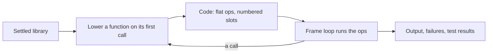

# 4. The interpreter

A settled library can run straight away, without generating any code.
That's what `tempest test` does by default, what the playground's Run
button shows, and how the functional tests check the frontend. The
interpreter is small, and it's built to run code with errors in it too:
an error node fails when it runs, with its message, as generated code
would, and a value that's only of the wrong type runs as written, as in
the dynamically typed backends ([typing](03-typing.md)).



## How it runs

- **Lowered late, per function.** On a function's first call, its
  settled body becomes a [`Code`](../../crates/temper-frontend/src/interp/lower.rs):
  a flat list of [`Op`](../../crates/temper-frontend/src/interp/lower.rs)s
  for a small stack machine, with jumps for control flow and locals in
  numbered slots. Functions never called are never lowered.
- **One loop per frame.** [`run_frame`](../../crates/temper-frontend/src/interp/frame.rs)
  steps through a frame's ops. Values are a plain enum,
  [`Val`](../../crates/temper-frontend/src/interp.rs).
- **Closures get cells.** A local that a nested function uses lives in
  a shared cell, made fresh each time its block is entered, so each pass
  of a loop has its own.
- **Failures cost nothing until they happen.** A failure jumps to the
  innermost `orelse` around it, found in a table by position, so the
  ordinary path pays nothing.
- **Generators pause.** A generator owns its body's frame, which returns
  from the loop at each `yield` and picks up from there on `next()`. An
  `async` block is a generator too, run from a queue, which also pauses
  at an `await` of a promise that isn't resolved yet.
- **Bounded.** Optional fuel stops a run after a number of steps (the
  playground sets it, and `tempest test` gives each test its own, so a
  runaway test fails alone), output kept for tests is capped at 64 KiB,
  and calls nest at most 2000 deep (500 in the browser), so runaway code
  can't hang a test run, fill memory, or crash a tab
  ([limits, in detail](detail/04-interpreter.md#limits-fuel-call-depth-and-nesting)).

Why each of these, and what else was considered:
[decisions, in detail](detail/04-interpreter.md#decisions).

Host code (`@connected` functions) runs only where the interpreter
implements it: std's `Date.today()`, `regex`, and `net`, for now
([builtins and connected code](detail/04-interpreter.md#builtins-and-connected-code)).

## Worked example

When `triple.temper`'s top level calls `triple(14)`, the body
`n * 3` is lowered on that first call to ops roughly like these
(a sketch, not printed output; `run-temper` can't print ops yet):

```text
Const(builtin *)   push the multiplication
Local(0)           push n, the first slot
Const(3)
Call { args: 2 }   n * 3
Return
```

The top level then concatenates the result into the string and logs
it. `run-temper triple.temper` prints:

```text
triple(14) = 42
```

## Running tests

`test("name") { … }` blocks become test cases during settling.
[`run_tests`](../../crates/temper-frontend/src/interp.rs) runs a
library's top level, then each module's tests, and reports them as
JUnit XML, the same report std's test runner gives in every language.
`tempest test` reads those results into one summary
([the CLI page](07-cli.md) says more). What tests pin the interpreter
itself: [its tests, in detail](detail/04-interpreter.md#tests).

## Where in the code

- [`run`](../../crates/temper-frontend/src/interp.rs) and [`run_tests`](../../crates/temper-frontend/src/interp.rs): the entry points, giving a [`Run`](../../crates/temper-frontend/src/interp.rs).
- [`call`](../../crates/temper-frontend/src/interp.rs): calling a Temper function, lowering it if needed.
- [`function`](../../crates/temper-frontend/src/interp/lower.rs) and [`module`](../../crates/temper-frontend/src/interp/lower.rs): lowering a function's body and a module's top level.
- [`Frame`](../../crates/temper-frontend/src/interp/frame.rs) and [`run_frame`](../../crates/temper-frontend/src/interp/frame.rs): the loop.
- Builtins by topic: [`strings`](../../crates/temper-frontend/src/interp/strings.rs), [`numbers`](../../crates/temper-frontend/src/interp/numbers.rs), [`maps`](../../crates/temper-frontend/src/interp/maps.rs), [`promises`](../../crates/temper-frontend/src/interp/promises.rs), [`regexes`](../../crates/temper-frontend/src/interp/regexes.rs), and [`net`](../../crates/temper-frontend/src/interp/net.rs).
- [`run-temper`](../../crates/temper-frontend/src/bin/run-temper.rs): a small tool that settles files and runs them, or prints the settled tree (`--tree`), the tmpl (`--tmpl`), or settle steps (`--steps`).

Later, the same interpreter is meant to evaluate constants and macros
written in Temper during settling ([notes/compile-time.md](../../notes/compile-time.md)).

## In detail

[The interpreter, in detail](detail/04-interpreter.md): each design
decision with its alternatives and trade-offs, the main types, the
tests, speed, and known weaknesses.
