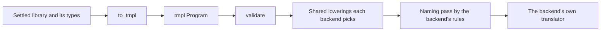

# 5. tmpl: the backend IR

Between the frontend and the seven backends sits one form: **tmpl**.
It's a settled, typed, fully explicit program. Every declaration has an
id, every expression a type, every call says exactly what it calls, and
every operator says which type's operator it is. A backend translates
tmpl without asking the frontend anything, which is why each backend
crate depends only on [`temper-tmpl`](../../crates/temper-tmpl/src/lib.rs).



## What's in a program

A [`Program`](../../crates/temper-tmpl/src/lib.rs) is one library: its
modules, plus tables they share for nodes, types, declarations, and
strings. Nodes live in one arena, [`Nodes`](../../crates/temper-tmpl/src/nodes.rs),
and every kind of node is declared once, in a table in
[`schema`](../../crates/temper-tmpl/src/schema.rs), from which the
Rust types are generated. tmpl also has a text form that reads back
exactly ([`write`](../../crates/temper-tmpl/src/text/write.rs) and
[`read`](../../crates/temper-tmpl/src/text/read.rs)), which the goldens
use, and a [`validate`](../../crates/temper-tmpl/src/validate.rs)
that checks a program's rules, each problem with its code.

## Worked example

`run-temper --tmpl triple.temper` prints the program as text:

```text
tmpl 1 model 1 library triple 0.0.0

uses `temper-core`#3 0.1.0 {
  interface Console#4 {
    connected method log#5(message: String): Void;
  }
  class Int32#7 {
    connected method toString#8(radix?: Int32): String;
  }
  connected fn getConsole#9(name?: String): Console#4;
}

module triple#0 {
  let ~console#6: Console#4;

  fn triple#1(n#2: Int32): Int32 {
    return %Int32.mul(n#2, 3);
  }

  init {
    init ~console#6 = getConsole#9(omitted);
    ~console#6.log#5(%String.cat("triple(14) = ", triple#1(14).toString#8(omitted)));
  }
}
```

- `#1`, `#2`: every declaration's id. Names are only for reading; the
  ids are what count.
- `uses temper-core`: only what this program uses of the runtime, with
  signatures. `connected` means each backend supplies it.
- `%Int32.mul`: a builtin operator, chosen by typing. Each backend
  spells it its own way.
- `~console`: made by the compiler (`~`), as `console.log` needs a
  console to log to.
- `init`: the module's top-level code, in the order it runs.
- `omitted`: an optional argument left out.

This is [`triple.tmpl`](../../crates/temper-be-testkit/tests/goldens/triple.tmpl),
the testkit's golden. The functional tests' tmpl goldens are in
[`tests/to_tmpl/`](../../crates/temper-frontend/tests/to_tmpl/).

## From the frontend: `to_tmpl`

[`to_tmpl`](../../crates/temper-frontend/src/to_tmpl.rs) walks the
settled tree, reads types and resolutions from typing, and builds the
program with a [`Builder`](../../crates/temper-tmpl/src/builder.rs). It
resolves nothing again. Core's members are copied from one fixture,
`core.tmpl`, so their signatures have one source. Anything it doesn't
cover yet is a [`NotYet`](../../crates/temper-frontend/src/to_tmpl.rs)
saying what and where, never a panic. An error node becomes tmpl's
`Error`, which fails where it runs; when the error is only about a
value's type, the `Error` keeps the value as written, for the
lowering below to settle. Classes, function values, and
defaults have files of their own: `to_tmpl_classes.rs`,
`to_tmpl_functions.rs`, and `to_tmpl_defaults.rs`.

## Shared lowerings

Some languages lack something tmpl has, such as generators, `switch`,
or statements inside expressions. The fix is the same whichever
language lacks it, so it lives in `temper-tmpl`. Each backend's
[`Profile`](../../crates/temper-tmpl/src/profile.rs) says what it
handles natively, and its `translate` calls the lowerings it needs,
each returning a new program only if it changed something. tmpl never
lists backends.

| Lowering | What it does | Used by |
|---|---|---|
| [`errors::settle`](../../crates/temper-tmpl/src/errors.rs) | Code with a type-only error runs as written where the language is dynamically typed, and fails there where it isn't | all seven, by profile |
| [`coroutines::lower`](../../crates/temper-tmpl/src/coroutines.rs) | Generators and `async` as state machines, for languages without their own generators | C++, Java, Rust |
| [`copy_captured_params`](../../crates/temper-tmpl/src/cells.rs) | A captured, reassigned parameter becomes a local, which can then be a cell | C++, Java, Rust |
| [`switches::to_if_chains`](../../crates/temper-tmpl/src/switches.rs) | A `Switch` as `if`s | C#, JS, Lua, Python, and Java for `Int64` |
| [`spill`](../../crates/temper-tmpl/src/spill.rs) and [`spill_with`](../../crates/temper-tmpl/src/spill.rs) | Keeps evaluation order when a backend moves statements out of an expression | C#, C++, Lua |
| [`naming::assign`](../../crates/temper-tmpl/src/naming.rs) | Pretty, collision-free names by each language's [`NamingRules`](../../crates/temper-tmpl/src/naming.rs) | all seven |

The naming pass is why there are no `x__123` names in the output.
`triple#1` becomes `_triple` in Python (module-private, so it starts
with `_`), `Triple` in C#, and `triple` everywhere else. A number is
added only when two names would really clash.

To see a lowering's effect, compare
[`control-flow-async.tmpl`](../../crates/temper-frontend/tests/to_tmpl/control-flow-async.tmpl)
with its [state-machine form](../../crates/temper-frontend/tests/to_tmpl/control-flow-async.state-machine.tmpl).

Backends also share analyses ([`analysis`](../../crates/temper-tmpl/src/analysis.rs)):
what a module imports, what a closure captures, what has effects. Plus
[`Host`](../../crates/temper-tmpl/src/host.rs) for a library's own
host code, and [`source_map`](../../crates/temper-tmpl/src/source_map.rs)
for source maps.

## Where in the code

- [`Program`](../../crates/temper-tmpl/src/lib.rs), [`Module`](../../crates/temper-tmpl/src/lib.rs), and [`Uses`](../../crates/temper-tmpl/src/lib.rs).
- [`schema!`](../../crates/temper-tmpl/src/schema.rs): every node kind.
- [`Builder`](../../crates/temper-tmpl/src/builder.rs) and [`validate`](../../crates/temper-tmpl/src/validate.rs).
- [`Profile`](../../crates/temper-tmpl/src/profile.rs), [`Features`](../../crates/temper-tmpl/src/profile.rs), and [`CoroutineStrategy`](../../crates/temper-tmpl/src/coroutines.rs): a backend's choices.
- [`Backend`](../../crates/temper-tmpl/src/backend.rs): what tools need of a backend, which each backend crate exports as `BACKEND` ([backends](06-backends.md)).
- [`to_tmpl`](../../crates/temper-frontend/src/to_tmpl.rs), [`translate_with`](../../crates/temper-frontend/src/to_tmpl.rs) (modules, then classes, then members, then bodies), [`stmt_or_gap`](../../crates/temper-frontend/src/to_tmpl.rs), and [`expr`](../../crates/temper-frontend/src/to_tmpl.rs).
- Tests: `crates/temper-tmpl/tests/` (round trips, naming, spill) and `crates/temper-frontend/tests/to_tmpl.rs`.

More: [notes/tmpl/](../../notes/tmpl/README.md), one file per topic.
