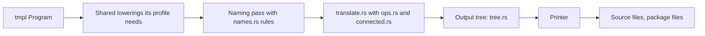

# 6. Backends

Each backend is one crate, `temper-be-LANGUAGE`, with tmpl in and
source files out. It writes code that reads as if a person wrote it:
real loops, the source's names, and no needless temporaries. And the
public API matches what Temper has always generated for that language,
so library users can't tell the difference.



## One backend's parts

Every backend crate has much the same files:

| File | Its job |
|---|---|
| `lib.rs` | Its `Variant` (profile, naming rules, and runtime version), its `BACKEND` description, and `translate`, which runs the pipeline and lays out the files, package files included |
| `names.rs` | Naming rules: keywords, case (`snake_case`, `PascalCase`), and scoping |
| `translate.rs` | tmpl to the language's output tree, statement by statement |
| `ops.rs` | How each builtin operator is spelled |
| `connected.rs` | How each of core's `connected` declarations maps to the language's runtime, `temper-core` |
| `tree.rs` | The output tree and its printer, which adds parentheses only where precedence needs them, and lays out code in the language's usual style |
| `runtime.rs` | The runtime's files, copied beside the output by `tempest build` |
| `tools.rs` | Natively, how the language runs built libraries' tests, for `tempest test -b`, and a library's top level, for `tempest run -b`: finding its tools, their command lines, and reading their results |

Which lowerings each backend runs, in what order, and how the seven
differ: [the pipeline](detail/06-backends.md#the-pipeline-each-backend-runs)
and [per-backend choices](detail/06-backends.md#per-backend-choices).

A crate's `BACKEND`, a [`Backend`](../../crates/temper-tmpl/src/backend.rs), is all
that tools see of it: its name, its comment syntax, its runtime's
files, its naming rules, its `translate` function, whether `build`
writes it by default, and its `tools.rs`'s
[`Tools`](../../crates/temper-tmpl/src/backend.rs) (`None` in wasm).
`temper-driver`'s registry keeps the one list of them, so adding a
backend means one crate, one line there, and its name among the known
ones ([the command](07-cli.md#one-compile-path)).

Each language's runtime is vendored from Temper in `vendor/temper/`,
with a few fixes kept as patches in `vendor/temper-patches/`. So
generated code calls the same runtime APIs as before
([runtimes and their patches, in detail](detail/06-backends.md#kotlins-runtimes-vendored-with-patches)).

## Worked example

`triple.temper` becomes this Python module
([golden](../../crates/temper-be-py/tests/goldens/triple.py)), beside a
`pyproject.toml` and the package's `__init__.py`:

```python
from temper_core import LoggingConsole as _LoggingConsole, int_mul as _int_mul

__all__ = ()


def _triple(n: int, /) -> int:
    return _int_mul(n, 3)


_console: _LoggingConsole = _LoggingConsole(__name__)
_console.log(f'triple(14) = {_triple(14)}')
```

The same two lines of Temper, in each language:

| Language | `n * 3` | The log line |
|---|---|---|
| [C++](../../crates/temper-be-cpp/tests/goldens/triple.cpp) | `core::Int::mul(n, 3)` | `core::Console::log(console, "triple(14) = " + std::to_string(triple(14)));` |
| [C#](../../crates/temper-be-csharp/tests/goldens/triple.cs) | `n * 3` | `console.Log("triple(14) = " + Triple(14).ToString(CultureInfo.InvariantCulture));` |
| [Java](../../crates/temper-be-java/tests/goldens/triple.java) | `n * 3` | `console.log("triple(14) = " + triple(14));` |
| [JavaScript](../../crates/temper-be-js/tests/goldens/triple.js) | `Math.imul(n, 3)` | ``console.log(`triple(14) = ${triple(14)}`);`` |
| [Lua](../../crates/temper-be-lua/tests/goldens/triple.lua) | `temper.int32_mul(n, 3)` | `print("triple(14) = " .. triple(14))` |
| [Python](../../crates/temper-be-py/tests/goldens/triple.py) | `_int_mul(n, 3)` | `_console.log(f'triple(14) = {_triple(14)}')` |
| [Rust](../../crates/temper-be-rust/tests/goldens/triple.rs) | `n.wrapping_mul(3)` | `println!("triple(14) = {}", triple(14));` |

Temper's `Int` is a 32-bit integer that wraps on overflow, so each
language gets what gives that: Java's and C#'s `*` already do, Rust
asks for `wrapping_mul`, JavaScript uses `Math.imul`, and C++, Lua, and
Python call the runtime. Names follow each language's rules: `triple`
is `_triple` in Python, where it's private to the module, and `Triple`
in C#.

## Statements inside expressions

tmpl allows statements inside an expression: an `orelse`, or a block
whose last value is the result. Rust has block expressions, so it
writes them as they are. The others move the statements out, just
before the statement that holds the expression, and keep earlier
operands in temporaries so that everything still runs in order. The
shared [`spill`](../../crates/temper-tmpl/src/spill.rs) pass does the
ordering part for C#, C++, and Lua; each backend's translator does the
rest. C++ also keeps its own order of evaluation explicit, since C++
leaves the order of a call's arguments open
([`effects`](../../crates/temper-be-cpp/src/effects.rs)). Which
translator hoists what:
[in detail](detail/06-backends.md#profiles-pick-the-shared-lowerings).

## Where in the code

| Language | Description | `translate` | Naming rules | Module translation |
|---|---|---|---|---|
| C++ | [`BACKEND`](../../crates/temper-be-cpp/src/lib.rs) | [`translate`](../../crates/temper-be-cpp/src/lib.rs) | [`RULES`](../../crates/temper-be-cpp/src/names.rs) | [`module`](../../crates/temper-be-cpp/src/translate.rs) |
| C# | [`BACKEND`](../../crates/temper-be-csharp/src/lib.rs) | [`translate`](../../crates/temper-be-csharp/src/lib.rs) | [`RULES`](../../crates/temper-be-csharp/src/names.rs) | [`module`](../../crates/temper-be-csharp/src/translate.rs) |
| Java | [`BACKEND`](../../crates/temper-be-java/src/lib.rs) | [`translate`](../../crates/temper-be-java/src/lib.rs) | [`RULES`](../../crates/temper-be-java/src/names.rs) | [`module`](../../crates/temper-be-java/src/translate.rs) |
| JavaScript | [`BACKEND`](../../crates/temper-be-js/src/lib.rs) | [`translate`](../../crates/temper-be-js/src/lib.rs) | [`RULES`](../../crates/temper-be-js/src/names.rs) | [`module`](../../crates/temper-be-js/src/translate.rs) |
| Lua | [`BACKEND`](../../crates/temper-be-lua/src/lib.rs) | [`translate`](../../crates/temper-be-lua/src/lib.rs) | [`RULES`](../../crates/temper-be-lua/src/names.rs) | [`module`](../../crates/temper-be-lua/src/translate.rs) |
| Python | [`BACKEND`](../../crates/temper-be-py/src/lib.rs) | [`translate`](../../crates/temper-be-py/src/lib.rs) | [`RULES`](../../crates/temper-be-py/src/names.rs) | [`module`](../../crates/temper-be-py/src/translate.rs) |
| Rust | [`BACKEND`](../../crates/temper-be-rust/src/lib.rs) | [`translate`](../../crates/temper-be-rust/src/lib.rs) | [`RULES`](../../crates/temper-be-rust/src/names.rs) | [`module`](../../crates/temper-be-rust/src/translate.rs) |

- Each crate's `lib.rs` doc comment says what it covers, and where its
  output deliberately differs from what Temper generated before.
- JavaScript also writes source maps ([`translate_with_source_maps`](../../crates/temper-be-js/src/lib.rs)).
- [`temper-be-testkit`](../../crates/temper-be-testkit/src/lib.rs): what the
  backends' tests share: test programs, goldens, and finding each
  language's tools. Tests run the generated code with each language's
  own tools and strict checkers, and skip with a message when a tool is
  missing ([the tests, in detail](detail/06-backends.md#tests)).

More: [notes/design.md](../../notes/design.md), section 9, and
[notes/api-compat.md](../../notes/api-compat.md) on the public API each
backend keeps.

## In detail

[Backends, in detail](detail/06-backends.md): the decisions all seven
share, with alternatives and trade-offs; each backend's pipeline,
choices, and naming rules side by side; the tests; and known
weaknesses.
