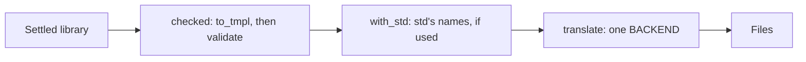
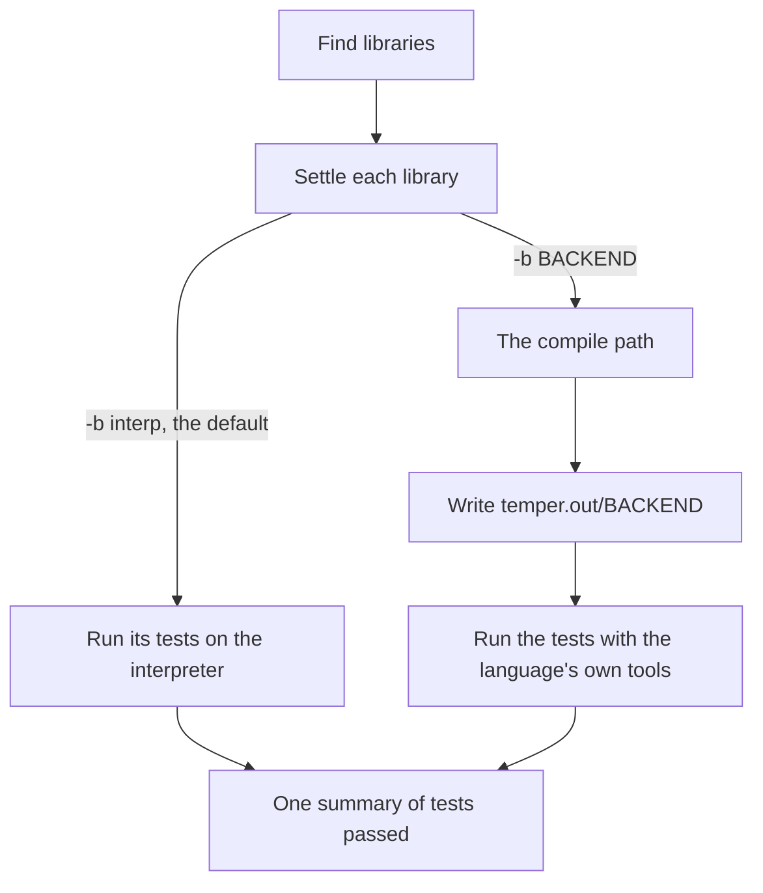

# 7. The tempest command

The `tempest` command is a thin layer, argument parsing and output, over
the `temper-driver` crate, which holds the registry of backends, the one
way from a settled library to each backend's files, and running tests
with each language's tools; the playground's wasm uses it too.
Temper's two main commands are `test`, which runs a project's tests,
and `build`, which writes every library in every language to
`temper.out`. Temper's std library is built into the
binary, so it needs nothing beside it.

```text
tempest test [-b interp|BACKEND] [-v] [DIR]
tempest build [-w DIR] [-b BACKEND]... [-v]
tempest lsp
```

`lsp` is a language server for editors, over stdin and stdout, on the
same library finding and `Sources` as `test` and `build`; it's the
`temper-lsp` crate, with [a page of its own](09-language-server.md).

## Finding libraries

Both commands start the same way. From the directory given, they find
the *work root*: the nearest directory holding `temper.out`, or else
the highest one holding a `config.temper.md`. Under it, each directory
with a `config.temper.md` is a library, and each directory in a library
is a module. Directories that `.gitignore` files list are skipped.

All reading goes through one [`Sources`](../../crates/temper-frontend/src/sources.rs)
value, so the compiler never touches the file system itself. It stacks
layers: the disk, std built in, or files in memory. The playground uses
memory, and the language server puts unsaved editor buffers in front of
the disk.

## One compile path



Every caller takes the same three steps, from
[`temper-driver`](../../crates/temper-driver/src/lib.rs):
[`checked`](../../crates/temper-driver/src/lib.rs) turns a settled library
into tmpl and validates it, [`with_std`](../../crates/temper-driver/src/lib.rs)
gives it std's names as the backend spells them, and
[`translate`](../../crates/temper-driver/src/lib.rs) runs one backend from
the [`Registry`](../../crates/temper-driver/src/lib.rs), which holds each
built-in backend crate's `BACKEND`, one per cargo feature, all on by
default. Which backends `build` writes without `-b`, and which names
this build lacks, come from the registry and the list of
[`KNOWN`](../../crates/temper-driver/src/lib.rs) names, not lists of
their own.

## `test` and `build`



- **On the interpreter** (the default), each library settles and runs
  its tests in-process. That's fast: no files are written.
- **With `-b BACKEND`**, each library is built as `build` does, then
  its tests run with the language's own tools: Python's
  `temper_core.testing`, Mocha for JavaScript, LuaUnit, JUnit through
  `javac`, `dotnet test`, `cargo test`, or CMake and the test program
  for C++. Each backend crate says how, in its `tools` module, as its
  `BACKEND`'s [`Tools`](../../crates/temper-tmpl/src/backend.rs), and
  the driver just runs them. Their results are read back into the same
  summary, so `-b interp` and `-b py` print alike.
- **`build`** writes `temper.out/BACKEND/LIBRARY/…`, laid out as Temper
  always has, with package files (`pyproject.toml`, `Cargo.toml`,
  `package.json`, the pom, the `.csproj`s, and a rockspec), and each
  backend's runtime beside the libraries. A library that imports
  another gets the other's names as that backend named them.
- **Errors never stop either command.** Every error is reported, the
  code is still written, and the tests still run; a test fails only if
  it reaches an error. The exit status is 1 whenever there were errors.

## Worked example

A library with one file and one test:

```text
triple/config.temper.md     export let name = "triple";
triple/triple.temper
```

```temper
export let triple(n: Int): Int { n * 3 }

test("triple of 14") {
  assert(triple(14) == 42);
}
```

```text
$ tempest test -v .
Testing triple
  ok      triple of 14
Tests passed: 1 of 1

$ tempest test -b py .
Tests passed: 1 of 1
```

`tempest build -b py` writes the library, std, and the runtime under
`temper.out/py/`. The test becomes a `unittest` case, with the
`assert` macro's message built in:

```python
class TestTriple(TestCase):
    def test_triple_of_14(self, /) -> None:
        'triple of 14'
        test: Test = Test()
        try:
            actual = triple(14)
            expected = 42
            test.assert_(actual == expected, lambda: f'expected triple(14) == ({expected}) not ({actual})')
        finally:
            test.soft_fail_to_hard()
```

Add a second test that misspells `triple` as `tripel`, and only that
test fails, on the interpreter and in Python alike:

```text
$ tempest test -b py .
triple/triple.temper:8:10: error: tripel has not been declared
triple: 1 error
Testing triple on py
  failed  misspelled - Traceback (most recent call last):
Tests passed: 1 of 2
```

## Where in the code

- [`temper-driver`](../../crates/temper-driver/src/lib.rs): the [`Registry`](../../crates/temper-driver/src/lib.rs), [`KNOWN`](../../crates/temper-driver/src/lib.rs), and the compile path above.
- [`main.rs`](../../crates/tempest/src/main.rs): argument parsing, [`test`](../../crates/tempest/src/main.rs), [`test_on`](../../crates/tempest/src/main.rs) for a backend, [`build_command`](../../crates/tempest/src/main.rs), and [`lsp`](../../crates/tempest/src/main.rs).
- [`serve`](../../crates/temper-lsp/src/lib.rs): the language server.
- [`build`](../../crates/temper-driver/src/build.rs): every library, each backend, in dependency order.
- [`run`](../../crates/temper-driver/src/test_run.rs) in `test_run`: any backend's test tools, as each backend crate's `tools` module gives them ([`Tools`](../../crates/temper-tmpl/src/backend.rs)), with JUnit XML and tool lookup shared in [`tools`](../../crates/temper-tmpl/src/tools.rs).
- Tests: `crates/temper-driver/tests/` (dependencies between libraries, and the built-in runtimes).
- [`test_dir`](../../crates/temper-frontend/src/library_tests.rs), [`test_library`](../../crates/temper-frontend/src/library_tests.rs), and [`Tally`](../../crates/temper-frontend/src/library_tests.rs): tests on the interpreter, and the summary.
- [`work_root`](../../crates/temper-frontend/src/project.rs), [`find_libraries`](../../crates/temper-frontend/src/project.rs), and [`load_library`](../../crates/temper-frontend/src/project.rs): finding and loading libraries.
- [`program`](../../crates/temper-frontend/src/stdlib.rs) in `stdlib`: std, built in, as its own library.
- Tests: `crates/tempest/tests/` (the CLI, and the layout of `temper.out`).

## Dynamic backends (future work)

The registry is a list built at startup, not a table fixed at compile
time, so backends that aren't built in can join it later. The plan:
first as external processes, each given a library as tmpl in a
versioned, serialized form and answering with its files (and running
its tests), so a backend can live in its own repository and language;
then as DLLs, only if processes prove too slow. The wasm build keeps a
fixed list of built-in backends.

`watch`, `run`, `repl`, and the rest of Temper's commands come later;
[the next page](08-playground.md) says how `watch` will reuse all this,
and [page 9](09-language-server.md) how `lsp` does.
