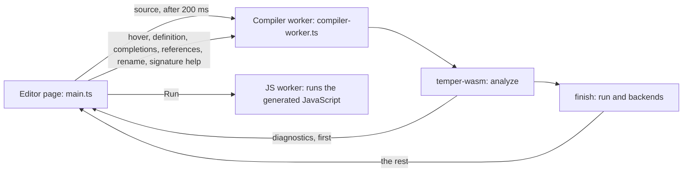
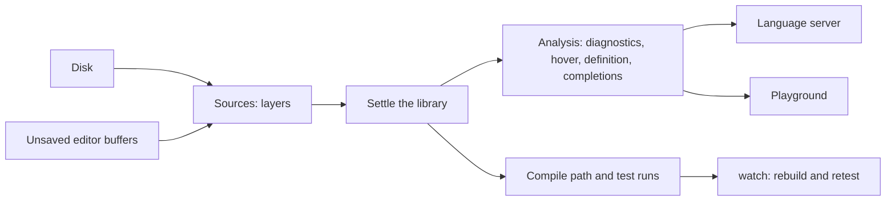

# 8. Wasm, the playground, watch, and a language server

The whole compiler also builds to wasm, about 4.4 MB (1.4 MB
gzipped), and runs in a browser with no server. The
[playground](../../site/playground/README.md) uses it: type Temper on the
left, and see errors, the program's output, its tests' results, and all
seven backends' code on the right, updated as you type. The editor also
underlines errors, shows types on hover, goes to definitions (into
std's and core's sources too), completes names and members, finds references,
renames, and shows a call's signature as you type its arguments.



## One compile, everything at once

The page settles the source once, then reuses that one settled library
for everything. [`compile`](../../crates/temper-wasm/src/lib.rs) does it
all in one call; the page calls it in two halves,
[`analyze`](../../crates/temper-wasm/src/lib.rs) and then
[`finish`](../../crates/temper-wasm/src/lib.rs), so errors show before
the slower run and backends:

1. its diagnostics, with positions counted as JavaScript and editors
   count them;
2. if asked, a run on the [interpreter](04-interpreter.md), with its
   tests;
3. tmpl, translated by each backend the page asks for, through the
   same [compile path](07-cli.md#one-compile-path) as `tempest build`.

std is settled the first time it's needed and kept, since it never
changes and settling it takes most of a translation's time.

The answer is one JSON object, shaped like this:

```json
{"diagnostics": [],
 "run": {"output": ["triple(14) = 42"], "failure": null},
 "backends": {"py": {"files": [{"path": "main/…", "text": "…"}]},
              "rust": {"files": ["…"]}}}
```

`analyze` gives just `{"diagnostics": [...]}`, and `finish` the rest.
Every export, and why it's a plain C ABI with JSON rather than
wasm-bindgen, is in [the wasm API, in detail](detail/08-playground.md#the-wasm-api)
and [its decisions](detail/08-playground.md#a-plain-c-abi-not-wasm-bindgen).

A REPL session lives there too, for a REPL tab:
[`repl_start`, `repl_input`, `repl_complete`, and `repl_reset`](detail/08-playground.md#the-repls-api)
settle and run one input at a time against what earlier ones declared,
with `tempest repl`'s transcript text.

Run shows the interpreter's results beside the generated JavaScript's,
run in a worker of its own. So the playground is also a quick check that
two very different ways of running a program agree.

## The page

- [`main.ts`](../../site/playground/src/main.ts): CodeMirror 6, a tab per
  backend, Run, errors in the editor, and the source in the URL for
  sharing.
- [`compiler-worker.ts`](../../site/playground/src/compiler-worker.ts):
  holds the wasm, so typing never waits on it. Only the newest request
  waits; a run that takes too long gets its worker replaced.
- [`js-worker.ts`](../../site/playground/src/js-worker.ts): runs the
  generated JavaScript, with the runtime from `vendor/temper/be-js/`.
- [`build.py`](../../site/playground/build.py): builds the wasm and bundles
  the page. GitHub Pages publishes it from `main`.
- [`smoke.mjs`](../../site/playground/smoke.mjs): CI's smoke test of the
  built page in headless Chromium, every example, and
  [`examples.rs`](../../crates/temper-wasm/tests/examples.rs): each
  example's output, pinned, through the wasm's API.

The messages between the page and its workers, the limits on runaway
code, CodeMirror's part, and permalinks are in
[the page's messages](detail/08-playground.md#the-pages-messages),
[limits](detail/08-playground.md#limits-fuel-a-stale-timer-a-fresh-instance),
[CodeMirror](detail/08-playground.md#codemirror-6-with-a-stream-language),
and [permalinks](detail/08-playground.md#permalinks-in-the-url-fragment),
in detail.

## Editor queries

`analyze` keeps the settled library in the wasm, inside an
[`Analysis`](../../crates/temper-analysis/src/lib.rs), until the
next source. The editor asks it questions at a position, and the
answers come from what settling already worked out, with nothing
settled again:

- [`diagnostics`](../../crates/temper-analysis/src/lib.rs): every
  error, warning, and hint, at its span in its file. The editor marks all
  of them, and settling keeps going past errors, so later code still
  gets types.
- [`hover`](../../crates/temper-analysis/src/lib.rs): for a name,
  its declaration's kind (`let`, `var`, `function`, `parameter`,
  `method`, `field`, `class`, and so on), its type, or a function's
  signature with its parameters' names, and its doc comment; for other
  code, the smallest typed expression's type.
- [`definition`](../../crates/temper-analysis/src/lib.rs): where a
  name, or a member after `.`, is declared, through imports to what
  they import. In the playground, F12, or Ctrl or Cmd and click; a
  declaration in std, or a builtin in core, opens that file, read-only,
  on the right.
- [`completions`](../../crates/temper-analysis/src/lib.rs): the
  names in scope, innermost first; after `x.`, the members of whatever
  `x` is, with a generic class's type arguments filled in, and builtin
  types' members from core; after a type's name, its statics; and in
  an object literal, the property names its class takes.
- [`references`](../../crates/temper-analysis/src/references.rs) and
  [`rename`](../../crates/temper-analysis/src/references.rs):
  Shift+F12 marks every use, and F2 renames them all; builtins and std
  can't be renamed.
- [`signature_help`](../../crates/temper-analysis/src/signatures.rs):
  the signature of the call being typed, with the argument the cursor
  is at, in a tooltip.
- [`document_symbols`](../../crates/temper-analysis/src/symbols.rs):
  a file's outline, for the language server.

"No member" errors span `obj.name`, as Kotlin Temper's do; the editor
underlines just the name.

A query names the node at the position from each name's symbol
([`Scopes`](../../crates/temper-frontend/src/scope.rs)), each member
read's resolution, and each declaration's and expression's type
([`Typing`](../../crates/temper-frontend/src/typing.rs)).

`Analysis` counts bytes in a file. Editors count UTF-16 code units, so
the wasm converts once, at its boundary, with
[`Position`](../../crates/temper-analysis/src/lib.rs) and
[`byte_offset`](../../crates/temper-analysis/src/lib.rs). A query
waits until the worker has settled the text on screen, so positions
always match. How a query finds what's at a position, and what it
costs: [temper-analysis, in detail](detail/09-language-server.md#temper-analysis).

## `watch` and a language server

The language server, `tempest lsp`, exists ([page 9](09-language-server.md));
`watch` doesn't yet. Both reuse what's here rather than add a second
compiler:



- **Watch** may not need to keep anything in memory. If building a
  library takes tens of milliseconds, rebuilding on each change is
  simplest: `watch` is then a loop around `build` or `test`, printing
  `Analysis::diagnostics`.
- **Unsaved buffers** are a memory layer of
  [`Sources`](../../crates/temper-frontend/src/sources.rs) in front of
  the disk, as the playground's source is, so a build sees them
  without writing files. The language server does this now.
- **The language server** wraps the same `Analysis` queries, with LSP's
  line and UTF-16 column positions converted at its boundary as the
  wasm's are.

How `watch` might look, and what it needs first:
[watch, in detail](detail/08-playground.md#watch-planned).

## Where in the code

- [`compile`](../../crates/temper-wasm/src/lib.rs) and [`compile_into`](../../crates/temper-wasm/src/lib.rs): everything in one call; [`analyze`](../../crates/temper-wasm/src/lib.rs) and [`finish`](../../crates/temper-wasm/src/lib.rs): the same in the playground's two halves.
- [`hover`](../../crates/temper-wasm/src/lib.rs), [`definition`](../../crates/temper-wasm/src/lib.rs), [`completions`](../../crates/temper-wasm/src/lib.rs), [`references`](../../crates/temper-wasm/src/lib.rs), [`rename`](../../crates/temper-wasm/src/lib.rs), and [`signature_help`](../../crates/temper-wasm/src/lib.rs): the editor's queries as wasm exports, in UTF-16.
- [`temper-analysis`](../../crates/temper-analysis/src/lib.rs): the queries themselves, in their own crate over the frontend only, for the playground and the language server. Tests: `crates/temper-analysis/tests/analysis.rs`.
- [`std_program`](../../crates/temper-wasm/src/lib.rs): std, settled once and kept.
- [`build.rs`](../../crates/temper-wasm/build.rs): a 16 MiB stack for the wasm build.
- Older single-purpose calls, `parse`, `run`, and `generate`, are in the same file.

More: [site/playground/README.md](../../site/playground/README.md), and
[notes/design.md](../../notes/design.md), section 11, on watch and the
language server.

**In detail:** [Wasm and the playground in detail](detail/08-playground.md):
each decision with its alternatives, the wasm API and the page's
messages, sizes, the tests, and known weaknesses.
