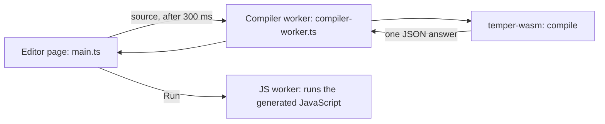
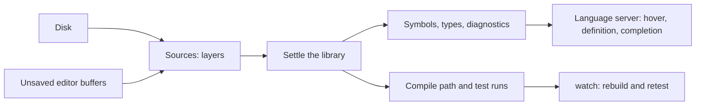

# 8. Wasm, the playground, watch, and a language server

The whole compiler also builds to wasm, about 4.3 MB (1.4 MB
gzipped), and runs in a browser with no server. The
[playground](../../site/playground/README.md) uses it: type Temper on the
left, and see errors, the program's output, its tests' results, and all
seven backends' code on the right, updated as you type.



## One compile, everything at once

The page calls one wasm function, [`compile`](../../crates/temper-wasm/src/lib.rs).
It settles the source once, then reuses that one settled library for
everything:

1. its diagnostics, with positions counted as JavaScript and editors
   count them;
2. if asked, a run on the [interpreter](04-interpreter.md), with its
   tests;
3. tmpl, translated by each backend the page asks for, through the
   same [compile path](07-cli.md#one-compile-path) as `tempest build`.

std is settled the first time it's needed and kept, since it never
changes and settling it takes most of a translation's time.

The answer is one JSON object, shaped like this:

```json
{"diagnostics": [],
 "run": {"output": ["triple(14) = 42"], "failure": null},
 "backends": {"py": {"files": [{"path": "main/…", "text": "…"}]},
              "rust": {"files": ["…"]}}}
```

Run shows the interpreter's results beside the generated JavaScript's,
run in a worker of its own. So the playground is also a quick check that
two very different ways of running a program agree.

## The page

- [`main.ts`](../../site/playground/src/main.ts): CodeMirror 6, a tab per
  backend, Run, errors in the editor, and the source in the URL for
  sharing.
- [`compiler-worker.ts`](../../site/playground/src/compiler-worker.ts):
  holds the wasm, so typing never waits on it. Only the newest request
  waits; a run that takes too long gets its worker replaced.
- [`js-worker.ts`](../../site/playground/src/js-worker.ts): runs the
  generated JavaScript, with the runtime from `vendor/temper/be-js/`.
- [`build.py`](../../site/playground/build.py): builds the wasm and bundles
  the page. GitHub Pages publishes it from `main`.

## Coming: `watch` and a language server

Neither exists yet. Both are meant to reuse what's here rather than add
a second compiler:



- **Watch** may not need to keep anything in memory. If building a
  library takes tens of milliseconds, rebuilding on each change is
  simplest: `watch` is then a loop around `build` or `test`.
- **Unsaved buffers** become a memory layer of
  [`Sources`](../../crates/temper-frontend/src/sources.rs) in front of
  the disk, as the playground's source already is, so a build sees them
  without writing files.
- **Hover, go to definition, and completion** read what the settle loop
  already worked out: each name's symbol ([`Scopes`](../../crates/temper-frontend/src/scope.rs)),
  each expression's type ([`Typing::expr`](../../crates/temper-frontend/src/typing.rs)),
  and each node's origin in the source. They'll be wasm exports beside
  `compile`, for the playground first, then a native `tempest lsp`.

## Where in the code

- [`compile`](../../crates/temper-wasm/src/lib.rs) and [`compile_into`](../../crates/temper-wasm/src/lib.rs): the playground's call.
- [`std_program`](../../crates/temper-wasm/src/lib.rs): std, settled once and kept.
- [`build.rs`](../../crates/temper-wasm/build.rs): a 16 MiB stack for the wasm build.
- Older single-purpose calls, `parse`, `run`, and `generate`, are in the same file.

More: [site/playground/README.md](../../site/playground/README.md), and
[notes/design.md](../../notes/design.md), section 11, on watch and the
language server.
