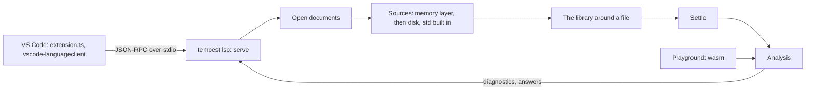

# 9. The language server and editors

`tempest lsp` is a language server: an editor starts it, talks to it
over stdin and stdout, and gets errors as you type, hover, go to
definition, completion, find references, rename, an outline, and
signature help. It answers from the same
[`Analysis`](../../crates/temper-analysis/src/lib.rs) as the
[playground](08-playground.md#editor-queries), so both always agree.
`editors/vscode/` holds a VS Code extension that starts it, with
TextMate grammars for highlighting.

## One loop, no async

The server is one plain loop, [`serve`](../../crates/temper-lsp/src/lib.rs),
in the `temper-lsp` crate, which `tempest lsp` runs. A thread reads
messages, each a `Content-Length` header and JSON, and hands them over
a channel; the loop waits for the next message or a timer, whichever
comes first. Messages are `serde_json` values, and their params and
results `lsp-types`' structs; no async runtime. Only the native
`tempest` uses the crate, so the wasm build, which answers the
playground itself, doesn't carry it or those crates. What this costs
(no cancellation, one request at a time) and the alternatives:
[one synchronous loop, in detail](detail/09-language-server.md#one-synchronous-loop).

A panic, a bug in tempest, doesn't end the server: each request and
each analysis is caught, the request answered with an error and the
analysis's document given an "internal error" diagnostic, and the
server goes on
([in detail](detail/09-language-server.md#panics-caught-per-request-and-analysis)).

## What gets analyzed

- **Open documents** live in memory, kept current by incremental sync:
  each change replaces a range ([`apply_change`](../../crates/temper-lsp/src/lib.rs)).
  They're a memory layer of
  [`Sources`](../../crates/temper-frontend/src/sources.rs) in front of
  the disk, so a library sees unsaved edits in every file.
- **A unit** is what's settled together: the library around a file,
  found as `tempest build` finds libraries (the nearest
  `config.temper.md`, under its work root), or else the file alone.
  One [`Analysis`](../../crates/temper-analysis/src/lib.rs) answers for
  all of its files, so references and rename cross files.
- **Staying current:** a change marks its unit stale. Once typing
  pauses for 250 ms, stale units are settled again and their
  diagnostics published, for each of the unit's own files (not std's).
  A question about a stale file settles it first, so answers always
  match the text on screen.
- **Positions** are LSP's lines and UTF-16 characters only at the
  edge ([`offset_at`](../../crates/temper-lsp/src/lib.rs),
  [`position`](../../crates/temper-lsp/src/lib.rs)); everything inside
  counts bytes in a file.
- **std** is built into the binary, so it has no files to open. Go to
  definition into std writes std's sources once, read-only, to a
  directory in the system's temporary directory, and points there.

What makes a unit stale, and the costs of settling it whole each time:
[units and staying current](detail/09-language-server.md#units-and-staying-current)
and [the whole library settled again](detail/09-language-server.md#the-whole-library-settled-again-on-each-pause),
in detail.

## The queries

Each is a method of `Analysis`, shared by the server and the playground:

- [`diagnostics`](../../crates/temper-analysis/src/lib.rs), [`hover`](../../crates/temper-analysis/src/lib.rs), [`definition`](../../crates/temper-analysis/src/lib.rs), and [`completions`](../../crates/temper-analysis/src/lib.rs), as on [the playground's page](08-playground.md#editor-queries).
  A generic class's members show its type arguments
  (`push(item: String)` on a `Stack<String>`); builtin types' members
  come from core's declarations
  ([`builtin_members`](../../crates/temper-frontend/src/typing/core_members.rs));
  and completion after `.` works on any expression whose type is known.
- [`references`](../../crates/temper-analysis/src/references.rs) and
  [`rename`](../../crates/temper-analysis/src/references.rs): every
  name that resolves to the same declaration, imports followed to what
  they import. Rename refuses builtins, std, and keywords, and renames
  object literals' keys for a constructor property too.
- [`document_symbols`](../../crates/temper-analysis/src/symbols.rs):
  a file's declarations, classes with their members.
- [`signature_help`](../../crates/temper-analysis/src/signatures.rs),
  and completion of an object literal's property names: both read the
  brackets open at the cursor from the text
  ([`open_brackets`](../../crates/temper-analysis/src/signatures.rs)),
  since a call being typed hasn't settled into a call yet.

How a query finds what's at a position:
[temper-analysis, in detail](detail/09-language-server.md#finding-whats-at-a-position).

## The VS Code extension

- **Highlighting:** TextMate grammars for `.temper` and literate
  `.temper.md`, where Temper is in fenced blocks (untagged or tagged
  `temper`, not `inert`) and indented blocks, as the
  [literate split](../../crates/temper-syntax/src/literate.rs) reads
  them. Their keywords match the playground's.
  `editors/vscode/check_grammar.py` scopes samples with a small
  TextMate tokenizer.
- **The client** ([`extension.ts`](../../editors/vscode/src/extension.ts))
  starts `tempest lsp` with `vscode-languageclient`. The server is
  `temper.server.path` if set, then the tempest bundled in the package,
  then `tempest` on `PATH`, only a file that's there
  ([`search`](../../editors/vscode/src/server.ts)); none, or one that
  doesn't start, is an error notification naming what was tried, with
  a button to the setting.
- **The preview** ([`preview.ts`](../../editors/vscode/src/preview.ts))
  of `.temper.md`, which VS Code's own Markdown preview skips for our
  language: VS Code's Markdown engine renders it (the built-in
  `markdown.api.render` command), [`highlightCodeBlocks`](../../editors/vscode/src/page.ts)
  highlights its Temper blocks with the editor's grammar (a small
  TextMate tokenizer, [`tokenize`](../../editors/vscode/src/highlight.ts)),
  and a webview shows it under a strict CSP, updated as you type.
  The engine marks each block with its source line (`data-line`);
  [`topForLine`](../../editors/vscode/src/sync.ts) and its inverse
  `lineForTop` interpolate between those marks to scroll the preview
  with the editor and the editor with the preview, each side ignoring
  the scrolls it caused, so neither echoes back.
- **Packaging:** `editors/vscode/build.py` checks the types, bundles
  with esbuild, and runs `vsce package`: a universal `.vsix` without
  tempest, and one per platform with it in `bin/` (linux, darwin, and
  win32, each x64 and arm64), which the Binaries workflow builds from
  its release binaries.
- **Tests in VS Code:** with `--test`, `test/suite.ts` runs in a real
  VS Code (`@vscode/test-electron`) against this platform's package,
  checking diagnostics, hover, definition, completion, rename, and the
  preview (rendering, live updates, and scroll sync both ways).
  How to install and build: [editors/vscode/README.md](../../editors/vscode/README.md).

Why each part of the extension is built as it is:
[the VS Code extension, in detail](detail/09-language-server.md#the-vs-code-extension).

## Where in the code

- [`temper-lsp`](../../crates/temper-lsp/src/lib.rs): the server; [`serve`](../../crates/temper-lsp/src/lib.rs), [`read_message`](../../crates/temper-lsp/src/lib.rs), and [`write_message`](../../crates/temper-lsp/src/lib.rs).
- [`temper-analysis`](../../crates/temper-analysis/src/lib.rs): the queries, with [`members`](../../crates/temper-analysis/src/members.rs), [`references`](../../crates/temper-analysis/src/references.rs), [`symbols`](../../crates/temper-analysis/src/symbols.rs), and [`signatures`](../../crates/temper-analysis/src/signatures.rs).
- Tests: `crates/temper-analysis/tests/analysis.rs` (the queries) and `crates/temper-lsp/tests/lsp.rs` (a scripted session with the server).
- `editors/vscode/`: the grammars, the extension, and their tests ([all the tests](detail/09-language-server.md#tests)).

**In detail:** [The language server and editors in detail](detail/09-language-server.md):
each decision with its alternatives and Kotlin Temper's way, the main
types, the tests, and known weaknesses.
