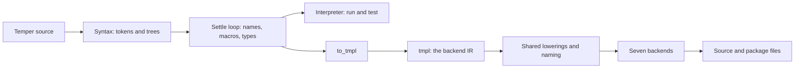
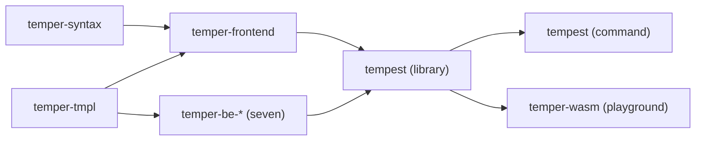

# How tempest works

Tempest is Temper's compiler written from scratch in Rust. It reads
Temper source, works out what every name means and what type every
value has, and then writes the same program in seven languages: C++,
C#, Java, JavaScript, Lua, Python, and Rust. It can also run a program
directly, with a small interpreter, which is how `tempest test` and the
playground's Run button work. The whole compiler is one small binary,
and the same code builds to wasm for the browser.

These pages walk through it one stage at a time. Each is short, follows
one tiny program through its stage, and ends with links into the code.
They cover the compiler's architecture, not the language: for Temper
itself, see [temperlang.dev](https://temperlang.dev/).

## The big picture



Only three data structures carry the program from start to end:

- **Tokens**, from the lexer: a kind and a byte span each.
- **The tree**, one arena per library. Parsing builds it, and the
  settle loop rewrites it in place until every node is one of a small
  set of core constructs.
- **tmpl**, the backend IR: a settled, typed, fully explicit program
  that a backend can translate without asking the frontend anything.

**Errors are values** at every stage. A syntax error, an undeclared
name, or a type that doesn't fit is reported and becomes an error node,
and everything around it carries on: it's typed, run, and translated.
The error fails only where it runs, so one mistake never hides the rest
of a library's diagnostics, tests, or generated code.

## The crates



| Crate | Its job |
|---|---|
| [`temper-syntax`](../../crates/temper-syntax/src/lib.rs) | Source to trees: literate files, lexing, parsing, the grammar step |
| [`temper-frontend`](../../crates/temper-frontend/src/lib.rs) | Trees to a settled library: the settle loop, typing, the interpreter, and translation to tmpl |
| [`temper-tmpl`](../../crates/temper-tmpl/src/lib.rs) | tmpl itself, plus the lowerings and naming that every backend shares |
| `temper-be-*` | One crate per language: tmpl in, source files out. Each depends only on `temper-tmpl` |
| [`tempest`](../../crates/tempest/src/lib.rs) | The one list of backends and the one compile path, as a library; and the command, `build` and `test` |
| [`temper-wasm`](../../crates/temper-wasm/src/lib.rs) | The compiler as wasm, for the playground |

## Reading order

1. [Syntax](01-syntax.md): from text to tokens to trees.
2. [The settle loop](02-settle-loop.md): names and macros, as work
   items that wait on facts.
3. [Typing](03-typing.md): types as more facts in the same loop, then
   checks.
4. [The interpreter](04-interpreter.md): running a settled library.
5. [tmpl](05-tmpl.md): the backend IR, and the lowerings backends share.
6. [Backends](06-backends.md): tmpl in, C++, C#, Java, JavaScript, Lua,
   Python, or Rust out.
7. [The tempest command](07-cli.md): `build` and `test`, and running
   tests with each language's own tools.
8. [Wasm, the playground, watch, and a language server](08-playground.md):
   the same compiler in a browser, and in an editor.

## The running example

Every page follows this program, `triple.temper`:

```temper
let triple(n: Int): Int { n * 3 }
console.log("triple(14) = ${triple(14)}");
```

Run, it prints `triple(14) = 42`. By the end, you'll have seen it as
tokens, as a tree, settled, typed, as tmpl, and in all seven languages.
It's one of the [playground](../../site/playground/README.md)'s examples,
and a shared test program
([`triple.temper.md`](../../crates/temper-be-testkit/programs/triple.temper.md)),
so the outputs these pages show are goldens that the tests keep
current: its [tmpl](../../crates/temper-be-testkit/tests/goldens/triple.tmpl),
and its [Python](../../crates/temper-be-py/tests/goldens/triple.py), for
one. For a bigger example, the functional test `algos/fibonacci` has
goldens at every stage, such as its
[tmpl](../../crates/temper-frontend/tests/to_tmpl/algos-fibonacci.tmpl).

## Going deeper

The design notes explain the why: [notes/README.md](../../notes/README.md)
for the goals, [notes/design.md](../../notes/design.md) for the whole
design, [notes/typing.md](../../notes/typing.md) for typing, and
[notes/tmpl/](../../notes/tmpl/README.md) for tmpl.

Links to code go to a file and name the type or function to look for
there. CI checks that each file still defines what its link names, and
that every link to a page or heading still leads somewhere
(`uv run compat/check_anchors.py`).
