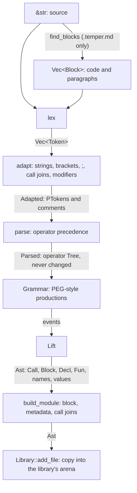

# Syntax in detail

[`temper-syntax`](../../../crates/temper-syntax/src/lib.rs) turns source
text into the tree the settle loop rewrites. It's the first stage, it has
no dependencies, and it knows nothing of what `let` or `if` mean. This
page is the long companion to [1. Syntax](../01-syntax.md): the decisions
behind each step, the main types and functions, the tests that pin them,
and what's weak. For Temper's syntax itself, see
the [syntax reference](../../language/syntax.md).

## Contents

- [The pipeline and its data](#the-pipeline-and-its-data)
- [Decisions](#decisions)
  - [Port Kotlin's front end step by step](#port-kotlins-front-end-step-by-step)
  - [One tree type, in flat arrays](#one-tree-type-in-flat-arrays)
  - [Two copies: the parse tree and the working tree](#two-copies-the-parse-tree-and-the-working-tree)
  - [Keywords are names, and almost everything is an operator](#keywords-are-names-and-almost-everything-is-an-operator)
  - [Token adapters as separate passes](#token-adapters-as-separate-passes)
  - [Bracket recovery](#bracket-recovery)
  - [Errors as values, and bounded depth](#errors-as-values-and-bounded-depth)
  - [Call joins rewritten before macros](#call-joins-rewritten-before-macros)
  - [A file's tree copied into the library](#a-files-tree-copied-into-the-library)
  - [Literate files and NFKC without dependencies](#literate-files-and-nfkc-without-dependencies)
- [The steps, type by type](#the-steps-type-by-type)
- [Tests](#tests)
- [Known weaknesses and planned changes](#known-weaknesses-and-planned-changes)

## The pipeline and its data

Each step is a function from one value to the next. Nothing is shared or
global, so any step can run alone, which the small tools and the tests
rely on.

[`parse`](../../../crates/temper-syntax/src/parse.rs) runs the lexer and
the adapters itself, and
[`build_module`](../../../crates/temper-syntax/src/module.rs) runs the
grammar step, so the frontend calls just those two, in
[`add_file`](../../../crates/temper-frontend/src/library.rs).

| Step | Lines | Kotlin Temper counterpart |
|---|---|---|
| Literate split | ~820 | `MarkdownSupport`, commonmark-java |
| Lexer | ~1,530 | `lexer/Lexer.kt` |
| Token adapters and bracket recovery | ~1,320 | `parser/TokenSourceAdapter.kt` (no recovery) |
| Parser and operator table | ~1,580 | `parser/Parse.kt`, `OperatorStack.kt`, `lexer/Operator.kt` |
| Grammar step | ~4,600 | `astbuild/Grammar.kt`, `Combinator.kt`, `Lift.kt` |
| Module step | ~180 | `frontend/parse/ParseStage.kt` |

## Decisions

### Port Kotlin's front end step by step

**Chosen:** each step is a port of Kotlin Temper's, keeping its
structure: the same lexer states, the same adapters in the same order,
the same operator table and `canNest` rules, and the grammar's
productions one method each, with Kotlin's definition in the doc
comment ([`Grammar`](../../../crates/temper-syntax/src/grammar.rs)).

**Alternatives:**

- One new parser straight to the working tree, as
  [notes/size-and-speed.md](../../../notes/size-and-speed.md) first
  planned ("no separate CST, AST or grammar DSL", 4–6k lines).
- A parser generator (lalrpop, tree-sitter) or a lossless-tree library
  (rowan).

**Pros:** every step can be compared with Kotlin's on every input, so
"the same program" is checkable, not hoped for: the `compat/check_*.py`
scripts and `compat/fuzz_*.py` fuzzers diff tokens, parse trees, and
grammar trees against Kotlin on all of Temper's, Chromarite's, and
Ordable's sources, and on random edits of them. Error messages match
Kotlin's word for word ("Expected a TopLevel here"). Kotlin's language
quirks (call joins, multi-quoted strings, modifier words) come along
without being rediscovered.

**Cons:** size. The crate is about 12.7k lines against the 4–6k
planned, and the grammar step alone is a third of it. It parses twice,
operator tree then grammar, as Kotlin does. And it copies Kotlin's
decisions along with its bugs, so two of those are kept on purpose until
the comparisons end ([below](#known-weaknesses-and-planned-changes)).

**Why:** compatibility is the first requirement, and a faithful port is
the cheapest way to prove it. The grammar can be simplified later, once
Kotlin is no longer the reference, with the trees the compat scripts
print as the safety net. Tempest's choice; not something the team asked
for.

### One tree type, in flat arrays

**Chosen:** one [`Tree`](../../../crates/temper-syntax/src/tree.rs) type,
a struct of arrays: `kinds`, `spans`, `first_child`, `child_count`,
`data`, and one shared `children` array. A node is a
[`NodeId`](../../../crates/temper-syntax/src/tree.rs), a `u32`. Payloads
that only some nodes have (names, values, origins, diagnostics) live in
side tables keyed by the id or the node's `data` index.
[`NodeKind`](../../../crates/temper-syntax/src/tree.rs) covers the parse
tree (`Op`, `Token`), the grammar step (`Call`, `Block`, `Decl`, `Fun`,
names, `Value`, `Error`), and the core constructs the settle loop
reduces everything to (`Let`, `Fn`, `If`, `Loop`, and so on).

**Alternatives:** an object per node with child pointers, as Kotlin
Temper's `Tree` classes are (`fundamentals/.../value/Tree.kt`: a `Tree`
per node, a `TEdge` per child edge, back-pointers through `incoming`,
and a shared `Document`); or an enum tree with `Box`ed children.

**Pros:** few allocations, contiguous memory, no back-pointers to keep
right, and cheap copies. A rewrite ([`Tree::replace`](../../../crates/temper-syntax/src/tree.rs))
appends a new child range and leaves the old one as garbage, freed with
the arena, so a macro never frees nodes one at a time and an old
`NodeId` never dangles. Peak memory to settle every functional test is
about 12 MiB.

**Cons:** garbage builds up during settling, since replaced child ranges
are never reused. Node kinds from three stages share one enum, so a
parse-only kind can appear where the settle loop expects core
constructs; the settle loop treats that as `unreachable!`. A node has no
parent link; passes that need one build their own (typing's `parents`).

**Why:** the design's main bet on speed and memory
([notes/design.md](../../../notes/design.md), section 3). Tempest's
choice.

### Two copies: the parse tree and the working tree

**Chosen:** [`Parsed`](../../../crates/temper-syntax/src/parse.rs) keeps
the operator tree, every lexer token (comments and space included), the
adapted tokens, and the names of words, and is never changed. The grammar
step builds a second tree, the [`Ast`](../../../crates/temper-syntax/src/ast.rs),
whose every node has an *origin*, the parse node it came from.

**Alternatives:** one lossless tree that later stages annotate (rowan
style); or dropping the parse tree once the grammar step is done.

**Pros:** formatting, outlines, hover, and docs read a tree shaped like
the source, while the settle loop rewrites its copy freely. Origins give
every settled node a way back to source for spans and the editor.

**Cons:** two trees per file in memory, plus the per-library copy
([below](#a-files-tree-copied-into-the-library)), and two token lists
in each `Parsed`: the lexer's and the adapters'.

**Why:** the language server and the playground need the parse tree,
and the settle loop needs to rewrite in place. Tempest's choice,
matching Kotlin's CST and AST split in spirit.

### Keywords are names, and almost everything is an operator

**Chosen:** the lexer and parser know no keywords. The one table in
[`operators!`](../../../crates/temper-syntax/src/operator.rs) gives each
operator its precedence, arity, and token, and calls (`f(x)`), blocks
(`f { }`), and declarations (juxtaposed words) are operators too. The
grammar step then gives everything one of a few shapes, where `if` is
just a callee. What a name means comes later, from macros.

This is Temper's design, not tempest's: Kotlin Temper parses the same
way, and the language relies on it for user-defined control flow.
Tempest keeps two small word lists Kotlin has too: modifier words such
as `public` and `var`, which the adapter turns into decorators
(`MODIFIERS` in [`adapt`](../../../crates/temper-syntax/src/adapt.rs)),
and `return`, `throw`, and `yield`, which the lexer lets precede a regex
literal.

### Token adapters as separate passes

**Chosen:** [`adapt`](../../../crates/temper-syntax/src/adapt.rs) runs
six steps in order, each over the whole token list, most returning a new
`Vec`: comment grouping, string fixing, bracket recovery, semicolon
insertion, call joins, and word pairing.

**Alternative:** Kotlin's `TokenSourceAdapter` is a streaming token
source with lookahead, one token at a time.

**Pros:** each step is short, readable, and testable on its own, and
their order is visible in one function.

**Cons:** five copies of the token vector per file. The adapters take
about 12 of the 57 ms that lexing and parsing all 815 corpus files took
(notes/size-and-speed.md, "Measured so far"), and one streaming pass is
the first idea listed there for speed.

**Why:** clarity first, while matching Kotlin exactly; speed later.

### Bracket recovery

**Chosen:** [`balance`](../../../crates/temper-syntax/src/balance.rs), an
adapter step of tempest's own. Only when brackets don't balance, it
closes an unclosed `(` or `[` at the nearest plausible place (a line at
or left of the opener's, a `{` that starts a body, a `;` outside
`for (...)`), drops an unmatched closer, matches a `}` by indentation
when an inner one is missing, and reads a `<` still open at a close
bracket, `;`, or `{` as less-than. Each fix is a
[`BracketError`](../../../crates/temper-syntax/src/balance.rs), which the
grammar step turns into a diagnostic at the gap.

**Alternatives:** none, as in Kotlin, where one missing `)` makes the
rest of the file one "Expected a TopLevel here"; or error productions
in the grammar.

**Pros:** one bad bracket stays one local error, so the rest of the
file still parses, types, and runs, which matters most while typing in
an editor. Balanced input is untouched, so it can't change a correct
program, and the compat checks still match exactly.

**Cons:** heuristics. A guess can be wrong (the closer goes in the wrong
place), and then the follow-on errors are odd. There's no fuzzer
comparing recovery with an intended fix, only properties.

**Why:** errors as values end to end. Tempest's choice (2026-11-06),
recommended for Kotlin too
([notes/kotlin-differences.md](../../../notes/kotlin-differences.md),
"Bracket recovery").

### Errors as values, and bounded depth

**Chosen:** no step fails. A bad character is an `Error`
[`Token`](../../../crates/temper-syntax/src/lex.rs); a missing closer is
a zero-width synthetic token; an operator with too few or too many
operands stays in the tree with a
[`ParseError`](../../../crates/temper-syntax/src/parse.rs); parts the
grammar can't match become an `Error` node with a
[`Diagnostic`](../../../crates/temper-syntax/src/ast.rs). Operands nested
more than [`MAX_DEPTH`](../../../crates/temper-syntax/src/grammar.rs)
(1000) deep are an error too, and the parse tree is flattened without
recursion ([`flatten`](../../../crates/temper-syntax/src/ast.rs)).

**Pros:** every file gives a tree, so later stages always have something
to check and run. No input overflows the stack, in wasm either, where
Kotlin overflows at about 300 nested calls.

**Cons:** later passes over the working tree still recurse (typing's
checks, the interpreter), so the commands and tests run the compiler on
a thread with a 64 MiB stack. The 1000 limit covers what the grammar
builds, not what macros add later.

Where Kotlin's grammar takes exponential time on nesting such as
`((((x))))`, because an alternative parses a whole operand and then
fails after it, four productions (`prefix`, `infix`, `tagged_string`,
and `decoration`) check the failing condition first, with the same
results.

### Call joins rewritten before macros

**Chosen:** the adapter puts a synthetic `callJoin:` between a `}` and a
following word, so `} else {` continues a call. Then
[`rewrite_call_joins`](../../../crates/temper-syntax/src/module.rs), as
the rest of Kotlin's `ParseStage` does, turns what follows into a
function that passes it all on: `if (a) { b } else { c }` becomes
`if(a, fn { b }, \else, fn (f#0) { f#0(fn { c }) })`. The temporary
`f#0` comes from [`Names::temporary`](../../../crates/temper-syntax/src/names.rs),
never interned, so no source name can clash with it. For documentation
([`Genre`](../../../crates/temper-syntax/src/module.rs)), the join is
just dropped.

**Pros:** the tree matches Kotlin's after its parse stage, so
`check_ast.py --module` can compare it.

**Cons:** the delegating function is overhead for every macro that reads
it: `if` and the others read the arguments it passes on rather than
calling it, as Kotlin does ([`macros`](../../../crates/temper-frontend/src/macros.rs),
header). A shape the grammar could give directly is built and then
taken apart.

### A file's tree copied into the library

**Chosen:** [`add_file`](../../../crates/temper-frontend/src/library.rs)
parses and builds each file's [`Ast`](../../../crates/temper-syntax/src/ast.rs)
in its own small arena, then copies every node into the library's one
[`Tree`](../../../crates/temper-syntax/src/tree.rs), shifting spans by
the file's base (so a span alone says which file it's in), re-interning
each name into the library's [`Names`](../../../crates/temper-syntax/src/names.rs),
and re-pointing values and error nodes.

**Alternative:** build the grammar step's output straight into the
library's arena, which notes/size-and-speed.md lists as an idea.

**Pros:** temper-syntax stays independent of the library (it has no
dependencies at all), and its trees are complete values the tools and
tests can print.

**Cons:** each word is interned three times: into the `Parsed`'s names,
into a clone of them in the grammar step, and into the library's. The
whole tree is copied once more. The copy is part of the 34–38 ms that
settling added for 818 files when last measured.

### Literate files and NFKC without dependencies

**Chosen:** [`find_blocks`](../../../crates/temper-syntax/src/literate.rs)
is a small CommonMark block scanner of tempest's own, giving the same
ranges as Kotlin's commonmark-java. [`nfkc`](../../../crates/temper-syntax/src/nfkc.rs)
checks identifiers against tables generated from the JDK
(`compat/gen_nfkc.py`, Unicode 15.0.0 for Java 21).

**Pros:** no dependencies, so the crate builds anywhere, wasm included,
and stays small. Kotlin's exact behavior, quirks included, where a crate
would differ.

**Cons:** two specs' worth of edge cases to keep right by hand. Code in
a block quote is prose here (Kotlin agreed in #632); NFKC is checked
only past Latin-1, as in Kotlin, which looks accidental.

## The steps, type by type

### Literate split

- [`find_blocks`](../../../crates/temper-syntax/src/literate.rs) gives a
  [`Block`](../../../crates/temper-syntax/src/literate.rs) per code block
  or paragraph, in byte ranges.
- [`is_temper_code`](../../../crates/temper-syntax/src/literate.rs)
  decides which blocks are code: untagged, or tagged `temper` and not
  `inert`, and not in a block quote.

The lexer calls it, for a [`SourceKind`](../../../crates/temper-syntax/src/lex.rs)
of `Markdown`, and lexes prose as comments, plus one synthetic doc comment
per paragraph, so prose next to a declaration can document it.

### Lexer

- [`lex`](../../../crates/temper-syntax/src/lex.rs) returns a `Vec` of
  [`Token`](../../../crates/temper-syntax/src/lex.rs): a
  [`TokenKind`](../../../crates/temper-syntax/src/lex.rs), a byte span,
  an optional [`Synthetic`](../../../crates/temper-syntax/src/lex.rs) (an
  inserted closer, or a paragraph), whether it may be a bracket, and an
  optional [`LexError`](../../../crates/temper-syntax/src/lex.rs).
- A token holds no text: its text is the source in its span, so tokens
  are small and `Copy`; [`Token::text`](../../../crates/temper-syntax/src/lex.rs)
  handles the synthetic ones.
- The [`Lexer`](../../../crates/temper-syntax/src/lex.rs) is a state
  machine ([`Mode`](../../../crates/temper-syntax/src/lex.rs)) over a
  stack of open delimiters ([`Opener`](../../../crates/temper-syntax/src/lex.rs)).
  The stack decides whether the next characters are code or string
  content, through one table, [`transition`](../../../crates/temper-syntax/src/lex.rs).

### Token adapters

- [`adapt`](../../../crates/temper-syntax/src/adapt.rs) gives
  [`Adapted`](../../../crates/temper-syntax/src/adapt.rs): the parser's
  tokens ([`PToken`](../../../crates/temper-syntax/src/adapt.rs), which
  add where their text is and whether they may be prefix or infix),
  grouped [`Comment`](../../../crates/temper-syntax/src/adapt.rs)s, and
  the bracket errors.
- The steps, in order: [`fix_strings`](../../../crates/temper-syntax/src/adapt.rs),
  [`fix_brackets`](../../../crates/temper-syntax/src/adapt.rs) (calling
  [`balance`](../../../crates/temper-syntax/src/balance.rs)),
  [`insert_semicolons`](../../../crates/temper-syntax/src/adapt.rs),
  [`insert_call_joins`](../../../crates/temper-syntax/src/adapt.rs), and
  [`pair_words`](../../../crates/temper-syntax/src/adapt.rs).

### Parser

- [`parse`](../../../crates/temper-syntax/src/parse.rs) keeps a stack
  of partly built nodes. For each token,
  [`place`](../../../crates/temper-syntax/src/parse.rs) decides whether
  it continues a node (a close bracket, a follower like the `,` in
  `extends A, B`), takes the top as its left operand, starts a node, or
  joins a run of value tokens, by precedence and the special cases in
  [`can_nest`](../../../crates/temper-syntax/src/parse.rs).
- [`check_arity`](../../../crates/temper-syntax/src/parse.rs) records a
  [`ParseError`](../../../crates/temper-syntax/src/parse.rs) for a node
  with the wrong number of operands, and keeps it.
- The table: [`Operator`](../../../crates/temper-syntax/src/operator.rs)
  and its [`Info`](../../../crates/temper-syntax/src/operator.rs), made
  by [`operators!`](../../../crates/temper-syntax/src/operator.rs).

### Grammar step

- [`build`](../../../crates/temper-syntax/src/ast.rs) flattens the parse
  tree into [`Part`](../../../crates/temper-syntax/src/grammar.rs)s (an
  open part per operator node, its tokens and children, then a close
  part), runs the [`Grammar`](../../../crates/temper-syntax/src/grammar.rs)
  from its [`root`](../../../crates/temper-syntax/src/grammar.rs)
  production, and lifts the resulting
  [`Event`](../../../crates/temper-syntax/src/grammar.rs)s into a tree
  ([`Lift`](../../../crates/temper-syntax/src/ast.rs)).
- Productions match parts PEG-style; a failed alternative truncates the
  event list ([`attempt`](../../../crates/temper-syntax/src/grammar.rs)).
  Events start a tree, add a leaf, finish a tree with its kind
  ([`Fin`](../../../crates/temper-syntax/src/grammar.rs)), swap the last
  two trees (so a callee comes first in `x + y`), or mark parts as an
  error.
- Values are [`Value`](../../../crates/temper-syntax/src/ast.rs)s:
  numbers ([`unpack_number`](../../../crates/temper-syntax/src/unpack.rs)),
  strings ([`unpack_string`](../../../crates/temper-syntax/src/unpack.rs)),
  symbols like `\word`, and the few builtins the grammar names directly
  ([`Builtin`](../../../crates/temper-syntax/src/ast.rs)), such as
  `desugarOperation` and `stringExpr`.

### Module step

- [`build_module`](../../../crates/temper-syntax/src/module.rs) wraps the
  code in a block, converts the metadata after `;;;` to
  [`Json`](../../../crates/temper-syntax/src/module.rs), and rewrites call
  joins.

### Printing

- [`write_tree`](../../../crates/temper-syntax/src/print.rs) and
  [`write_ast`](../../../crates/temper-syntax/src/print.rs) print trees as
  the overview page shows them, for tests and for the tools
  [`lex-tokens.rs`](../../../crates/temper-syntax/src/bin/lex-tokens.rs),
  [`parse-tree.rs`](../../../crates/temper-syntax/src/bin/parse-tree.rs),
  and [`ast-tree.rs`](../../../crates/temper-syntax/src/bin/ast-tree.rs).

## Tests

| What | Where | Covers |
|---|---|---|
| Lexer cases | `tests/kotlin-lexer-tests.cases` (98), `kotlin-token-cluster-tests.cases` (62), `edge-cases.cases` (19) | Tokens, many taken from Kotlin's own tests |
| Parser cases | `tests/parse/*.cases` (177) | Operator trees, adapters, multi-quoted strings |
| Grammar cases | `tests/ast/*.cases` (223) | Grammar trees and diagnostics, 194 from Kotlin's `BuildTreeTest` |
| Module cases | `tests/module/*.cases` (21) | Call joins, metadata, documentation genre |
| Property fuzzers | [`lex.rs`](../../../crates/temper-syntax/tests/lex.rs), [`parse.rs`](../../../crates/temper-syntax/tests/parse.rs), [`ast.rs`](../../../crates/temper-syntax/tests/ast.rs) | Random edits of every case: spans in bounds and covering children, every token in the tree once and in order, origins valid, no node reached twice, parsing twice gives the same tree |
| Deep input | `deep_and_nested_inputs_parse` in [`parse.rs`](../../../crates/temper-syntax/tests/parse.rs) | 400 nested calls, a 1000-term sum, and Kotlin's exponential cases, on a normal stack |
| NFKC | `matches_the_jdk` in [`nfkc.rs`](../../../crates/temper-syntax/tests/nfkc.rs) | The tables against the JDK's answers |
| Bracket recovery | `balance` unit tests; `bracket_recovery_stays_local` in [`settle.rs`](../../../crates/temper-frontend/tests/settle.rs); `compiles_with_narrow_syntax_errors` in [`temper-wasm`](../../../crates/temper-wasm/src/lib.rs) | Each fix's error and place; later declarations still typed and run |
| Against Kotlin | `compat/check_lex.py`, `check_parse.py`, `check_ast.py` (`--module`), `check_literate.py`, and `fuzz_lex.py`, `fuzz_parse.py`, `fuzz_ast.py` | Every corpus file and case, and fuzzed edits, diffed against Kotlin's output, except deliberate differences listed in `compat/deviations.py` |

Cases are snapshot tests: `UPDATE_SNAPSHOTS=1` rewrites the expected
output, to be reviewed as a diff.

**What they don't cover:**

- The Kotlin comparisons need a Kotlin Temper install and a JDK, so CI
  doesn't run them. They're run by hand when the syntax changes; CI
  runs only the in-tree cases and property fuzzers.
- The property fuzzers check structure, not meaning: a wrong but
  well-formed tree passes. Only the cases and the Kotlin comparisons
  catch that.
- Nothing checks that bracket recovery guesses the place a person would
  fix.

## Known weaknesses and planned changes

- **Two Kotlin bugs copied on purpose,** only for broken input, to keep
  the comparisons quiet: a close bracket closes only the innermost open
  bracket, and semicolon insertion counts a `{` twice when it inserts a
  `;` before it ([`insert_semicolons`](../../../crates/temper-syntax/src/adapt.rs)
  says so). Both go once the comparisons with Kotlin end
  ([notes/kotlin-differences.md](../../../notes/kotlin-differences.md),
  "Kotlin bugs found").
- **Speed is untuned.** The grammar step is a straight port of Kotlin's
  combinators, trying alternatives in turn, and costs about as much as
  the parser. Ideas, in notes/size-and-speed.md: dispatch on the next
  part's operator, keep values out of events until lifting, one
  streaming adapter pass, and building straight into the library's
  arena.
- **Size against the plan:** about 12.7k lines against 4–6k. Once Kotlin
  isn't the reference, the parse tree and the grammar step could merge
  into one parser that builds the working tree, with the trees the
  compat scripts print as the check.
- **Names interned three times** per word, and each file's tree copied
  once more into the library ([above](#a-files-tree-copied-into-the-library)).
- **Strings in the grammar's output:** symbols such as `\else` and
  `callJoin:` are interned names that later stages compare by text
  (`self.lib.names.get(n) == "label"` and the like). That's how
  decorators come to be matched by name in the settle loop
  ([settle loop, decorators](02-settle-loop.md#decorators-matched-by-name)).
- **Deviations to keep tracking:** multi-quoted strings, spans that
  cover all of a node's parts, and the nesting limit differ from Kotlin
  on purpose, each with cases and an entry in `compat/deviations.py`.
