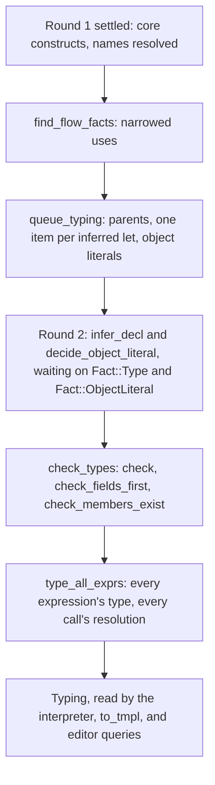

# Typing in detail

Typing works out what type every declaration and expression has, what
every call calls, and which programs are wrong. It runs inside the
[settle loop](02-settle-loop.md), as its second round, and in a few
passes over the settled tree after it. This page is the long companion
to [3. Typing](../03-typing.md): the decisions behind it, its main types
and functions, the tests that pin it, and what's weak. The rules
themselves are in [notes/typing.md](../../../notes/typing.md), and the
language's own semantics in the [language reference](../../language/README.md).

## Contents

- [Where it sits](#where-it-sits)
- [Decisions](#decisions)
  - [Types inside the settle loop, and on demand](#types-inside-the-settle-loop-and-on-demand)
  - [One interned type representation](#one-interned-type-representation)
  - [Unknown is never an error](#unknown-is-never-an-error)
  - [Side tables, not fields on nodes](#side-tables-not-fields-on-nodes)
  - [Flow facts without a control-flow graph](#flow-facts-without-a-control-flow-graph)
  - [Generic calls solved per call site](#generic-calls-solved-per-call-site)
  - [Invariant type parameters](#invariant-type-parameters)
  - [Target typing, and the object literal as a macro that waits](#target-typing-and-the-object-literal-as-a-macro-that-waits)
  - [Language changes typing makes](#language-changes-typing-makes)
  - [Checks after inference, deeper errors first, in Kotlin's words](#checks-after-inference-deeper-errors-first-in-kotlins-words)
  - [Resolutions recorded for later stages](#resolutions-recorded-for-later-stages)
  - [Core's members read from core's source](#cores-members-read-from-cores-source)
  - [Typing as methods on the settle loop's state](#typing-as-methods-on-the-settle-loops-state)
- [The main types and functions](#the-main-types-and-functions)
- [Tests](#tests)
- [Known weaknesses and planned changes](#known-weaknesses-and-planned-changes)

## Where it sits

Everything typing learns goes into one table,
[`Typing`](../../../crates/temper-frontend/src/typing.rs), which ends up
in [`Settled`](../../../crates/temper-frontend/src/settle.rs). Later stages
read it through [`Typing::expr`](../../../crates/temper-frontend/src/typing.rs),
[`Typing::resolved`](../../../crates/temper-frontend/src/typing.rs), and
[`Typing::type_args`](../../../crates/temper-frontend/src/typing.rs), and
never work a type out again.

## Decisions

### Types inside the settle loop, and on demand

**Chosen:** a declaration whose type comes from its initializer, as `let
x = f(1)`, is a work item ([`infer_decl`](../../../crates/temper-frontend/src/typing.rs))
that publishes `Fact::Type` once it knows the type, waiting on the
declarations its initializer reads. Everything else is worked out on
demand: [`expr_type`](../../../crates/temper-frontend/src/typing.rs)
returns `Result<TypeId, Fact>`, memoizes what it finds, and returns the
fact it needs when a declaration's type isn't known yet
([`decl_type`](../../../crates/temper-frontend/src/typing.rs)). Declared
types and functions' signatures need no waiting. A cycle, as `let a =
b; let b = a`, is forced, and its type stays unknown.

**How Kotlin Temper does it:** in its Type stage, `Typer` fills each
node's `typeInferences`, in an order a `TyperPlan` works out for the
module, and solves constraints with a solver over bounds (`type2/TypeSolver.kt`).
Checks come later, in the GenerateCode stage (`TypeChecker.kt`).

**Alternatives:** a separate typing pass in dependency order; whole-module
constraint solving, as Kotlin; or Hindley–Milner-style inference.

**Pros:** the order comes for free from the loop, as for names. Inference
is local and cheap: one declaration, one initializer. Typing can grow a
piece at a time, since what isn't worked out is just unknown.

**Cons:** inference is weaker than a solver's: a type parameter that
arguments bind two ways is left unknown, where Kotlin finds a common
supertype; a local's type comes from its initializer alone, never its
later uses. Forced results aren't memoized, since they may lack what
they didn't wait for, so a forced chain is worked out again on each
read. Most typing runs after the loop, not in it
([settle loop, two rounds](02-settle-loop.md#two-rounds-and-passes-between-and-after)).

**Why:** Temper requires signatures at module boundaries, so local
inference covers what the language asks for, and it fits the loop.
Tempest's design.

### One interned type representation

**Chosen:** a type is a [`TypeId`](../../../crates/temper-frontend/src/types.rs)
standing for one [`TypeData`](../../../crates/temper-frontend/src/types.rs),
interned in [`Types`](../../../crates/temper-frontend/src/types.rs), so
equal types have equal ids. The well-known ones are constants (`UNKNOWN`,
`NEVER`, `NULL`, `VOID`, `BOOLEAN`, `INT32`, and the rest). A class's
supertypes, type parameters, and `@fun` signature are a
[`ClassInfo`](../../../crates/temper-frontend/src/types.rs) beside them.

**How Kotlin Temper does it:** two type systems, `type/` and the newer
`type2/`, bridged by `hackMapOldStyleToNew`, and moving to the new one
(Kotlin issues #500 and #652).

**Pros:** comparing types is comparing two numbers; one set of rules
for subtyping, joins, and display; nothing to bridge.

**Cons:** `TypeData` is small on purpose, and some of Kotlin's types
are approximations here: `Never<T>` is a plain bottom type without its
`T` (notes/typing.md, "`Never<T>`"), and there are no intersection or
union types beyond nullability. Interning means a `TypeData` is cloned
to look at in places (`join` clones both sides).

**Why:** simplicity and speed. Listed as a recommended change for
Kotlin too; it lands on the team's current direction.

### Unknown is never an error

**Chosen:** [`UNKNOWN`](../../../crates/temper-frontend/src/types.rs)
stands for anything typing hasn't worked out, and is never a reason for
an error. [`is_subtype`](../../../crates/temper-frontend/src/types.rs)
answers `Option<bool>`: `None` where it can't tell, as for a type that
may have subtypes typing doesn't know. A mismatch is reported only when
both sides are fully known and the answer is `Some(false)`
([`is_mismatch`](../../../crates/temper-frontend/src/typing.rs)). An
error node's type is unknown, so code around an error checks without
follow-on errors.

**Alternatives:** an error type that absorbs everything, as Kotlin's
`InvalidType`; or reporting what can't be typed.

**Pros:** typing could be built a slice at a time, against Kotlin's
tests, without false errors along the way; errors don't cascade.

**Cons:** a gap in typing is silent: code typing doesn't understand is
simply not checked. `run-temper --untyped` and `compat/count_untyped.py`
measure what's left, per file, so it's visible, but nothing fails a
build on it. [notes/design.md](../../../notes/design.md), section 6,
still says an error node takes the expected type or `Never`; the code
gives it unknown.

### Side tables, not fields on nodes

**Chosen:** [`Typing`](../../../crates/temper-frontend/src/typing.rs)
holds everything, keyed by node: declarations' types (`decls`), every
expression's type (`exprs`, a `Vec` indexed by node), narrowed uses
(`non_null`, `is_type`), resolutions, type arguments, trailing blocks
placed, parents, and more.

**How Kotlin Temper does it:** each tree node carries its own
`typeInferences`, cleared and recomputed (`clearTypeInferences`).

**Pros:** the tree stays plain and shared by every stage; a table can be
dropped or rebuilt without touching nodes; nodes that typing never sees
cost nothing in the maps.

**Cons:** about twenty tables, some only for one check, in one struct;
the `exprs` and `parents` vectors are as long as the tree, garbage
included; nodes added after typing starts (an object literal's lowering)
have to be given parents by hand.

### Flow facts without a control-flow graph

**Chosen:** [`find_flow_facts`](../../../crates/temper-frontend/src/flow.rs),
one pass over each file in evaluation order, carries the set of
declarations known not to be null, or to be of a type after an `is`
check, merging where control merges and dropping what a jump leaves.
Only declarations that are never assigned again are narrowed, so a fact,
once true, stays true: loops need no fixed point, and a closure keeps
the facts where it's made. Uses that facts narrow go into `non_null` and
`is_type`, and [`narrowed`](../../../crates/temper-frontend/src/typing.rs)
applies them.

**How Kotlin Temper does it:** narrows only in the branches of an `if`
whose condition is one null or `is` check of a name, negated at most
once.

**Alternatives:** a control-flow graph with a dataflow fixed point; or
the fuller design in [notes/typing.md](../../../notes/typing.md) ("Flow
facts without a CFG"), with value ranges, loops iterated to a fixed
point, and narrowing of `var`s that no closure assigns.

**Pros:** linear time, simple, and it accepts everything Kotlin does and
more: through `&&`, `||`, `!`, `while`, and after an early `return`,
which Kotlin rejects.

**Cons:** narrower than its own design: no `var` narrowing, no ranges,
no definite assignment. Accepting more than Kotlin is a language
change, listed for the team ([below](#language-changes-typing-makes)).

### Generic calls solved per call site

**Chosen:** [`solve_call`](../../../crates/temper-frontend/src/typing/generic_calls.rs)
binds a generic function's, method's, or constructor's type parameters at
each call, from its type arguments if it has them, else by unifying
parameter types with arguments' types
([`unify`](../../../crates/temper-frontend/src/types.rs)), then from the
type the call's place wants. The result is a
[`Solved`](../../../crates/temper-frontend/src/typing/generic_calls.rs),
and the bindings are kept for `to_tmpl` ([`Typing::type_args`](../../../crates/temper-frontend/src/typing.rs)).

**How Kotlin Temper does it:** a bounds-based solver over the whole
module (`type2/TypeSolver.kt`, `InferBounds.kt`).

**Pros:** small and predictable; each call is solved once its arguments'
types are known, so it fits the loop.

**Cons:** a parameter bound two ways is unknown rather than joined; a
function literal binds a type parameter only if it declares its result
type; what Kotlin's solver infers from later uses isn't.

### Invariant type parameters

**Chosen:** type parameters are invariant: `List` is never a
`List<Super>`. Kotlin's `@out` and `@in` parse as ordinary decorations
and are ignored. Until it's known what code relies on variance,
[`is_subtype`](../../../crates/temper-frontend/src/types.rs) reports a
mismatch only where an argument sets two types apart under any variance,
so it gives no false errors, and accepts some programs that strict
invariance would reject.

**Status:** invariance is Temper's plan, since C++ and Rust can't
express variance well, and the team treats Kotlin's invariant choices
as deliberate. Tempest decided (2026-10-28) to stay invariant and to
ignore `@out` and `@in`, and asks Kotlin to drop them. Its checks are
looser than its rule, though: it accepts programs that only variance
would allow, which the team means to reject. That gap closes once it's
known what code relies on `@out` and `@in`.

### Target typing, and the object literal as a macro that waits

**Chosen:** the type a value's place wants
([`wanted_type`](../../../crates/temper-frontend/src/typing/targets.rs)):
a declared type, a function's result, a known callee's parameter, or a
list's element type, types literals that have none of their own:
`[]`, function literals' parameters and results
([`literal_type`](../../../crates/temper-frontend/src/typing/targets.rs)),
and object literals. An object literal without `class: C` keeps its
named values through round 1 and becomes a round 2 item
([`decide_object_literal`](../../../crates/temper-frontend/src/typing/object_literals.rs))
that waits on the type wanted, decides the class from it, and rewrites
itself into a constructor call, publishing `Fact::ObjectLiteral`. It's
the one macro that waits on types, which is what the loop is for.

**Pros:** object literals replace named arguments
([notes/language.md](../../../notes/language.md), "Object literals, not
named arguments") without guessing classes from property names alone;
`[]` and `{ x => … }` need no annotations where the type is plain.

**Cons:** the type wanted comes from parents, so typing builds a parent
table for the whole tree first; trailing blocks are placed during typing
([`record_trailing_block`](../../../crates/temper-frontend/src/typing/targets.rs)),
so typing changes what a call passes, and later stages must read that
back (`trailing_blocks`).

### Language changes typing makes

Some decisions change which programs compile, so they differ from
Kotlin Temper on purpose, each with tests. Where they stand
([notes/kotlin-differences.md](../../../notes/kotlin-differences.md),
"Changes we recommend to Temper"):

| Change | Status |
|---|---|
| Fields first: no use of `this` in a constructor until every field is set ([`check_fields_first`](../../../crates/temper-frontend/src/typing/fields_first.rs)) | Decided by the Temper team, 2026-11-02 |
| Named `@fun` interfaces are nominal, and a function literal needs a type wanted ([`fun_interfaces`](../../../crates/temper-frontend/src/typing/fun_interfaces.rs)) | Tempest's decision (2026-10-29); proposed to the team |
| Object literals take their class from the type wanted | Proposed |
| Narrowing through `&&`, `\|\|`, `!`, `while`, and after an early exit | Proposed; accepts more than Kotlin |
| Invariance, with `@out` and `@in` ignored | Temper's plan; tempest's checks are looser for now |

The ones that reject what Kotlin accepts (nominal `@fun` interfaces,
fields first) mean a library can pass one compiler and fail the other
while both are in use.

### Checks after inference, deeper errors first, in Kotlin's words

**Chosen:** once round 2 is done, [`check_types`](../../../crates/temper-frontend/src/typing.rs)
walks each file, checking each node after its children
([`check`](../../../crates/temper-frontend/src/typing.rs)), as Kotlin's
`TypeChecker` does, so deeper errors come first. Messages and positions
match Kotlin's by default ("Cannot assign to String from Int32"), and
fix only clearly bad ones, each listed in
notes/kotlin-differences.md. Topic checks live in their own files:
[`check_overrides`](../../../crates/temper-frontend/src/typing/overrides.rs),
[`check_bubbles`](../../../crates/temper-frontend/src/typing/bubbles.rs),
[`check_rtti`](../../../crates/temper-frontend/src/typing/rtti.rs),
[`check_fun_interface`](../../../crates/temper-frontend/src/typing/fun_interfaces.rs),
and [`check_connected_class`](../../../crates/temper-frontend/src/typing/connected.rs).

**Pros:** users and tests see the same errors from both compilers.

**Cons:** the checks recurse over the tree, so the compiler runs on a
big stack. Some checks scan every diagnostic so far to avoid reporting
twice at one place ([`check_not_void`](../../../crates/temper-frontend/src/typing.rs),
[`check_member_exists`](../../../crates/temper-frontend/src/typing.rs)),
which is quadratic in errors.

**Extensions:** instance extensions, `@extension("name")`, aren't
supported yet, but one may supply a member, so
[`check_member_exists`](../../../crates/temper-frontend/src/typing.rs)
doesn't report `x.name` where an extension of that name is visible, as
a name is looked up: declared there or in an enclosing scope, or
imported ([`extension_visible`](../../../crates/temper-frontend/src/extensions.rs);
declarations and the imports of them are recorded as static extensions
are). Until 2026-11-09 it skipped the whole library if any file's text
contained `@extension`, a comment included (the audit's C1). The same
function still lists the builtin types whose members are known in full
by name.

### Resolutions recorded for later stages

**Chosen:** after checking, [`type_all_exprs`](../../../crates/temper-frontend/src/typing/exprs.rs)
gives every expression its type and records what each call, operator,
and member read resolves to, as a
[`Resolved`](../../../crates/temper-frontend/src/typing/resolve.rs): a
declaration, a builtin by its key (`Int32.add`, `String.cat`), a null
check, or a call of a function value. `==` with nothing to call but
identity is noted apart ([`Typing::identity_eq`](../../../crates/temper-frontend/src/typing.rs)).

**Pros:** `to_tmpl` and the interpreter never resolve a call again, so
the frontend's rules live in one place; [`coverage`](../../../crates/temper-frontend/src/typing/exprs.rs)
can count what's left untyped or unresolved.

**Cons:** builtin keys are strings, matched against temper-tmpl's table
by name; a typo is found only when a backend can't translate it.

### Core's members read from core's source

**Chosen:** builtin types' members' signatures come from
`lib/core/core.temper`, begun as Kotlin's. [`core_class`](../../../crates/temper-frontend/src/typing/core_members.rs)
finds a type's declaration by scanning core's text for its `export
class` line and slicing to the next `}` on its own line, parses that
alone, and keeps what it read, once per type.

**Alternative:** load core as a library, settled like std, with its
types' members as ordinary declarations.

**Pros:** core stays Kotlin's file, easy to diff; no settle of core per
build.

**Cons:** a text search over source is fragile; core's own semantics
aren't checked; and core's types are special cases throughout typing
(`BUILTIN_SUPERTYPES` and other name lists in [`types`](../../../crates/temper-frontend/src/types.rs)).
Loading core as a library is planned.

### Typing as methods on the settle loop's state

**Chosen:** typing's steps are methods on [`Settle`](../../../crates/temper-frontend/src/settle.rs),
split by topic over [`typing/`](../../../crates/temper-frontend/src/typing/)'s
seventeen files, so a step can read the tree, scopes, and its own
tables, and wait on facts, without passing context around.

**Pros:** short signatures; the loop can call typing directly.

**Cons:** no boundary: typing can rewrite the tree (trailing blocks,
object literals, overloads renaming a call's key), and every table is
`pub(crate)`, so what typing reads and writes is hard to see. A typing
context that borrows the tree and scopes and owns its tables would make
it testable on its own.

## The main types and functions

### Types

- [`TypeId`](../../../crates/temper-frontend/src/types.rs),
  [`TypeData`](../../../crates/temper-frontend/src/types.rs),
  [`Param`](../../../crates/temper-frontend/src/types.rs), and
  [`Types`](../../../crates/temper-frontend/src/types.rs) with
  [`intern`](../../../crates/temper-frontend/src/types.rs).
- [`is_subtype`](../../../crates/temper-frontend/src/types.rs),
  [`join`](../../../crates/temper-frontend/src/types.rs),
  [`unify`](../../../crates/temper-frontend/src/types.rs),
  [`substitute`](../../../crates/temper-frontend/src/types.rs), and
  [`display`](../../../crates/temper-frontend/src/types.rs), which writes
  a type as Kotlin's messages do.

### The table

- [`Typing`](../../../crates/temper-frontend/src/typing.rs), with
  [`Typing::expr`](../../../crates/temper-frontend/src/typing.rs),
  [`Typing::resolved`](../../../crates/temper-frontend/src/typing.rs),
  [`Typing::type_args`](../../../crates/temper-frontend/src/typing.rs),
  and [`Typing::is_unreachable`](../../../crates/temper-frontend/src/typing.rs).
- [`Resolved`](../../../crates/temper-frontend/src/typing/resolve.rs).

### Inference

- [`queue_typing`](../../../crates/temper-frontend/src/typing.rs) starts
  round 2; [`infer_decl`](../../../crates/temper-frontend/src/typing.rs)
  is one item's step.
- [`decl_type`](../../../crates/temper-frontend/src/typing.rs),
  [`expr_type`](../../../crates/temper-frontend/src/typing.rs),
  [`name_type`](../../../crates/temper-frontend/src/typing.rs), and
  [`call_type`](../../../crates/temper-frontend/src/typing.rs): the
  demand-driven core, each returning the fact it needs.
- [`eval_type`](../../../crates/temper-frontend/src/typing.rs): a type
  expression, as written, to a `TypeId`.
- [`solve_call`](../../../crates/temper-frontend/src/typing/generic_calls.rs),
  [`wanted_type`](../../../crates/temper-frontend/src/typing/targets.rs),
  [`resolve_overload`](../../../crates/temper-frontend/src/typing/overloads.rs),
  and [`initializers_type`](../../../crates/temper-frontend/src/typing/initializers.rs).
- [`find_flow_facts`](../../../crates/temper-frontend/src/flow.rs) and
  [`narrowed`](../../../crates/temper-frontend/src/typing.rs).
- Builtins' signatures: [`variants`](../../../crates/temper-frontend/src/typing/signatures.rs)
  for operators, [`core_class`](../../../crates/temper-frontend/src/typing/core_members.rs)
  and [`builtin_members`](../../../crates/temper-frontend/src/typing/core_members.rs)
  for core's types' members.

### Checking and recording

- [`check_types`](../../../crates/temper-frontend/src/typing.rs),
  [`check`](../../../crates/temper-frontend/src/typing.rs),
  [`check_value`](../../../crates/temper-frontend/src/typing.rs),
  [`check_call`](../../../crates/temper-frontend/src/typing.rs), and the
  topic checks above.
- [`type_all_exprs`](../../../crates/temper-frontend/src/typing/exprs.rs)
  and [`coverage`](../../../crates/temper-frontend/src/typing/exprs.rs),
  with [`FileCoverage`](../../../crates/temper-frontend/src/typing/exprs.rs).

## Tests

| What | Where | Covers |
|---|---|---|
| Types | unit tests in [`types.rs`](../../../crates/temper-frontend/src/types.rs) | Subtyping, function types, builtin supertypes against core, generic subtypes, users' generic supertypes |
| Core's members | unit tests in [`core_members.rs`](../../../crates/temper-frontend/src/typing/core_members.rs) | Signatures read from core, generic ones, the list editors complete from |
| Typing cases | [`types.cases`](../../../crates/temper-frontend/tests/settle/types.cases) (33), [`class-types.cases`](../../../crates/temper-frontend/tests/settle/class-types.cases) (17), [`flow.cases`](../../../crates/temper-frontend/tests/settle/flow.cases) (7), [`fields-first.cases`](../../../crates/temper-frontend/tests/settle/fields-first.cases) (11) | Each slice's types and errors as snapshots, many named "as Kotlin Temper reports them"; each language change has a case named in notes/kotlin-differences.md |
| Integration | [`settle.rs`](../../../crates/temper-frontend/tests/settle.rs): `every_expression_is_typed`, `calls_resolve_to_what_they_call`, `fun_values_take_their_interface`, `imported_extensions_hide_no_member` | No expression left untyped or call unresolved in a program using most of what's typed; resolutions by kind; an imported `@extension` hiding "No member" only where it's imported |
| Coverage | `compat/count_untyped.py` over the functional tests, std, and real libraries | What's still unknown, unresolved, or relying on identity, per file |
| Downstream | tmpl goldens in `crates/temper-frontend/tests/to_tmpl/`, the functional tests on every backend under strict checkers (pyright, mypy, `tsc --strict`, clippy) | Types that reach generated code: a wrong type shows up as a type error in a statically typed backend |
| Property fuzzer | `mutated_inputs_settle` | Typing runs in it, so no panics or nondeterminism on edited input |

**What they don't cover:**

- No script compares type errors with Kotlin's automatically, as the
  syntax has. The cases were checked against Kotlin by hand when
  written, so a later change in either compiler goes unnoticed.
- Unknown types pass silently; only the coverage count shows them, and
  nothing fails when it grows.
- Error-heavy input is fuzzed only for panics, not for whether its
  errors make sense.

## Known weaknesses and planned changes

- **Instance extensions** (`@extension("name")`) are recorded only to
  keep "No member" from being reported where one is visible; a call of
  one still fails in translation ("a call typing didn't resolve").
- **`Never` without its `T`:** a backend can't get the fallback type, and
  a `Never<A>` used as an unrelated `B` isn't reported. Planned before
  more of code generation relies on it.
- **Weaker inference than Kotlin's solver** in places: type parameters
  bound two ways, results of function literals that don't declare them,
  generators and `async` blocks, and list literals without a common
  type (notes/typing.md, "Every expression typed", "Left").
- **Flow facts are narrower than their design:** no `var` narrowing,
  ranges, or definite assignment yet.
- **Quadratic duplicate checks** that scan all diagnostics per node; a
  set of reported spans would do.
- **Names as strings:** builtin keys in `Resolved`, core's types' names
  in `types.rs`'s tables, and the member check's list of fully known
  types. Constants or an enum would catch typos at compile time.
- **Language changes to settle with the team:** nominal `@fun`
  interfaces, wider narrowing, and invariance, listed as proposals with
  their tests ([above](#language-changes-typing-makes)).
- **design.md is stale** on error nodes' types (it says the expected
  type or `Never`; it's unknown).
