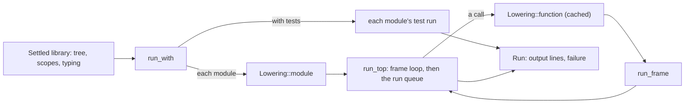
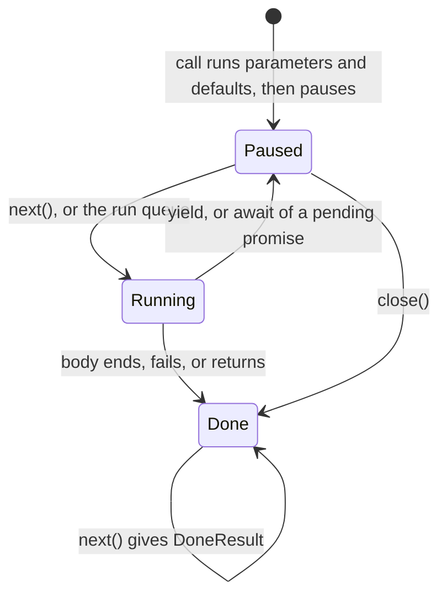
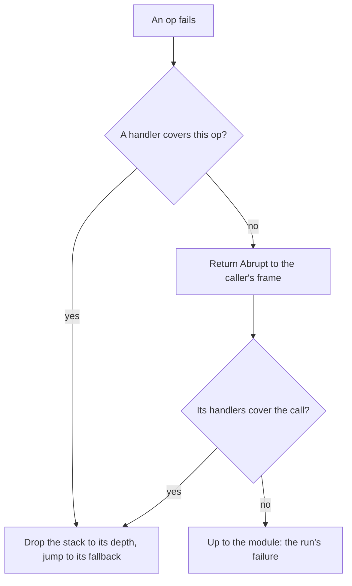
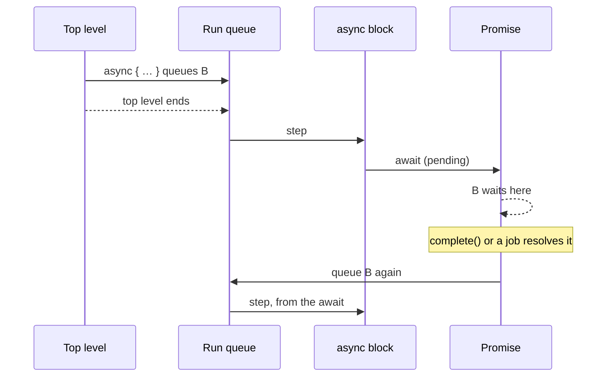

# The interpreter, in detail

The interpreter runs a settled library in-process, with no generated
code and no other language's tools. It's what `tempest test` runs by
default, what the playground's Run button shows, and how CI checks the
frontend against Temper's 72 functional tests. It lives in
`temper-frontend`, in [`interp.rs`](../../../crates/temper-frontend/src/interp.rs)
and the [`interp/`](../../../crates/temper-frontend/src/interp/) modules,
about 4,500 lines, plus a regex engine in
[`regex.rs`](../../../crates/temper-frontend/src/regex.rs).

It sits beside `to_tmpl`, not after it: both read the settled tree and
typing's facts. [The overview page](../04-interpreter.md) follows
`triple.temper` through it; this page covers the decisions behind it,
its main types, its tests, and its weak spots. For what the language
means, see [temperlang.dev](https://temperlang.dev/).

## Contents

- [Where it sits](#where-it-sits)
- [Decisions](#decisions)
  - [Run the settled tree, not tmpl](#run-the-settled-tree-not-tmpl)
  - [Flat ops, lowered late, per function](#flat-ops-lowered-late-per-function)
  - [Calls on the Rust stack; generators own their frame](#calls-on-the-rust-stack-generators-own-their-frame)
  - [Cells for captured locals, fresh per block](#cells-for-captured-locals-fresh-per-block)
  - [Failures as values, caught by table](#failures-as-values-caught-by-table)
  - [Dynamic values, and errors that fail where they run](#dynamic-values-and-errors-that-fail-where-they-run)
  - [Limits: fuel, call depth, and nesting](#limits-fuel-call-depth-and-nesting)
  - [Builtins and connected code](#builtins-and-connected-code)
  - [Async: a run queue after the top level](#async-a-run-queue-after-the-top-level)
  - [Tests report through std's own runner](#tests-report-through-stds-own-runner)
- [The main types and functions](#the-main-types-and-functions)
- [Tests](#tests)
- [Speed and size](#speed-and-size)
- [Known weaknesses and plans](#known-weaknesses-and-plans)

## Where it sits

Three callers use it:

- [`test_library`](../../../crates/temper-frontend/src/library_tests.rs)
  and [`test_dir`](../../../crates/temper-frontend/src/library_tests.rs),
  for `tempest test` (and `-b interp`, as Kotlin's `temper test` takes it);
- the playground's wasm ([`run`](../../../crates/temper-wasm/src/lib.rs)),
  with a step budget;
- [`run-temper`](../../../crates/temper-frontend/src/bin/run-temper.rs),
  which `compat/check_functional.py` and the benchmarks drive.

## Decisions

Each decision says what was chosen, what else was on the table, and
whose call it was: *team-agreed* (with the Temper team), *tempest's*
(the user's call for tempest), or *open*.

### Run the settled tree, not tmpl

**Chosen:** the interpreter reads the settled tree, its scopes, and
typing's facts directly. tmpl is for backends.

**Alternatives:**

- *Interpret tmpl.* One IR for every way of running code, and the
  interpreter would test `to_tmpl` too.
- *Interpret the parse tree*, as Kotlin's tree walker reads its AST.

**Pros:** it runs whatever settles, including code `to_tmpl` doesn't
cover yet (those are `NotYet` there, never here), and code with errors.
And the settle loop will need to evaluate code before anything is
settled enough for tmpl: constants and macros written in Temper
([notes/compile-time.md](../../../notes/compile-time.md)).

**Cons:** two paths give code its meaning: the interpreter, and
`to_tmpl` plus seven backends. They can drift. A few known differences
are written down in
[kotlin-differences.md](../../../notes/kotlin-differences.md) ("Keep on
trucking"): a body that ends without a value returns `void` here but
fails in generated code, and a non-Boolean condition fails here where a
dynamic language tests its truthiness. The shared test programs check
every backend against the interpreter's log ([Tests](#tests)), which
catches most drift, but not all.

**Kotlin Temper** has one interpreter, a tree walker over its AST, which
both runs programs and partially evaluates them during compilation
stages (`Interpreter.kt`, `InterpretiveDance.kt`).

**Status:** tempest's, recorded in
[history/milestone-3.md](../../../notes/history/milestone-3.md)
("Interpreters and backend crates"). A small tmpl interpreter is
planned there as an oracle for lowerings (run before and after a pass,
compare), not as a replacement.

### Flat ops, lowered late, per function

**Chosen:** on its first call, a function's settled body is lowered to
a [`Code`](../../../crates/temper-frontend/src/interp/lower.rs): a flat
list of [`Op`](../../../crates/temper-frontend/src/interp/lower.rs)s
for a stack machine, with jumps for control flow and locals in numbered
slots. [`Lowering`](../../../crates/temper-frontend/src/interp/lower.rs)
caches each `Code` by node for the run. A module's top level and a
class's initializers are lowered the same way.

**Alternatives:**

- *A recursive tree walk*, which tempest had first, as Kotlin has.
- *Lower everything up front*, or to a register machine, or
  closure-compile.

**Pros:** no name lookup or tree walk while running; a small loop that
a debugger, a step budget, or cancellation can hook; code never called
costs nothing. Lowering is apart from running, so each is easy to read.

**Cons:** about 1,000 more lines than the tree walk, and lowering
itself recurses on expression depth (bounded, below). A stack machine
moves more values than a register machine would; nobody has measured
whether that matters here.

**Status:** decided with the user on 2026-10-24
([history/milestone-3.md](../../../notes/history/milestone-3.md), "The
interpreter: flat frames"). Measured at 180–370 ns a call or loop turn,
down from 600 ns–1 µs for the tree walk
([size-and-speed.md](../../../notes/size-and-speed.md), "Interpreter").

### Calls on the Rust stack; generators own their frame

**Chosen:** an ordinary call runs its callee's [`Frame`](../../../crates/temper-frontend/src/interp/frame.rs)
nested on the Rust stack. A frame holds everything it needs to go on,
its position included, so a generator (and an `async` block, which is
one) keeps its body's frame and re-enters
[`run_frame`](../../../crates/temper-frontend/src/interp/frame.rs) where
it paused.

**Alternatives:**

- *Fully resumable*: an explicit stack for every call, so any frame can
  pause. Every builtin that calls back into Temper (sorting, mapping)
  would then have to be resumable too.
- *The backends' state machines* (`temper_tmpl::coroutines`), run in
  the interpreter. That would tie the interpreter to tmpl.

**Pros:** simple, and enough, because a pause appears only directly in
a generator's own body, never in a function it calls.

**Cons:** native stack grows with call depth, so depth needs a limit
([Limits](#limits-fuel-call-depth-and-nesting)). A pause inside a
`for … of` body, which is lowered as its own function, isn't supported
yet: it's an error with a clear message, as Kotlin's also fails there.

**Status:** decided with the user on 2026-10-24, as the "middle path";
the flat form leaves full resumability open if a need appears.

### Cells for captured locals, fresh per block

**Chosen:** [`Layout`](../../../crates/temper-frontend/src/interp/lower.rs)
makes one pass over a function's code (its *home*) and numbers its
locals. A local that a nested function or class uses lives in a shared
cell; every other local gets a plain slot. Each time a block is
entered, its cells are made fresh (`Op::FreshCell`), so each pass of a
loop has its own. A closure captures cells when it's made
(`Op::MakeFn`, with [`Source`](../../../crates/temper-frontend/src/interp/lower.rs)s
saying where each comes from).

**Pros:** a closure made in a loop sees that pass's variable, as
Temper means; most locals stay cheap slots.

**Cons:** a method call builds its captures afresh, `this` included
([`invoke`](../../../crates/temper-frontend/src/interp.rs)), which
allocates per call.

**Kotlin Temper:** its environments are chained maps. Its Python output
shares one variable across loop passes (its issue #264); tempest's
interpreter and backends keep one per pass, with tests
([kotlin-differences.md](../../../notes/kotlin-differences.md)).

### Failures as values, caught by table

**Chosen:** an op that can't go on returns an
[`Abrupt`](../../../crates/temper-frontend/src/interp.rs): a failure, a
panic, a `yield`, a pending `await`, or a jump out of a `for … of`
body's call. [`land`](../../../crates/temper-frontend/src/interp/frame.rs)
looks up where it goes: a failure goes to the innermost `orelse` around
the failing op, found in the code's
[`Handler`](../../../crates/temper-frontend/src/interp/lower.rs) table
by position; a jump from a `for … of` body goes to a
[`Landing`](../../../crates/temper-frontend/src/interp/lower.rs).
Anything else returns to the caller.

**Alternatives:** check a result after every op, or use Rust's
unwinding (`panic!` and `catch_unwind`).

**Pros:** the ordinary path pays nothing for an `orelse`; a panic
(`Abrupt::Panic`) passes every handler, as Temper means.

**Cons:** "innermost" depends on an ordering: handlers are pushed after
their body is lowered, so inner ones come first in the table and `find`
returns them first. That's sound but implicit; no test names it. The
lookup is linear in the number of handlers, which is fine at today's
sizes.

### Dynamic values, and errors that fail where they run

**Chosen:** values are one enum,
[`Val`](../../../crates/temper-frontend/src/interp.rs), with `Rc` for
anything shared: strings, lists and their builders, maps, closures,
classes, objects, generators, promises, and a few of std's connected
values. Types are mostly ignored at run time; they matter for `is`,
`as`, and picking a generator's kind.

An error node fails where it runs, with its message, as each backend's
generated code does. An error that's only about a value's type
(*type-only*) runs as written, as in the dynamically typed backends:
[`error_at`](../../../crates/temper-frontend/src/interp/lower.rs)
emits a failing op only for errors that aren't type-only.

**Pros:** keeps the interpreter small and lets it run ill-typed code,
so one mistake never hides a library's other test results.

**Cons:** no type-directed speedups, and errors are matched to nodes by
their exact source span, built once per run from the diagnostics. A
diagnostic whose span is a little off doesn't fail anywhere. `to_tmpl`
builds the same span map on its own
([`Translator::error_at`](../../../crates/temper-frontend/src/to_tmpl.rs)).

**Kotlin Temper:** its interpreter is dynamically typed too, and runs
ill-typed code. **Status:** "type-only errors run on" was the user's
call, 2026-11-06 ([kotlin-differences.md](../../../notes/kotlin-differences.md),
"Type-only errors run on, where the language can").

### Limits: fuel, call depth, and nesting

**Chosen:**

- **Fuel:** optional; each op costs one step. `None` means no limit,
  as any language's own runner has none.
  [`FUEL`](../../../crates/temper-frontend/src/interp.rs), 50 million,
  is the budget the playground passes.
- **Call depth:** [`MAX_DEPTH`](../../../crates/temper-frontend/src/interp.rs),
  2000 natively (calls take about 3 KB of stack in a release build, and
  the CLI and tests run on 64 MiB threads) and 500 in wasm, where the
  JS engine's stack runs out first. Kelpto's tests need about 450.
- **Nesting:** [`MAX_NESTING`](../../../crates/temper-frontend/src/interp/lower.rs),
  3000, bounds lowering's own recursion on deep expressions.

Running out of any of these is a panic, which no `orelse` catches.

**Kotlin Temper** overflows the JVM's stack between 150 and 200 nested
calls in `temper test -b interp` (2026-11-06), and caps compile-time
interpretation with a step counter (`ContinueCondition`).

**Gap:** `tempest test` passes no fuel
([`test_library`](../../../crates/temper-frontend/src/library_tests.rs)
calls `run_settled_tests` with `None`), and output collects in memory
([`Run`](../../../crates/temper-frontend/src/interp.rs)'s `output`). A
test that loops forever while logging grows until something kills it
(the audit saw 1.2 GB in about 8 s). See
[Known weaknesses](#known-weaknesses-and-plans).

### Builtins and connected code

**Chosen:** builtins are Rust, grouped by topic:
[`strings`](../../../crates/temper-frontend/src/interp/strings.rs),
[`numbers`](../../../crates/temper-frontend/src/interp/numbers.rs),
[`maps`](../../../crates/temper-frontend/src/interp/maps.rs), lists and
builders in `interp.rs`, and operators in
[`builtin`](../../../crates/temper-frontend/src/interp.rs). A builtin
type's method dispatches on its name, as text
([`method`](../../../crates/temper-frontend/src/interp.rs)). A
user's class's method is found by
[`find_member`](../../../crates/temper-frontend/src/interp.rs): its own
members first, then its supertypes breadth first, an abstract member
giving way to a body found later.

`@connected` declarations without a body run only where the
interpreter implements them: std's `Date.today()`, `regex`
([`regexes`](../../../crates/temper-frontend/src/interp/regexes.rs),
over [`Regex`](../../../crates/temper-frontend/src/regex.rs)), and
`net` ([`net`](../../../crates/temper-frontend/src/interp/net.rs), over
`web_client.rs`). They're matched by class and member name, checked to
be in the right std module
([`connected`](../../../crates/temper-frontend/src/interp.rs)). A
user's connected class with a full Temper implementation runs that.

**Pros:** straightforward to read and extend; matches Kotlin's
behavior, which implements a fixed set of connecteds
(`standardLibraryConnecteds`).

**Cons:** each method call searches for the member and allocates while
doing it (a queue and a list), though typing already knows what each
call calls. Builtin methods compare strings. This is likely much of
Kelpto's 55-second test run. The regex engine is a backtracking matcher
in continuation-passing style, so its native stack grows with the
input: a repeat over 300,000 characters overflows and aborts the
process.

### Async: a run queue after the top level

**Chosen:** `async { … }` makes the block's generator and queues it
([`start_async`](../../../crates/temper-frontend/src/interp/promises.rs)).
Queued blocks run after the module's top level ends
([`run_tasks`](../../../crates/temper-frontend/src/interp/promises.rs)).
A block that awaits a pending [`Promise`](../../../crates/temper-frontend/src/interp/promises.rs)
waits in that promise's list; resolving it queues its waiters, in the
order they began to wait. Native work, such as `net`'s request, is a
[`Task`](../../../crates/temper-frontend/src/interp/promises.rs) job
that resolves its promise when the queue reaches it.

**Pros:** deterministic, single-threaded, and as Kotlin's interpreter
orders it (`Promises.kt`, `AsyncFn.kt`). Tempest reports the first
failing block, where Kotlin's is silent
([kotlin-differences.md](../../../notes/kotlin-differences.md)).

**Cons:** `net`'s requests block the queue while they run; fine for
tests, not for real I/O. Everything is `Rc` and `RefCell`, so a run is
tied to one thread.

### Tests report through std's own runner

**Chosen:** settling turns `test` blocks into a test run per module,
which calls std's `runTestCases` and returns JUnit XML as a string.
[`run_tests`](../../../crates/temper-frontend/src/interp.rs) appends
that report to the output, and
[`run_settled_tests`](../../../crates/temper-frontend/src/library_tests.rs)
splits it back out of the output lines at `<testsuites>` and reads it
([`parse_junit`](../../../crates/temper-frontend/src/library_tests.rs)).

**Pros:** the same report as every backend's runner gives, from the
same Temper code, so `tempest test` and `tempest test -b py` print
alike.

**Cons:** the report travels in the log. A program that logs a line
reading `<testsuites>` would confuse the split. Returning the report as
its own field of `Run` would be cleaner.

## The main types and functions

**Entry points** ([`interp.rs`](../../../crates/temper-frontend/src/interp.rs)):

- [`run`](../../../crates/temper-frontend/src/interp.rs) and
  [`run_tests`](../../../crates/temper-frontend/src/interp.rs), both
  through [`run_with`](../../../crates/temper-frontend/src/interp.rs),
  give a [`Run`](../../../crates/temper-frontend/src/interp.rs): output
  lines and a failure, if any. Module declarations are globals, numbered
  module by module.
- [`Interp`](../../../crates/temper-frontend/src/interp.rs): the run's
  state: output, fuel, depth, globals, the [`Lowering`](../../../crates/temper-frontend/src/interp/lower.rs)
  caches, and the run queue.

**Values:** [`Val`](../../../crates/temper-frontend/src/interp.rs);
[`Closure`](../../../crates/temper-frontend/src/interp.rs) (a function
node and its captured cells);
[`Class`](../../../crates/temper-frontend/src/interp.rs) (layout,
captures, statics, and supertypes and operator methods found when first
needed); [`Object`](../../../crates/temper-frontend/src/interp.rs);
[`Generator`](../../../crates/temper-frontend/src/interp.rs) (its
paused frame, and [`GeneratorKind`](../../../crates/temper-frontend/src/interp/lower.rs)).

**Lowering** ([`lower.rs`](../../../crates/temper-frontend/src/interp/lower.rs)):

- [`Lowering::function`](../../../crates/temper-frontend/src/interp/lower.rs):
  parameters' checks and defaults, then the body; a generator pauses
  once before its body, so making one checks its arguments.
- [`class_code`](../../../crates/temper-frontend/src/interp/lower.rs),
  [`module`](../../../crates/temper-frontend/src/interp/lower.rs), and
  [`expression`](../../../crates/temper-frontend/src/interp/lower.rs)
  for the other kinds of code.
- [`Layout::new`](../../../crates/temper-frontend/src/interp/lower.rs):
  slots, cells, free variables, and jump targets for a home.
- [`expr`](../../../crates/temper-frontend/src/interp/lower.rs) and
  [`node`](../../../crates/temper-frontend/src/interp/lower.rs) lower
  an expression, tracking the stack's depth so each `Code` knows its
  deepest stack; [`looping`](../../../crates/temper-frontend/src/interp/lower.rs),
  [`jump`](../../../crates/temper-frontend/src/interp/lower.rs), and
  [`call`](../../../crates/temper-frontend/src/interp/lower.rs) handle
  loops, jumps, and calls (trailing blocks placed where typing put
  them).

**Running** ([`frame.rs`](../../../crates/temper-frontend/src/interp/frame.rs)):
[`Frame`](../../../crates/temper-frontend/src/interp/frame.rs) (slots
then stack in one vector, cells, captures, and the next op),
[`run_frame`](../../../crates/temper-frontend/src/interp/frame.rs), and
[`land`](../../../crates/temper-frontend/src/interp/frame.rs).

**Calls and classes** (`interp.rs`):
[`call`](../../../crates/temper-frontend/src/interp.rs) (depth check,
lowering on demand),
[`apply`](../../../crates/temper-frontend/src/interp.rs) (any callable
value), [`call_method`](../../../crates/temper-frontend/src/interp.rs),
[`invoke`](../../../crates/temper-frontend/src/interp.rs),
[`construct`](../../../crates/temper-frontend/src/interp.rs) (fields
from arguments or defaults, then initializers, then the constructor),
[`get_property`](../../../crates/temper-frontend/src/interp.rs) and
[`set_property`](../../../crates/temper-frontend/src/interp.rs) (with
private-member checks), and
[`class_operator`](../../../crates/temper-frontend/src/interp.rs) for
`==` and `<=>` on objects.

**Generators and async:** [`start_generator`](../../../crates/temper-frontend/src/interp.rs),
[`step`](../../../crates/temper-frontend/src/interp.rs),
[`resume`](../../../crates/temper-frontend/src/interp.rs), and
[`generator_method`](../../../crates/temper-frontend/src/interp.rs);
[`promises.rs`](../../../crates/temper-frontend/src/interp/promises.rs)
for the queue.

## Tests

| Test | What it pins | Where |
|---|---|---|
| Settle cases, run | Every case in `tests/settle/*.cases` is settled and then run with 1,000,000 steps; the expected text has what it logs and how it failed. [`run.cases`](../../../crates/temper-frontend/tests/settle/run.cases) has 63 cases for the interpreter: wrapping arithmetic, closures per loop pass, jumps out of expressions, generators, async ordering, deep recursion, runaway loops | [`cases_settle_as_expected`](../../../crates/temper-frontend/tests/settle.rs) |
| Mutation fuzz | Randomly edited cases settle and then run without a Rust panic | [`mutated_inputs_settle`](../../../crates/temper-frontend/tests/settle.rs) |
| Functional tests | Temper's 72 functional tests log what their `interp` log blocks expect, or fail as expected; CI runs it | `compat/check_functional.py` |
| Library tests | `tempest test`'s finding, running, and reporting, on small libraries | [`library_tests.rs`](../../../crates/temper-frontend/tests/library_tests.rs) |
| The interpreter as oracle | The shared programs log on the interpreter what their log blocks say, so each backend that runs them is checked against it; std `net`'s tests against a local server | [`programs_log_as_the_interpreter_does`](../../../crates/temper-be-testkit/tests/programs.rs), [`net_tests_on_the_interpreter`](../../../crates/temper-be-testkit/tests/programs.rs) |
| Regexes | The dialect's parsing and the matcher's backtracking | [`regex.rs`](../../../crates/temper-frontend/src/regex.rs)'s unit tests |
| Errors | Code with errors fails only where it runs, on the interpreter and Python | [`errors_fail_only_where_they_run`](../../../crates/tempest/tests/cli.rs) |
| Real libraries | Chromarite and Ordable's tests on the interpreter, in CI; Hrefine, Kelpto, and Wherewith locally | CI's `tempest test` steps |

**Not covered:** `tempest test` with a runaway test (no budget there);
regexes on long inputs; a printed form of lowered ops, so there are no
goldens for lowering itself (only for what code logs); and the
interpreter against lowered tmpl, which the planned tmpl interpreter
would give.

## Speed and size

`compat/bench_interp.py` measures loops, calls, closures, and `fib`
against Kotlin's warm JVM: 7–15 times faster before flat frames, and
flat frames cut the cost of a call or loop turn by about two thirds
([size-and-speed.md](../../../notes/size-and-speed.md), "Interpreter").
On Ordable's property tests, the interpreter roughly matches Python's
generated code and takes 2–3 times Lua's time. Peak memory for a test
run is about 12 MiB. Flat frames added about 48 KiB to the release
binary.

## Known weaknesses and plans

- **No step budget or output cap in `tempest test`.** A runaway test
  hangs and grows memory. Plan: a default per-test budget with a
  `--fuel` flag, "ran out of steps" as that test's failure, and output
  streamed or capped with a note.
- **Regex recursion.** The matcher can overflow the native stack on
  long inputs and abort the process, where the JVM throws a catchable
  error. Plan: an explicit backtracking stack or a depth guard first;
  later a Pike VM, since Temper's regexes have no backreferences.
- **Method lookup on every call.** `find_member` searches and allocates
  per call, and builtin methods match strings. Plan: resolve a call's
  member when lowering (typing already knows it), or cache it by class
  and name; builtin methods as an enum.
- **Allocation per call.** Each call collects its arguments into a new
  vector, and each method call builds its captures, `this` in a fresh
  cell. Worth profiling with the lookup above.
- **Names matched as text.** Lowering skips type arguments by the key's
  name, `typeArg`, and connecteds are matched by class and member names.
  Plan: constants checked by a test, as for tmpl's operators.
- **Two semantics.** Interpreter and backends can disagree; the known
  cases are listed in kotlin-differences.md. A tmpl interpreter as an
  oracle is planned, not built.
- **Compile-time evaluation isn't built.** The plan in
  [compile-time.md](../../../notes/compile-time.md) puts the
  interpreter in its own crate with one entry point; today it lives in
  `temper-frontend` (which also holds the regex engine and an HTTP
  client), and runs only after settling.
- **One thread.** `Rc` and `RefCell` throughout; a parallel test runner
  would run libraries in separate interpreters, which works today.
