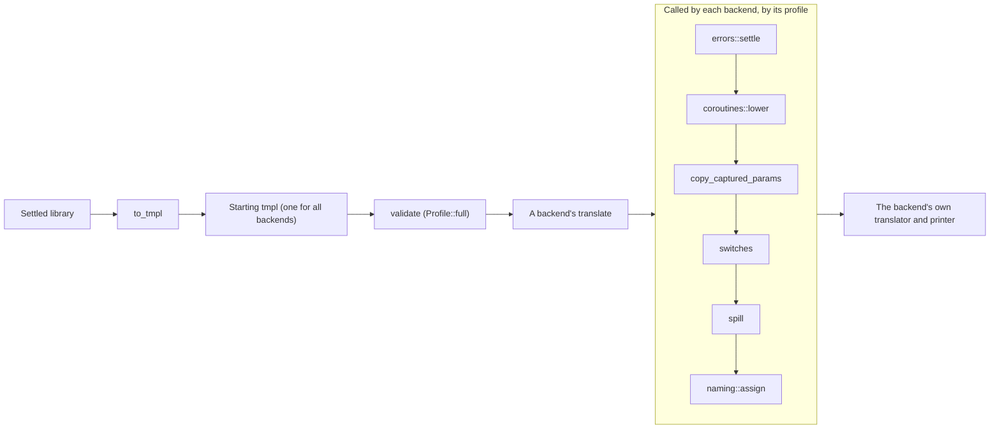
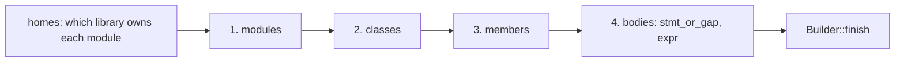

# tmpl, in detail

tmpl is the one form between the frontend and the seven backends: a
settled, typed, fully explicit program that a backend translates
without asking the frontend anything. This page covers its crate,
[`temper-tmpl`](../../../crates/temper-tmpl/src/lib.rs) (about 14,900
lines, no dependencies), and the frontend's translation into it,
[`to_tmpl`](../../../crates/temper-frontend/src/to_tmpl.rs) (about
6,000 lines in four files). [The overview page](../05-tmpl.md) shows
`triple.temper` as tmpl; [the backends' detail page](06-backends.md)
picks up where a backend takes over. The full design, topic by topic,
is in [notes/tmpl/](../../../notes/tmpl/README.md); this page is the
architecture and its trade-offs, checked against the code.

## Contents

- [Where it sits](#where-it-sits)
- [Decisions](#decisions)
  - [One starting form, independent of the frontend](#one-starting-form-independent-of-the-frontend)
  - [Fully explicit](#fully-explicit)
  - [Columns in an arena, kinds from one schema](#columns-in-an-arena-kinds-from-one-schema)
  - [A text form that reads back exactly](#a-text-form-that-reads-back-exactly)
  - [A validator with coded rules](#a-validator-with-coded-rules)
  - [Core as declarations; only operators built in](#core-as-declarations-only-operators-built-in)
  - [Errors stay values](#errors-stay-values)
  - [Profiles, and lowerings each backend calls](#profiles-and-lowerings-each-backend-calls)
  - [Naming as one shared pass](#naming-as-one-shared-pass)
  - [Qnames in Kotlin's format](#qnames-in-kotlins-format)
  - [What a backend is to tools](#what-a-backend-is-to-tools)
- [From the frontend: `to_tmpl`](#from-the-frontend-to_tmpl)
- [The shared lowerings](#the-shared-lowerings)
- [The main types and functions](#the-main-types-and-functions)
- [Tests](#tests)
- [Known weaknesses and plans](#known-weaknesses-and-plans)

## Where it sits

The driver ([`checked`](../../../crates/temper-driver/src/lib.rs))
translates once and validates once, against the full profile. Each
backend then runs the lowerings it needs and the naming pass, in its
own `translate`.

## Decisions

Each says what was chosen, what else was on the table, its pros and
cons, how Kotlin Temper does it, and whose call it was: *team-agreed*,
*this compiler's* (the user's call, often recorded as "Decided" in
notes/tmpl/), or *open*.

### One starting form, independent of the frontend

**Chosen:** `temper-tmpl` depends on nothing. tmpl has its own types,
names, literals, and tables, all ids into its own arenas. `to_tmpl`
gives one starting program for every backend; every per-backend choice
is a pass after it.

**Alternatives:** Kotlin's way: its TmpL is built per backend, with the
backend's `SupportNetwork` consulted while translating, and its nodes
hold frontend objects (`TmpLTranslator.kt`, `SupportNetwork.kt`).

**Pros:** backends build and test against tmpl alone (each
`temper-be-*` depends only on this crate); starting tmpl can be
printed, compared, cached, and tested on its own; the wasm playground
and the editor tools reuse it.

**Cons:** a translation step and a second printer to keep; anything
backends need must be carried explicitly, which grows the model (the
crate is about 14,900 lines, against a plan of 4,000–7,000).

**Status:** this compiler's, "Decided" 2026-10-29
([notes/tmpl/overview.md](../../../notes/tmpl/overview.md), "Core
decisions").

### Fully explicit

**Chosen:** every expression has a type (an interned
`TypeId`); every reference is a `DeclId` (both in
[`ids.rs`](../../../crates/temper-tmpl/src/ids.rs)); conversions
(upcasts, downcasts, nullable in and out, function values to `@fun`
interfaces and back) are nodes; function literals list what they
capture; calls that may fail are flagged; and each builtin operator is
its type's own ([`Op`](../../../crates/temper-tmpl/src/ops.rs), such as
`Int32.add`), never a generic one.

**Alternatives:** infer what's needed in each backend from types, as
Kotlin's backends do.

**Pros:** a backend never infers or re-resolves; one fact read the same
way by seven translators; whole classes of Kotlin bugs ruled out by
construction (its `Boolean ==` in Lua, JS, and Python; overview.md,
"Lessons from Kotlin Temper's tmpl").

**Cons:** `to_tmpl` does more work, and the validator has more to
check; every new language feature means new nodes or facts.

**Status:** this compiler's; typed operators "Decided" 2026-10-29.

### Columns in an arena, kinds from one schema

**Chosen:** [`Nodes`](../../../crates/temper-tmpl/src/nodes.rs) keeps
one column per field (kind, type, span, children range, two payload
slots, flags), indexed by `NodeId`; children come before parents.
Every node kind (about 70) is declared once, in the [`schema!`](../../../crates/temper-tmpl/src/schema.rs)
table: its [`Family`](../../../crates/temper-tmpl/src/schema.rs), where
its type comes from ([`TypeRule`](../../../crates/temper-tmpl/src/schema.rs)),
its fields and where each is stored ([`Slot`](../../../crates/temper-tmpl/src/schema.rs)),
and, for a few, the profile [`Features`](../../../crates/temper-tmpl/src/profile.rs)
bit it needs (`Switch` needs `SWITCH`, `BlockValue`
`STATEMENT_EXPRESSIONS`). From it, the macro generates
[`Kind`](../../../crates/temper-tmpl/src/schema.rs), the typed view
[`Node`](../../../crates/temper-tmpl/src/schema.rs), and its decoder.

**Alternatives:** an enum of boxed nodes; a generated AST from a
grammar file, as Kotlin's `tmpL.out-grammar`.

**Pros:** compact and fast to walk; a near-direct dump for a future
binary form; one place to add a kind, which text, validator, and
decoder all follow.

**Cons:** passes don't edit in place easily. Each one clones the
program into a [`Builder`](../../../crates/temper-tmpl/src/builder.rs)
(`from_program`), replaces nodes, and renumbers so children still come
first. That's a whole-program copy per pass that fires, cheap so far.
And decoding panics on a malformed node, which only the validator's S1
rule rules out.

### A text form that reads back exactly

**Chosen:** [`write`](../../../crates/temper-tmpl/src/text/write.rs)
prints a program as Temper-like text, leaving out types the local rules
give back; [`read`](../../../crates/temper-tmpl/src/text/read.rs)
parses it and restores them. Read then write gives the same bytes;
write then read gives an equal program, where "equal" means the same
meaning ([`difference`](../../../crates/temper-tmpl/src/same.rs):
declarations by id, nodes, types, and strings by content). Spans are an
optional section.

**Pros:** goldens that people can review in a diff; hand-written test
programs (the testkit's `jumps.tmpl`, for jumps the frontend doesn't
translate yet); `run-temper --tmpl` for debugging; the core fixture is tmpl
text.

**Cons:** the reader is the crate's largest file (about 2,400 lines),
and the format needs versioning once anything stores it
([notes/tmpl/formats.md](../../../notes/tmpl/formats.md)).

**Kotlin Temper** prints TmpL for debugging, but doesn't read it back.

### A validator with coded rules

**Chosen:** [`validate`](../../../crates/temper-tmpl/src/validate.rs)
checks a program against a profile and returns each
[`Problem`](../../../crates/temper-tmpl/src/validate.rs) with its
[`Rule`](../../../crates/temper-tmpl/src/validate.rs) code: structure
(S), types (T), references and scopes (R), flow (F), declarations (D),
qnames (Q), modules (M), classes (C), nullables (N), and function
values (V). Structure runs first, so one mistake isn't reported many
times. The module doc lists every rule.

**Pros:** `to_tmpl` and every pass are checked against one written
spec, in tests; the builder never fails, so the validator is the one
judge.

**Cons:** builds validate only starting tmpl, against
[`Profile::full`](../../../crates/temper-tmpl/src/profile.rs). Lowered
programs are validated only in some tests, and never against the
backend's own profile, so S4 (each kind allowed by the profile) never
runs for a real backend. Its `expr` check is one function of about 460
lines.

### Core as declarations; only operators built in

**Chosen:** a call of `n.toString()` or `console.log(s)` is an
ordinary call of an external declaration in a `uses temper-core`
section. `to_tmpl` copies core's declarations, as used, from one
hand-written fixture,
[`core.tmpl`](../../../crates/temper-tmpl/tests/fixtures/core.tmpl)
(through [`catalog`](../../../crates/temper-frontend/src/to_tmpl.rs)),
which a test checks against Temper's `core.temper`. Only the 69
operators are built in, as [`Op`](../../../crates/temper-tmpl/src/ops.rs)
with an [`OpInfo`](../../../crates/temper-tmpl/src/ops.rs) table each
backend spells.

**Pros:** one source for core's signatures; backends connect core by
qname from a table, which their `tables.rs` tests check covers every
connected declaration.

**Cons:** a second copy of core's surface to keep in step (the test
catches drift); passes and `to_tmpl` find some operators by their text
(`Op::named("Boolean.not").unwrap()`, nine places), where constants
would be checked at compile time.

**Status:** "Decided" 2026-10-29.

### Errors stay values

**Chosen:** code with an error becomes tmpl's `Error` node, which fails
where it runs. When the error is only about a value's type, the `Error`
keeps the value as written. [`errors::settle`](../../../crates/temper-tmpl/src/errors.rs)
then decides per backend: a profile with `RUNS_TYPE_ERRORS` (JS, Lua,
Python) runs the value; the others turn it into a plain failure and
drop what can't run after it.

**Pros:** a library with one mistake still gets every backend's code,
failing only where the mistake runs; statically typed backends never
get code their compilers would reject.

**Cons:** two kinds of `Error`, and a frontend classification
(`Message::type_only`) that both the interpreter and `to_tmpl` read by
matching diagnostics to nodes by span.

**Kotlin Temper** writes ill-typed code for every backend, so its
statically typed backends' builds fail (its issue 58). **Status:** the
user's call, 2026-11-06.

### Profiles, and lowerings each backend calls

**Chosen:** a [`Profile`](../../../crates/temper-tmpl/src/profile.rs)
is a set of [`Features`](../../../crates/temper-tmpl/src/profile.rs)
the target keeps natively (statements inside expressions, `Switch`,
running type errors) and a [`CoroutineStrategy`](../../../crates/temper-tmpl/src/coroutines.rs).
Each lowering is a plain function from a program to a new program, or
`None` if nothing changed. Each backend's `translate` calls the ones it
needs, in order. tmpl never lists backends.

**Alternatives:** the design in
[notes/tmpl/profiles.md](../../../notes/tmpl/profiles.md) ("Passes"): a
table of passes, each saying what it removes, needs, and may add, run
in a fixed order by one `lower`, validating after each in debug builds
and tests.

**Pros:** simple; a backend's pipeline is a dozen readable lines; each
lowering is tested alone.

**Cons:** nothing enforces the order or the validation. Today every
backend happens to call them in the same order (errors, coroutines,
cells, switches, spill, naming), but each writes the list by hand, so
it could drift. And profiles don't say everything a backend handles:
Java and Python claim statements inside expressions natively and hoist
them in their translators; JS lacks the feature and hoists in its
translator without `spill`. So a profile can't yet decide the pipeline
alone. [The backends page](06-backends.md#the-pipeline-each-backend-runs)
has the table.

**Kotlin Temper** chooses per backend through `SupportNetwork`
properties (`bubbleStrategy`, `coroutineStrategy`,
`functionTypeStrategy`, `computedJumpStrategy`), read during TmpL
translation. **Status:** the shape is this compiler's; a shared
`prepare(program, profile)` with hoisting is planned
([notes/tmpl/roadmap.md](../../../notes/tmpl/roadmap.md), "Lowering
that backends duplicate").

### Naming as one shared pass

**Chosen:** [`naming::assign`](../../../crates/temper-tmpl/src/naming.rs)
gives every declaration an output name by the target's
[`NamingRules`](../../../crates/temper-tmpl/src/naming.rs), data
rather than code: reserved words, case per kind, a private prefix,
escapes, raw keywords, and a few scoping switches (block scoping,
shadowing, whether fields and types have names of their own). Public
names come first and never change; locals keep their source names; a
number is added only on a real clash. The result is a
[`NameMap`](../../../crates/temper-tmpl/src/naming.rs) side table;
tmpl itself holds no output names. Another library's names come from
its [`Interface`](../../../crates/temper-tmpl/src/naming.rs), so a
dependent spells exactly what that library's own pass chose.

**Pros:** no `x__123` names; one resolver instead of seven; stable
output; the same names whichever order libraries build in.

**Cons:** rules grow by switches as targets need them; a backend that
needs names before a lowering runs the pass twice (C++, for its
order-of-evaluation analysis before `spill`).

**Kotlin Temper** names per backend, numbering many names
(`values__139`). **Status:** this compiler's ([design.md](../../../notes/design.md),
section 8); keeping public names exactly Kotlin's is required for
compatibility ([notes/api-compat.md](../../../notes/api-compat.md)).

### Qnames in Kotlin's format

**Chosen:** every declaration but labels and compiler-made ones has a
qualified name, derived on demand ([`QNames`](../../../crates/temper-tmpl/src/qname.rs))
from the library, module path, owners, and names, in Kotlin's format
exactly ([`QName`](../../../crates/temper-tmpl/src/qname.rs) parses and
prints it). Core's and std's connected declarations resolve by qname
([`resolves_by_qname`](../../../crates/temper-tmpl/src/qname.rs)); a
library's own by name, through its host code
([`host`](../../../crates/temper-tmpl/src/host.rs)).

**Pros:** connected keys match Kotlin's runtimes and tables; library
interfaces key names by qname.

**Cons:** derived each time it's needed (cheap, but repeated per
pass); a declaration stores an override only where Kotlin's would
differ, which is subtle.

### What a backend is to tools

**Chosen:** a backend is a [`Backend`](../../../crates/temper-tmpl/src/backend.rs)
value: name, comment syntax, runtime files, naming rules, `translate`,
whether `build` writes it by default, and its
[`Tools`](../../../crates/temper-tmpl/src/backend.rs) for running
tests. Shared helpers for those tools (finding a tool, running it,
reading JUnit XML) are in [`tools`](../../../crates/temper-tmpl/src/tools.rs).

**Pros:** backends stay pluggable: `temper-driver` holds the one list;
nothing else names a backend.

**Cons:** process running and XML reading live in the IR crate. Kotlin's
`be` mixes these too, so it's defensible; a small `temper-backend`
crate could hold them later.

## From the frontend: `to_tmpl`

[`to_tmpl`](../../../crates/temper-frontend/src/to_tmpl.rs) walks the
settled tree and reads types and resolutions from typing; it resolves
nothing again. [`translate_with`](../../../crates/temper-frontend/src/to_tmpl.rs)
works in four rounds, so anything may refer to anything:

1. **Modules:** each of the library's own, in the order they run,
   named by its path from the library's root.
2. **Classes:** every class and interface, top-level or local, so any
   module may name any class.
3. **Members:** their signatures.
4. **Bodies:** each module's items, init block, and tests.

**Who owns a module:** a library's settled tree includes the modules it
imports, from std and from other libraries under the work root.
[`homes`](../../../crates/temper-frontend/src/to_tmpl.rs) decides each
module's [`Home`](../../../crates/temper-frontend/src/to_tmpl.rs) by
directory prefix; what's used of another library becomes external
declarations in a `uses` section. This is the reason a dependency is
settled again inside each importer (the audit's B1), and why its errors
are reported once per importer.

**Gaps, not panics:** what isn't covered yet is a
[`NotYet`](../../../crates/temper-frontend/src/to_tmpl.rs), saying what
and where (about 150 sites over the four files). [`gaps`](../../../crates/temper-frontend/src/to_tmpl.rs)
goes on past each gap to list them all, for `compat/count_tmpl.py`.
Errors become `Error` nodes ([`stmt_or_gap`](../../../crates/temper-frontend/src/to_tmpl.rs)
first checks whether a statement is an error).

**Kotlin Temper** translates from its frontend's Lispy AST to TmpL per
backend, in `TmpLTranslator.kt`, with the backend's support network.

**Weak spots:** library identity by path strings, and std matched by
the name `"std"` in several places across `to_tmpl` and the backends;
user-facing messages that say "not yet in tmpl", internal words, after
an error makes a call unresolvable (to do: hide gaps inside spans that
already have errors).

## The shared lowerings

| Lowering | What it does | Why it's shared | Called by |
|---|---|---|---|
| [`errors::settle`](../../../crates/temper-tmpl/src/errors.rs) | Type-only errors run as written or fail there, by profile | One rule for "what runs after an error" | all seven |
| [`coroutines::lower`](../../../crates/temper-tmpl/src/coroutines.rs) | Generator literals as state machines: a factory whose step function is a `Switch` on the state, folded so no unreachable states remain | Kotlin's `CoroutineStrategy`, done once | C++, Java, Rust |
| [`copy_captured_params`](../../../crates/temper-tmpl/src/cells.rs) | A parameter a closure captures and reassigns becomes a local, so it can be a cell | Targets whose closures copy captures | C++, Java, Rust |
| [`to_if_chains`](../../../crates/temper-tmpl/src/switches.rs) and [`to_if_chains_where`](../../../crates/temper-tmpl/src/switches.rs) | A `Switch` as `if`s, its scrutinee held once | Targets without `switch`, or Java's without `long` | C#, JS, Lua, Python; Java for `Int64` |
| [`spill`](../../../crates/temper-tmpl/src/spill.rs) and [`spill_with`](../../../crates/temper-tmpl/src/spill.rs) | Operands that run before an `orelse` or a block's value are held first, so order survives hoisting; choices and loop conditions that need statements become statements | Step 1 of the planned `hoist` pass | C#, C++, Lua |
| [`naming::assign`](../../../crates/temper-tmpl/src/naming.rs) | Pretty, collision-free names | One resolver | all seven |

Shared analyses ([`analysis`](../../../crates/temper-tmpl/src/analysis.rs))
feed them and the backends: [`imports`](../../../crates/temper-tmpl/src/analysis.rs)
(a module's imports are derived from what it refers to, never stored),
[`captures`](../../../crates/temper-tmpl/src/analysis.rs) and
[`assigned_captures`](../../../crates/temper-tmpl/src/analysis.rs),
[`module_state`](../../../crates/temper-tmpl/src/analysis.rs) (which
module `var`s functions write, for Python's `global` and the locks in
C++ and Rust), [`function_groups`](../../../crates/temper-tmpl/src/analysis.rs),
and [`Effects`](../../../crates/temper-tmpl/src/analysis.rs) (what an
operand's evaluation may show, for targets with an unspecified order).

To see a lowering's effect, compare
[`control-flow-async.tmpl`](../../../crates/temper-frontend/tests/to_tmpl/control-flow-async.tmpl)
with its [state-machine form](../../../crates/temper-frontend/tests/to_tmpl/control-flow-async.state-machine.tmpl).

## The main types and functions

**The program** ([`lib.rs`](../../../crates/temper-tmpl/src/lib.rs)):
[`Program`](../../../crates/temper-tmpl/src/lib.rs) (a library: its
[`Library`](../../../crates/temper-tmpl/src/lib.rs) name and version,
its [`Uses`](../../../crates/temper-tmpl/src/lib.rs), its
[`Module`](../../../crates/temper-tmpl/src/lib.rs)s in dependency
order, and shared tables), plus, given by the build and not in the
text, its [`Host`](../../../crates/temper-tmpl/src/host.rs) code and
its dependencies' naming interfaces.

**Tables:** [`Nodes`](../../../crates/temper-tmpl/src/nodes.rs) with
[`Kids`](../../../crates/temper-tmpl/src/nodes.rs) and
[`Flags`](../../../crates/temper-tmpl/src/nodes.rs);
[`TypeTable`](../../../crates/temper-tmpl/src/types.rs) of interned
[`TypeData`](../../../crates/temper-tmpl/src/types.rs), with
[`Signature`](../../../crates/temper-tmpl/src/types.rs);
[`DeclTable`](../../../crates/temper-tmpl/src/decls.rs) of
[`Decl`](../../../crates/temper-tmpl/src/decls.rs)s, each with a
[`DeclKind`](../../../crates/temper-tmpl/src/decls.rs) and
[`Facts`](../../../crates/temper-tmpl/src/decls.rs) (exported,
connected, compiler-made, generator, …); and
[`Strings`](../../../crates/temper-tmpl/src/decls.rs).

**Making and checking:** [`Builder`](../../../crates/temper-tmpl/src/builder.rs)
(children first; gives each node the type the local rules say; never
fails), [`validate`](../../../crates/temper-tmpl/src/validate.rs),
[`write`](../../../crates/temper-tmpl/src/text/write.rs),
[`read`](../../../crates/temper-tmpl/src/text/read.rs), and
[`difference`](../../../crates/temper-tmpl/src/same.rs).

**Choices and passes:** [`Profile`](../../../crates/temper-tmpl/src/profile.rs),
[`Features`](../../../crates/temper-tmpl/src/profile.rs),
[`CoroutineStrategy`](../../../crates/temper-tmpl/src/coroutines.rs),
the lowerings above, and [`assign_checked`](../../../crates/temper-tmpl/src/naming.rs),
which fails where an export's name would have to change.

**The frontend side:** [`to_tmpl`](../../../crates/temper-frontend/src/to_tmpl.rs),
[`Translator`](../../../crates/temper-frontend/src/to_tmpl.rs) (its
state: the builder, declarations by frontend node, homes, externals,
and the error maps), [`expr`](../../../crates/temper-frontend/src/to_tmpl.rs),
and the files for classes (`to_tmpl_classes.rs`), function values
(`to_tmpl_functions.rs`), and defaults (`to_tmpl_defaults.rs`).

## Tests

| Test | What it pins | Where |
|---|---|---|
| Text cases | Hand-written tmpl: what the reader, writer, and validator make of it, with each problem's rule code | [`text.rs`](../../../crates/temper-tmpl/tests/text.rs), `tests/text/*.cases` |
| Round trip | A property test: random valid programs validate, write, read back equal, and write the same again (seed and rounds by environment) | [`round_trip.rs`](../../../crates/temper-tmpl/tests/round_trip.rs) |
| Model | The tables, spans, and the validator on programs text can't express | [`model.rs`](../../../crates/temper-tmpl/tests/model.rs) |
| Core fixture | `core.tmpl` matches `core.temper`: names, kinds, parameters, results, bubbling, connected marks | [`core_fixture.rs`](../../../crates/temper-tmpl/tests/core_fixture.rs) |
| Lowerings | Coroutines' state machines, switches, spill, each result validated | [`coroutines.rs`](../../../crates/temper-tmpl/tests/coroutines.rs), [`switches.rs`](../../../crates/temper-tmpl/tests/switches.rs), [`spill.rs`](../../../crates/temper-tmpl/tests/spill.rs) |
| Naming, qnames, host | Kotlin's cases, sharing, prefixes, escapes, suffixes only on clashes; Kotlin's qname examples; Kotlin's connected choice | [`naming.rs`](../../../crates/temper-tmpl/tests/naming.rs), [`qname.rs`](../../../crates/temper-tmpl/tests/qname.rs), [`host.rs`](../../../crates/temper-tmpl/tests/host.rs) |
| Analyses | Which operands' order shows, and temporaries' names | [`analysis.rs`](../../../crates/temper-tmpl/tests/analysis.rs) |
| `to_tmpl` goldens | Covered functional tests translate, validate, round-trip with spans, and match goldens in `tests/to_tmpl/`; the state-machine goldens too | [`subset_a_goldens`](../../../crates/temper-frontend/tests/to_tmpl.rs) |
| Every functional test | No functional test panics `to_tmpl` or gives invalid tmpl; the rest say what isn't covered | [`every_functional_test_translates_or_says_why`](../../../crates/temper-frontend/tests/to_tmpl.rs) |
| Shared programs | Each translates to valid tmpl, as its golden shows | [`programs_translate_to_tmpl`](../../../crates/temper-be-testkit/tests/programs.rs) |

Beyond these, every backend's goldens and runs exercise the lowerings
end to end ([backends](06-backends.md#tests)).

**Not covered:** lowered programs validated against each backend's own
profile; passes composed in every order a profile allows; a fuzzer that
lowers random tmpl under random profiles (planned in
[notes/tmpl/testing.md](../../../notes/tmpl/testing.md)); and an
interpreter for tmpl, which would compare a program before and after
each pass without any language's tools.

## Known weaknesses and plans

- **The pipeline is per backend, by hand.** Each backend lists its
  lowerings and naming; the order is the same today by care, not by
  construction. Plan: one `prepare(program, profile)` in tmpl that runs
  them in a fixed order and validates after each in debug builds and
  tests, as profiles.md designs, as its own restructuring change.
- **Hoisting is in every backend.** `spill` is step 1 of the planned
  `hoist` pass; steps 2 and 3 (statements out of expressions, values
  delivered to their target) are still done seven ways
  ([roadmap.md](../../../notes/tmpl/roadmap.md) lists each backend's
  copy). Then profiles could honestly say which backends keep
  statements inside expressions.
- **Lowered programs aren't checked in builds,** and `Program::profile`
  is never set by a pass, so a lowered program doesn't say what it was
  lowered for.
- **Operators found by text.** `Op::named("…").unwrap()` in passes and
  `to_tmpl`; constants such as an `Op::BOOLEAN_NOT` would be checked at
  compile time.
- **One `NotYet` per crate.** The frontend's carries a position; the
  seven backends' are copies of one struct, each with its own
  `Display`. One shared type in tmpl would do.
- **Each importer re-settles its dependencies,** owned by path prefix
  in `homes`. The planned library cache settles each library once and
  gives importers its interface
  ([notes/library-cache.md](../../../notes/library-cache.md)).
- **Size.** The crate is about twice its planned size, mostly the text
  reader and the validator; worth a look once the model settles.
