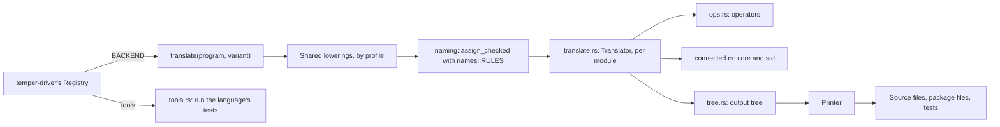

# Backends, in detail

A backend takes a tmpl program and writes one language's source and
package files. Tempest has seven, one crate each: `temper-be-cpp`,
`-csharp`, `-java`, `-js`, `-lua`, `-py`, and `-rust`, from about 5,600
to 9,800 lines each. Each depends only on
[`temper-tmpl`](../../../crates/temper-tmpl/src/lib.rs).
[The overview page](../06-backends.md) shows `triple.temper` in all
seven languages; [tmpl's detail page](05-tmpl.md) covers the IR and
the lowerings backends share. This page covers what the seven share,
where they differ, why, and how they're tested.

## Contents

- [Where it sits](#where-it-sits)
- [Shared decisions](#shared-decisions)
  - [Compatible API, prettier bodies](#compatible-api-prettier-bodies)
  - [A small tree and printer per language](#a-small-tree-and-printer-per-language)
  - [Profiles pick the shared lowerings](#profiles-pick-the-shared-lowerings)
  - [One naming pass, rules as data](#one-naming-pass-rules-as-data)
  - [Operators and connected declarations as tables](#operators-and-connected-declarations-as-tables)
  - [The runtimes, from Kotlin Temper's](#the-runtimes-from-kotlin-tempers)
  - [Changes from Kotlin Temper's runtimes](#changes-from-kotlin-tempers-runtimes)
  - [Pluggable: a description per backend](#pluggable-a-description-per-backend)
  - [Each language runs its own tests](#each-language-runs-its-own-tests)
- [The pipeline each backend runs](#the-pipeline-each-backend-runs)
- [Per-backend choices](#per-backend-choices)
  - [C++'s warning policy](#cs-warning-policy)
- [Naming rules by backend](#naming-rules-by-backend)
- [The main types and functions](#the-main-types-and-functions)
- [Tests](#tests)
- [Known weaknesses and plans](#known-weaknesses-and-plans)

## Where it sits

## Shared decisions

Each says what was chosen, the alternatives, pros and cons, how Kotlin
Temper does it, and whose call it was: *team-agreed*, *tempest's* (the
user's call), or *open*.

### Compatible API, prettier bodies

**Chosen:** what a library's users can see (layout, package files,
public names and signatures, the runtime it calls) matches what Kotlin
Temper writes for that language. Function bodies are free to read
better: source names, real loops, no needless temporaries or labels.
Where Kotlin's output is unsafe or wrong, tempest's differs on purpose,
and each crate's `lib.rs` doc comment says where.

**Alternatives:** a fresh API per language, or byte-for-byte Kotlin
output.

**Pros:** existing users of Temper-built libraries can't tell the
difference; reviewers can read the generated code.

**Cons:** inherits Kotlin's API choices, including ones tempest would
change ([notes/api-compat.md](../../../notes/api-compat.md),
"Proposed changes", lists eleven).

**Status:** tempest's goal from the start; the API rules per language
are in api-compat.md. Changing a public API needs the Temper team.

### A small tree and printer per language

**Chosen:** each backend has its own hand-written output tree and
printer (`tree.rs`, about 900 to 1,950 lines), which adds parentheses
only where precedence needs them and lays code out in the language's
usual style.

**Alternatives:** Kotlin's generated per-language ASTs (from
`*.out-grammar` files, about 42,000 generated lines over seven
backends), or one shared output tree and printer.

**Pros:** small, readable, no code generator; each printer can follow
its language's conventions (rustfmt's widths, PEP 8's blank lines,
Lua's `end`s), which share little.

**Cons:** seven printers repeat helpers: float literals in four or
more, string concatenation parts in six, host wrappers in six. The
"shared document builder" in the size plan
([size-and-speed.md](../../../notes/size-and-speed.md)) wasn't built.

**Status:** tempest's ([design.md](../../../notes/design.md),
section 9).

### Profiles pick the shared lowerings

**Chosen:** each backend's [`Profile`](../../../crates/temper-tmpl/src/profile.rs)
says what it keeps natively, and its `translate` calls the shared
lowerings it lacks ([tmpl's page](05-tmpl.md#the-shared-lowerings)
lists them). Anything still language-specific stays in the backend.

**Pros:** a fix to generators, switches, or evaluation order lands
once for every backend that uses it.

**Cons:** statements inside expressions (an `orelse`, a block's value)
are still mostly hoisted by each translator: C#'s `hoist` and `sink`,
C++'s `pending` and `temporary`, Java's `spilled`, JS's `pre` list,
Lua's and Python's own. Only the first step, keeping earlier operands
in order (`spill`), is shared, and only C#, C++, and Lua use it. So
profiles don't yet describe what each translator does
([the pipeline](#the-pipeline-each-backend-runs)).

**Kotlin Temper** chooses through each backend's `SupportNetwork`
while building its per-backend TmpL. **Status:** the principle "what
more than one backend needs belongs in tmpl" is the user's, 2026-11-06
([notes/tmpl/roadmap.md](../../../notes/tmpl/roadmap.md)).

### One naming pass, rules as data

**Chosen:** names come from tmpl's shared pass,
[`assign_checked`](../../../crates/temper-tmpl/src/naming.rs), by a
`RULES` constant in each backend's `names.rs`
([table below](#naming-rules-by-backend)). The checked form fails, as a
`NotYet`, where an export's name would have to change. A backend never
invents a name string; for helpers it asks the pass for hints.

**Pros:** no `x__123` names; numbers only on real clashes; dependents
spell another library's names from its interface.

**Cons:** each new scoping quirk is a new switch in `NamingRules`.

**Kotlin Temper** names per backend (`selectNames`), numbering
compiler-made and many local names.

### Operators and connected declarations as tables

**Chosen:** `ops.rs` spells each of tmpl's 69 operators;
`connected.rs` maps core's (and some of std's) connected declarations,
keyed by qname, to the language's runtime. Each backend's
`tests/tables.rs` checks that every operator is spelled and that each
key names a connected declaration.

**Pros:** what a backend does with core is one sorted table, checked
against core's own declarations.

**Cons:** the tables are code (templates and closures), so they can't
be shared or diffed across backends as data.

**Kotlin Temper** keeps the same in each backend's `SupportNetwork` and
helper files.

### The runtimes, from Kotlin Temper's

**Chosen:** each backend crate holds its language's runtime in
`runtime/temper-core/`, with that backend's std host code in
`runtime/std/` (Rust's, Java's, and C#'s), LuaUnit in Lua's
`runtime/luaunit/`, and C#'s library template in
`runtime/library-template/`. Each backend's `runtime.rs` embeds its
runtime's files for `tempest build` to write beside the output. These,
with `lib/std/`, `lib/core/`, and `temper-funtests`'s `cases/`, began
as Kotlin Temper's at commit 69f1a5b0, with the changes below, and are
tempest's own now. Rust's runtime and std are also published as crates
of their own, `temper-core` and `temper-std` on crates.io, rather than
packaged inside `temper-be-rust`.

**Pros:** generated code calls the same runtime APIs as Kotlin's, so
both compilers' output can mix; each runtime sits in the crate that
calls it, so a change to both is one change.

**Cons:** some changes add API (a top-level turn and `awakeUpon` for
Java, `awake_upon` for Rust, async for Lua), which Kotlin's published
0.6.0 runtimes lack, so output needs the runtime of its own build;
it names that build's version
([Versions](#versions-one-version-spelled-for-each-ecosystem)), which
isn't published yet.

### Changes from Kotlin Temper's runtimes

What tempest changed in the runtimes it began with, numbered as the
patches that made them (other docs cite these numbers):

| Runtime | No. | Change |
| --- | --- | --- |
| C++ | 0005 | Drain the async queue when code outside any async block settles a promise; let C++20 coroutines `co_await` Temper promises |
| C++ | 0012 | Let a range-for step generators (C++14); a failed step leaves a generator done |
| C++ | 0019 | std/net through a pluggable client (`temper::core::net::set_client`), by default libcurl's multi interface on a `temper-io` thread where the build defines `TEMPER_NET_CURL`; other threads post work back to the async queue, which waits while any hold is out |
| C++ | 0021 | `to_base`, an upcast of a never-null `shared_ptr`, so g++'s `-Wnull-dereference` has no null path to follow |
| C++ | 0022 | Skip `List::make`'s `reserve` for Booleans, so g++'s false `-Warray-bounds` at -O3 in `vector<bool>` doesn't fail `-Werror` builds |
| C++ | 0023 | `DenseBitVector`, as core's Temper body: `get` past the end is false, and `set` past it grows the vector for a true bit, where both bubbled (the regex engine's `ctype`) |
| C# | 0009 | Run async steps one at a time on one thread, and hold top-level code in a turn |
| C# | 0014 | Let host code swap the runner, block on a promise only where that can't deadlock, and resume after an await outside any turn |
| Java | 0008 | Run async steps one at a time on one runner; add `Core.awakeUpon` and the top-level turn; make `Generator` `Iterable` |
| Java | 0016 | Connect and send std/net requests on the common pool, never in the async step that calls `stdNetSend` |
| JS | 0001 | Fix the JSDoc types of eight helpers, so strict `tsc` takes generated calls without casts |
| JS | 0002 | Fix `listBuilderSplice`'s JSDoc types, likewise |
| JS | 0004 | Make `breakPromise`'s reason optional in its JSDoc |
| JS | 0015 | Type `sendRequest`'s method as any string in its JSDoc, for std/net's generated call |
| Lua | 0006 | Add promises and async blocks, which Kotlin's Lua calls but its runtime lacks |
| Lua | 0011 | Queue promise waiters behind one drain loop; make generators callable tables that `for`-`in` steps and a failed step leaves done |
| Lua | 0018 | std/net through a pluggable client (`temper.set_net_client`), by default LuaSocket's `socket.http`, on sockets that never block a turn |
| Lua | 0020 | Let generators yield values and take their factory's arguments |
| Python | 0007 | Run async steps one at a time on one runner, settle promises by queueing waiters, and make promises awaitable from asyncio |
| Python | 0013 | Annotate promises and std/net's futures as `TemperFuture`, so strict checkers take a bare `await` of them |
| Rust | 0003 | Make `Promise` a std `Future`, so Rust code can `.await` Temper promises on any executor |
| Rust | 0010 | Queue resumes on the runner (`AsyncRunner::awake_upon`), guard turns, and make `SafeGenerator` an `Iterator` |
| Rust | 0017 | Let work outside any turn hold the runner (`AsyncRunner::hold`), so `run_all_blocking` waits for the tasks it will queue |

### Versions: one version, spelled for each ecosystem

**Chosen:** Temper's version is written once, as the root `Cargo.toml`'s
`[workspace.package] version` (0.7.0), and every runtime, std, core,
generated package, and `tempest --version` names it. `temper-tmpl`'s
[`version.rs`](../../../crates/temper-tmpl/src/version.rs) has the
rules: a `Version` is that base, a stage (dev, `alpha.K`, `beta.K`,
`rc.K`, or release), and the commits since the stage's tag, spelled
for each ecosystem so that every one sorts dev builds, pre-releases,
and releases in the same order:

| Stage | SemVer: npm, Cargo, NuGet, Maven, vcpkg, Conan | Python (PEP 440) | LuaRocks |
| --- | --- | --- | --- |
| dev build | `0.7.0-alpha.0.123` | `0.7.0.dev123` | `0.7.0.alpha.0.123-1` |
| alpha 1 | `0.7.0-alpha.1` | `0.7.0a1` | `0.7.0.alpha.1-1` |
| alpha 1 plus 5 commits | `0.7.0-alpha.1.5` | `0.7.0a2.dev5` | `0.7.0.alpha.1.5-1` |
| beta 1, rc 1 | `0.7.0-beta.1`, `0.7.0-rc.1` | `0.7.0b1`, `0.7.0rc1` | `0.7.0.beta.1-1`, `0.7.0.rc.1-1` |
| release | `0.7.0` | `0.7.0` | `0.7.0-1` |
| dev build after it | `0.7.1-alpha.0.5` | `0.7.1.dev5` | `0.7.1.alpha.0.5-1` |

Go would add `v`; CMake's `project(VERSION)` takes the numbers alone,
so generated `CMakeLists.txt` also sets `LIBRARY_VERSION_FULL`, and the
C++ runtime defines `TEMPER_CORE_VERSION`. `dev` appears nowhere, as
SemVer, Maven, and LuaRocks sort it above alphas or even releases; and
no spelling relies on build metadata (`+…`), which registries ignore or
reject. `temper-tmpl`'s
[`version_order`](../../../crates/temper-tmpl/tests/version_order.rs)
test sorts each spelling with its ecosystem's own comparator where one
is installed (pip's `packaging`, node-semver, Maven's
`ComparableVersion`, `NuGet.Versioning`, and LuaRocks' `vers`).

Where the version comes from:

- `temper-driver`'s `build.rs` reads git: the last `v` tag
  (`v0.7.0-beta.1`) and the commits since it, or since the first commit
  before any tag. After a release tag, dev builds are of the next
  patch; a workspace version ahead of the tag wins. `TEMPER_VERSION`
  (`0.7.0-rc.1`) overrides git; without git, outside this repository,
  or in a shallow clone without tags, the version is a dev build with
  no commits counted, `0.7.0-alpha.0.0`. It reruns only when HEAD or the
  tags move, so `--version`'s "modified" mark is as of then.
- `tempest` sets that as the process's version first thing
  (`temper_driver::version::init`); the backends and the frontend read
  `temper_tmpl::version::current()`, which is otherwise the version
  with no commits counted. Tests, the playground, and other library
  users therefore get the same output at every commit, and a commit
  rebuilds only `temper-driver` and what uses it.
- Runtimes' package files say `0.0.0`, a version every ecosystem
  takes, so they build and test where they are; each backend's
  `runtime::VERSION` lists those spots, which `tempest build` fills in
  `temper.out` (Lua's rockspec is renamed for it). std's
  `config.temper.md` says none, and std and core take Temper's in tmpl.
- Nothing is published by accident. The workspace's crates all say
  `publish = false` (`temper-driver`'s `version_guard` test checks).
  Runtimes' package files refuse publishing as they stand, and
  `tempest build` drops that only for a release (no pre-release part),
  so a dev build's runtimes can't be published either
  (`runtime::VERSION`'s `unpublished`): Cargo's `publish = false`,
  npm's `"private": true`, a `Private :: Do Not Upload` classifier,
  which PyPI rejects, C#'s `IsPackable` false, and Maven's
  `skipPublishing` and `maven.deploy.skip`. LuaRocks has no such marker,
  and C++'s runtime no package file.
- Goldens of functional tests and shared programs show the version as a
  sentinel, a dev build of 0.0.0 (`0.0.0-alpha.0.0`, `0.0.0.dev0`,
  `0.0.0.alpha.0.0-1`), valid in each file, so a release changes only
  std's goldens and the version's own tests; std's, and one package file
  per backend (the `modules` program's), keep the real spellings
  (`temper-be-testkit`'s `Goldens`).
- `tempest --version` prints `tempest 0.7.0-alpha.0.123 (3f2b063,
  modified)`.

**Pros:** one place to change; packages built together name each
other's exact versions; every ecosystem orders builds the same way; a
version names the runtime API the output needs.

**Cons:** local tools that cache by version (Maven's `~/.m2`, NuGet's
global packages, pip) can mix two builds with the same version, as
uncommitted changes since a commit; output refers to runtimes by path
where the ecosystem allows. Commit counts can repeat across branches,
which is fine while only tagged releases are published.

Releases are tag-driven: a release comes only from a `v` tag whose
version is the workspace's (`v0.7.0`, or a pre-release of it as
`v0.7.0-beta.1`, for `version = "0.7.0"`), and
only tagged builds are published; the release workflow, still to be
written, checks that before it publishes anything
([contributing](../../contributing/README.md#versions-and-releases)).

### Pluggable: a description per backend

**Chosen:** each crate exports `BACKEND`, a
[`Backend`](../../../crates/temper-tmpl/src/backend.rs): name, comment
syntax, runtime files, naming rules, a `translate` function, whether
`build` writes it by default (all but C++, as Kotlin), and its
[`Tools`](../../../crates/temper-tmpl/src/backend.rs).
[`Registry`](../../../crates/temper-driver/src/lib.rs) in
`temper-driver` lists them, one cargo feature each; the frontend and
tmpl never do.

**Pros:** adding a backend is one crate, one registry line, and its
name in [`KNOWN`](../../../crates/temper-driver/src/lib.rs); the wasm
build leaves out runtimes and tools.

**Cons:** each crate also defines a `Variant` struct (profile, rules,
and version fields that differ by backend) and a `VARIANTS` list that
nothing reads.

**Status:** tempest's ("Pluggable backends": frontend and tmpl never
list or count backends).

### Each language runs its own tests

**Chosen:** each crate's `tools.rs` says how its language runs a built
library's tests for `tempest test -b`, through
[`Tools`](../../../crates/temper-tmpl/src/backend.rs)'s `test` (and an
optional `prepare`), and its top level for `tempest run -b`, through
its `run`, with shared helpers in tmpl's
[`tools`](../../../crates/temper-tmpl/src/tools.rs). Most
read JUnit XML; Rust reads what `cargo test` prints, and Java a
line-per-test runner it compiles. `temper-driver`'s
[`test_run`](../../../crates/temper-driver/src/test_run.rs) runs them
for any backend that has them, summarizing as the interpreter's runner
does, and its [`run`](../../../crates/temper-driver/src/run.rs) runs a
library, building quietly first where the language needs a build
(Cargo, CMake, `javac`, `dotnet build`), then the program with the
command's own output, so what it prints streams.

| Backend | How its tests run |
|---|---|
| C++ | CMake on the `CMakeLists.txt` tempest writes, its test target, then the program, which writes JUnit XML |
| C# | `dotnet test --logger:junit` in the `tests` project, then `dotnet build-server shutdown` |
| Java | `javac` on runtime, std, and libraries, then JUnit 5's launcher from Maven's local repository (Kotlin runs Maven, which needs the network) |
| JavaScript | Mocha with its xunit reporter, packages linked under `temper.out/js/node_modules` |
| Lua | Each library's `tests/init-test.lua` with LuaUnit, writing JUnit XML |
| Python | `python3 -m temper_core.testing result.xml`, as Kotlin's `RunPython` |
| Rust | `cargo test`, offline, one shared target directory |

**Cons:** the backends' own CI tests (`tests/functional.rs`, about
6,500 lines over seven crates) mostly run tools with their own
commands rather than through `tools.rs`, so `tempest test -b` for
Python, Lua, C++, and JS is checked only by the real-library runs in
CI and locally.

## The pipeline each backend runs

Every backend's `translate` starts the same way: shared lowerings,
then the naming pass, then its own translator, module by module.

| Backend | Profile: native | Generators | Lowerings, in order |
|---|---|---|---|
| C++ | `SWITCH` | state machines | errors, coroutines, cells, naming (for its effects analysis), `spill_with` (what its order of evaluation needs), naming again |
| C# | none | C# iterators | errors, switches, `spill_with` (`panic()`), naming |
| Java | statements in expressions, `SWITCH` | state machines | errors, coroutines, cells, switches on `Int64` only, naming |
| JavaScript | `RUNS_TYPE_ERRORS` | `function*` | errors, switches, naming |
| Lua | `RUNS_TYPE_ERRORS` | coroutines | errors, switches, `spill`, naming |
| Python | statements in expressions, `RUNS_TYPE_ERRORS` | generators | errors, switches, naming |
| Rust | statements in expressions, `SWITCH` | state machines | errors, coroutines, cells, naming |

Read across, the order is the same everywhere: errors, coroutines,
cells, switches, spill, naming. That's by care: each list is written
out by hand in its crate. And "statements in expressions" means
"handles them somehow": Rust has block expressions, but Java's and
Python's translators hoist them, and JS lacks the feature yet neither
spills nor fails; its translator hoists and orders operands itself.

## Per-backend choices

| | C++ | C# | Java | JavaScript | Lua | Python | Rust |
|---|---|---|---|---|---|---|---|
| **Target** | C++14, as Kotlin | .NET 6 (`net6.0`) | Java 17 | ES modules, Node | Lua 5.1 declared; tested on 5.4.6 and LuaJIT | Python 3.11+ | `rust-version` 1.71.1, as Kotlin; tested on 1.85.0 |
| **Package** | `init.hpp`/`.cpp` per module, `main.cpp`, `test.cpp`, plus a CMake project (Kotlin writes none) | `src` and `program` projects, `ROOTGlobal` class, a file per type | Maven `pom.xml`, `NAMEGlobal` and `NAMEMain`, a file per type | `package.json`, `.internal.js` modules re-exported by public ones | `init.lua` per library, a rockspec | `pyproject.toml`, a package, `__all__` | a crate, `Cargo.toml` |
| **Failure (`orelse`)** | `try`/`catch` of `TemperBubble` | `try`/`catch`; `panic()` uncaught | `try`/`catch (RuntimeException)`; `panic()` an `AssertionError` | `try`/`catch` | `temper.pcall` | `try`/`except Exception`; `panic()` a `BaseException` | `Result` and `?`, closures for complex bodies |
| **Null** | null `shared_ptr` or `NullableParam` | `T?` | `@Nullable`, boxed | `T \| null` (JSDoc) | `temper.null` (Lua's `nil` can't be a table value) | `T \| None` | `Option<T>` |
| **Statements in expressions** | translator, after `spill_with` | translator (`hoist`, `sink`), after `spill_with` | translator (`spilled`) | translator (`pre`, `t$0`) | translator, after `spill` | translator (`:=` for `??`) | native block expressions |
| **Order of evaluation** | its own analysis ([`effects`](../../../crates/temper-be-cpp/src/effects.rs)), since C++ leaves argument order open | left to right | left to right | left to right | left to right | left to right | left to right |
| **Checked by** | `g++ -Wall -Wextra -Wpedantic -Werror` and more ([policy below](#cs-warning-policy)), at `-O1` to `-O3`; ASan, UBSan, TSan | `csc`, nullable references, warnings and analyzers as errors | `javac -Xlint:all -Werror` | `tsc --checkJs --strict` | `luac`, LuaLS | mypy and pyright, strict | `cargo build`, clippy |
| **Notable** | module `var`s under a lock; shifts defined for every count; only exports in headers; strings the runtime's shared `core::Str`, literals `TEMPER_STR("…")`, as Kotlin | parameter names are API, never renamed; culture-invariant formatting | lists that may hold null via `Core.listOf` | source maps ([`translate_with_source_maps`](../../../crates/temper-be-js/src/lib.rs)) | `goto` only for `continue` and jumps out of inner loops; LuaCATS annotations | module privates start with `_` | module state safe across threads; `Arc<String>` strings |

Each row is from the crate's `lib.rs` doc comment and its profile;
the per-language API rules are in
[api-compat.md](../../../notes/api-compat.md), and the as-built notes
per backend in [notes/tmpl/profiles.md](../../../notes/tmpl/profiles.md).

### C++'s warning policy

Generated C++ compiles cleanly under whatever strict settings its
users build with, `-Werror` included, so no warning is turned off for
generated code to pass. The tests'
[`STRICT`](../../../crates/temper-be-cpp/tests/functional.rs) is `-Wall -Wextra -Wpedantic -Werror` and 33 more, `-Wnull-dereference`,
`-Wconversion`, and `-Wshadow` among them; only `-Weffc++`, older advice
than C++11's, is off. `runs` builds with it at `-O1`, and `strict`
compiles everything again at `-O2`, where more inlining shows GCC's
path-following warnings more, on g++ 12 and 14 (14 at `-O3` too,
CMake's `Release`), and in CI on clang++ with its own names for the
same set (`CLANG_STRICT`). The runtime's
headers are a system directory there, as in a user's build, so its
own few (`-Wshadow`, `-Wsign-conversion`, `-Wuseless-cast`,
`-Wfloat-equal`) are its own. When a warning is a false positive, the
fix is in what's generated or the runtime, not a pragma: an upcast to
an interface, a virtual base, goes through the runtime's `to_base`,
which tells the compiler the value isn't null, since the conversion's
null check otherwise gives `-Wnull-dereference` a path to report at the
next call on the result (a class's value is called as the class, with
no conversion); a list literal of Booleans skips `reserve`, whose
libstdc++ code g++ misreads at `-O3` (`-Warray-bounds`); and private
functions that only tests call are inside `#ifdef TEMPER_TESTS` with
the tests, so a build without them has no unused function.

## Naming rules by backend

| Rule | C++ | C# | Java | JS | Lua | Python | Rust |
|---|---|---|---|---|---|---|---|
| Private prefix | | | | | | `_` | |
| Raw keywords | | `@` | | | | | `r#` |
| Block-scoped locals | yes | yes | yes | yes | yes | no | no |
| Locals share a name only with the same type | | | | | | yes | |
| Init's lambdas avoid module names | yes | | yes | | | | |
| Members prefixed (storage `_name`) | | | | | | yes | |
| Fields apart from methods | | | | | | | yes |
| Types apart from functions and `let`s | | yes | yes | | | | |

Every backend escapes a reserved word with a trailing `_`. Case per
kind of declaration (`snake_case`, `PascalCase`, or as written) is each
`RULES`' `case` function.

## The main types and functions

Per crate, the same items:

| Language | Variant | Description | `translate` | Naming rules | Module translation | Test tools | Runtime files |
|---|---|---|---|---|---|---|---|
| C++ | [`CPP`](../../../crates/temper-be-cpp/src/lib.rs) | [`BACKEND`](../../../crates/temper-be-cpp/src/lib.rs) | [`translate`](../../../crates/temper-be-cpp/src/lib.rs) | [`RULES`](../../../crates/temper-be-cpp/src/names.rs) | [`module`](../../../crates/temper-be-cpp/src/translate.rs) | [`TOOLS`](../../../crates/temper-be-cpp/src/tools.rs) | [`FILES`](../../../crates/temper-be-cpp/src/runtime.rs) |
| C# | [`CSHARP`](../../../crates/temper-be-csharp/src/lib.rs) | [`BACKEND`](../../../crates/temper-be-csharp/src/lib.rs) | [`translate`](../../../crates/temper-be-csharp/src/lib.rs) | [`RULES`](../../../crates/temper-be-csharp/src/names.rs) | [`module`](../../../crates/temper-be-csharp/src/translate.rs) | [`TOOLS`](../../../crates/temper-be-csharp/src/tools.rs) | [`FILES`](../../../crates/temper-be-csharp/src/runtime.rs) |
| Java | [`JAVA`](../../../crates/temper-be-java/src/lib.rs) | [`BACKEND`](../../../crates/temper-be-java/src/lib.rs) | [`translate`](../../../crates/temper-be-java/src/lib.rs) | [`RULES`](../../../crates/temper-be-java/src/names.rs) | [`module`](../../../crates/temper-be-java/src/translate.rs) | [`TOOLS`](../../../crates/temper-be-java/src/tools.rs) | [`FILES`](../../../crates/temper-be-java/src/runtime.rs) |
| JavaScript | [`JS`](../../../crates/temper-be-js/src/lib.rs) | [`BACKEND`](../../../crates/temper-be-js/src/lib.rs) | [`translate`](../../../crates/temper-be-js/src/lib.rs) | [`RULES`](../../../crates/temper-be-js/src/names.rs) | [`module`](../../../crates/temper-be-js/src/translate.rs) | [`TOOLS`](../../../crates/temper-be-js/src/tools.rs) | [`FILES`](../../../crates/temper-be-js/src/runtime.rs) |
| Lua | [`LUA`](../../../crates/temper-be-lua/src/lib.rs) | [`BACKEND`](../../../crates/temper-be-lua/src/lib.rs) | [`translate`](../../../crates/temper-be-lua/src/lib.rs) | [`RULES`](../../../crates/temper-be-lua/src/names.rs) | [`module`](../../../crates/temper-be-lua/src/translate.rs) | [`TOOLS`](../../../crates/temper-be-lua/src/tools.rs) | [`FILES`](../../../crates/temper-be-lua/src/runtime.rs) |
| Python | [`PY`](../../../crates/temper-be-py/src/lib.rs) | [`BACKEND`](../../../crates/temper-be-py/src/lib.rs) | [`translate`](../../../crates/temper-be-py/src/lib.rs) | [`RULES`](../../../crates/temper-be-py/src/names.rs) | [`module`](../../../crates/temper-be-py/src/translate.rs) | [`TOOLS`](../../../crates/temper-be-py/src/tools.rs) | [`FILES`](../../../crates/temper-be-py/src/runtime.rs) |
| Rust | [`RUST`](../../../crates/temper-be-rust/src/lib.rs) | [`BACKEND`](../../../crates/temper-be-rust/src/lib.rs) | [`translate`](../../../crates/temper-be-rust/src/lib.rs) | [`RULES`](../../../crates/temper-be-rust/src/names.rs) | [`module`](../../../crates/temper-be-rust/src/translate.rs) | [`TOOLS`](../../../crates/temper-be-rust/src/tools.rs) | [`FILES`](../../../crates/temper-be-rust/src/runtime.rs) |

Also worth knowing: each crate's `NotYet` (what it doesn't cover yet;
`translate` returns it, never panics); its `ops.rs` `unspelled` (the
operators it lacks, which its `tables.rs` test expects empty) and
`connected.rs` `TABLE`; C++'s [`Effects`](../../../crates/temper-be-cpp/src/effects.rs)
and [`needing_temporaries`](../../../crates/temper-be-cpp/src/effects.rs),
[`cmake_lists`](../../../crates/temper-be-cpp/src/lib.rs), and
[`test_main`](../../../crates/temper-be-cpp/src/lib.rs); and Java's
[`pom`](../../../crates/temper-be-java/src/lib.rs) and
[`main_class`](../../../crates/temper-be-java/src/lib.rs).

Shared by the driver: [`checked`](../../../crates/temper-driver/src/lib.rs)
(to tmpl and validated), [`with_std`](../../../crates/temper-driver/src/lib.rs)
(std's naming interface for a backend), and
[`translate`](../../../crates/temper-driver/src/lib.rs). Shared by the
tests: [`temper-be-testkit`](../../../crates/temper-be-testkit/src/lib.rs).

## Tests

| Test | What it pins | Where |
|---|---|---|
| Goldens | Each covered functional test's and shared program's output, file by file, in `tests/goldens/` (93 for C++ to 404 for C#); `UPDATE_SNAPSHOTS=1` rewrites them for review | each crate's `tests/functional.rs` |
| Runs | The output runs with the language's own tools against its runtime and logs what Kotlin's backend is expected to log; tests run as tests compare their failures with `expectedFailures` | each crate's `tests/functional.rs` |
| Strict checkers | The checkers in [the table above](#per-backend-choices), on every case; ill-typed programs' output is skipped, as Kotlin's | each crate's `tests/functional.rs` |
| Strict at `-O2` | C++'s every generated file compiled at `-O2` with `STRICT` by g++ 12 and 14 (14 at `-O3` too), and in CI by clang++ too ([policy](#cs-warning-policy)) | `temper-be-cpp`'s `tests/functional.rs`, `strict` |
| Sanitizers | C++ under ASan, UBSan, and TSan; `module-state` from 8 threads on every backend that has threads | `temper-be-cpp`'s `tests/functional.rs`; testkit's `threads_expected` |
| Tables | Every operator spelled; every connection keyed by a real connected declaration | each crate's `tests/tables.rs` |
| Host code | A library's own connected functions and classes, with host files, as is and under `--no-connected` | each crate's `tests/host/` and `CONNECTED` cases |
| Against the interpreter | The shared programs log on the interpreter what each backend must log | [`programs_log_as_the_interpreter_does`](../../../crates/temper-be-testkit/tests/programs.rs) |
| Kotlin's layout | `tempest build`'s `temper.out` matches Kotlin's: every path, each runtime's files, package names and versions, with differences listed and justified | [`temper_out_is_kotlins`](../../../crates/tempest/tests/kotlin_layout.rs) |
| Real libraries | Hrefine, Chromarite, Ordable, Kelpto, and Wherewith pass their tests on all seven locally; in CI, Chromarite and Ordable on C#, Java, JS, Lua, and Python | CI's `tempest test -b` steps |

A missing tool skips its test with a message, unless
`TEMPEST_REQUIRE_CHECKERS` is set, as in CI, where it fails, except
what `TEMPEST_ALLOW_MISSING` names (comma-separated words in the
message, as `LuaLS`), which the weekly `platforms` job sets where a
platform can't have a tool ([ci.md](../../contributing/ci.md)).

`tempest test -b csharp` and `-b java` hide the compilers' warnings,
as Kotlin's do, unless `TEMPEST_STRICT_WARNINGS` is set, as in CI's
runs of the real libraries: then a warning in std, a library, or its
tests fails them, as in the backends' own tests (the C# runtime's
nullable warnings, Kotlin's, aside). All five libraries compile
without one (2026-11-10).

Every command a backend's tools start goes through `temper_tmpl::tools`'s
`output` and `program` ([`children.rs`](../../../crates/temper-tmpl/src/children.rs)):
each runs in a process group of its own, killed when it ends, times
out (600 seconds by default), or tempest is interrupted, and on Linux
dies with tempest; tools that want a memory limit ask for it with
`limit_memory` ([the CLI's page](../../tools/cli.md#what-tools-start)).
The OS calls for this are `temper-os`'s
([OS calls in one crate](07-cli.md#os-calls-in-one-crate-the-only-unsafe-code)).

**Not covered:** the declared MSRV (generated crates say 1.71.1; CI
builds them with 1.85.0); PUC Lua 5.1 (LuaJIT runs the Lua tests);
C#'s `net48` side, and Java 8; output built against published
runtimes rather than those beside it; and `tempest test -b`
through each `tools.rs` in the backends' own test suites.

## Known weaknesses and plans

- **Unpublished runtimes.** Output names its own build's runtime
  version ([Versions](#versions-one-version-spelled-for-each-ecosystem)),
  which no registry has until the first tagged release publishes them.
- **Untested MSRV and older targets.** One CI job on Rust 1.71.1, or a
  newer MSRV (api-compat.md, proposed change 11); C#'s `net48` and .NET
  8 are a to-do in [roadmap.md](../../../notes/tmpl/roadmap.md)
  ("State").
- **Hoisting in every translator.** The rest of the planned `hoist`
  pass would let translators handle only statements and plain
  expressions; then profiles could say truthfully which backends keep
  statements inside expressions.
- **Hand-written pipelines.** One `prepare(program, profile)` in tmpl,
  in a fixed order, validated in debug builds; C++'s double naming pass
  could then share one map.
- **Rust builds code as strings.** Its nullables write
  `if let Some(x) = x` as a path whose text starts with `let`, parse
  that text back, and the printer special-cases it, though the tree has
  `Expr::Let`; a tuple is a call of an empty path. Plan: use `Expr::Let`
  and add a tuple expression; goldens unchanged.
- **Java decides nullability by text.** Whether a field's type is
  nullable is read from its printed type (`@Nullable …`) and a list of
  primitive names; it should come from the `TypeId`.
- **Dead and repeated code.** `VARIANTS` in all seven crates, never
  read; `NotYet` and its `Display` in each; `Variant` fields that differ
  only in which version they carry; std special-cased by the name
  `"std"` in several crates. Plans: delete `VARIANTS`, one `NotYet` in
  tmpl, and one way to ask whether a library is std, each as
  restructuring.
- **Seven printers.** Helpers shared by several (float literals, string
  parts, host wrappers) could move to tmpl first, a shared printer core
  later.
- **Long functions.** Several translators' `module` functions run to
  400 lines, and Rust's and Java's `lib.rs` mix packaging with
  translation; splitting packaging out is restructuring for later.
- **Stale comments.** C++'s variant doc still says a program needing
  statements out of expressions is `NotYet` because the hoisting pass
  isn't built, though `spill` and its translator handle them now.
