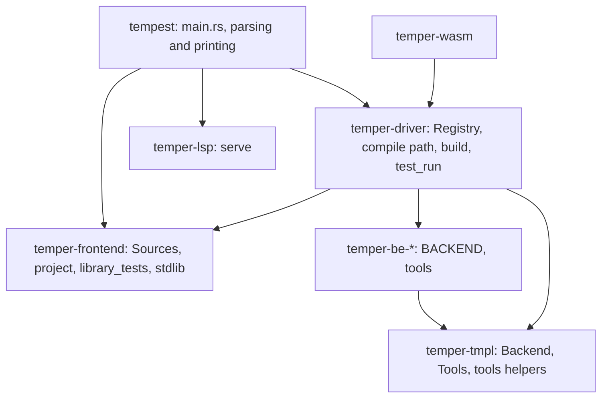
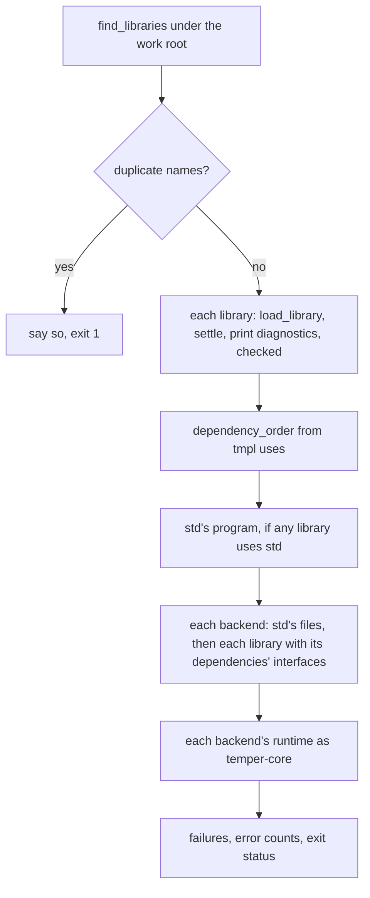
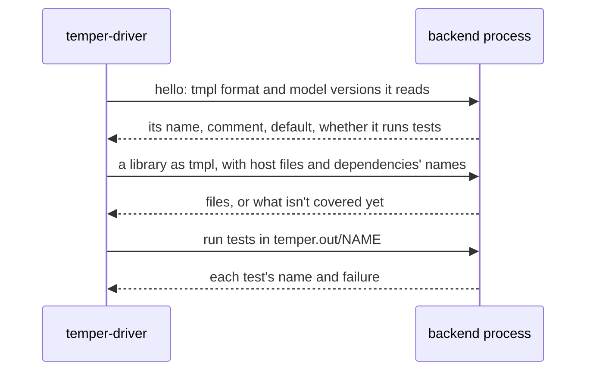

# The tempest command in detail

The `tempest` command is what people run: `build`, `test`, `run`,
`init`, `serve` (or `lsp`), and the rest of Kotlin Temper's `temper`
commands it has. It's a thin layer of argument parsing and
output over library crates that do the work, chiefly `temper-driver`,
which holds the registry of backends, the compile path from a settled
library to each backend's files, `build`, and running tests with each
language's tools. This page is the long companion to
[7. The tempest command](../07-cli.md): the decisions behind each part,
with what they cost, the main types and functions, the tests that pin
them, and what's weak or planned.

## Contents

- [Where it sits](#where-it-sits)
- [Decisions](#decisions)
  - [A thin command over library crates](#a-thin-command-over-library-crates)
  - [Kotlin's commands and flags, parsed by hand](#kotlins-commands-and-flags-parsed-by-hand)
  - [Exit codes](#exit-codes)
  - [Not in tempest yet, said plainly](#not-in-tempest-yet-said-plainly)
  - [One Sources value for every read](#one-sources-value-for-every-read)
  - [Finding libraries as Kotlin does, ignore files as git does](#finding-libraries-as-kotlin-does-ignore-files-as-git-does)
  - [Configs read, not run](#configs-read-not-run)
  - [std built into the binary](#std-built-into-the-binary)
  - [A registry built at startup, from cargo features](#a-registry-built-at-startup-from-cargo-features)
  - [A backend is a struct of function pointers](#a-backend-is-a-struct-of-function-pointers)
  - [One compile path](#one-compile-path)
  - [Each library settled on its own, with what it imports](#each-library-settled-on-its-own-with-what-it-imports)
  - [Kotlin's output layout](#kotlins-output-layout)
  - [Errors never stop a command](#errors-never-stop-a-command)
  - [Tests on the interpreter by default](#tests-on-the-interpreter-by-default)
  - [Each language's own tools, without package managers where possible](#each-languages-own-tools-without-package-managers-where-possible)
  - [JSON records in Kotlin's shape](#json-records-in-kotlins-shape)
  - [The crates' licenses, kept current by a test](#the-crates-licenses-kept-current-by-a-test)
  - [OS calls in one crate, the only unsafe code](#os-calls-in-one-crate-the-only-unsafe-code)
- [The commands, step by step](#the-commands-step-by-step)
  - [build](#build)
  - [test on the interpreter](#test-on-the-interpreter)
  - [test -b BACKEND](#test--b-backend)
  - [run](#run)
  - [init](#init)
  - [serve, or lsp](#serve-or-lsp)
- [Main types and functions](#main-types-and-functions)
- [Dynamic backends (planned)](#dynamic-backends-planned)
- [Parity with Kotlin's temper](#parity-with-kotlins-temper)
- [Tests](#tests)
- [Known weaknesses and planned changes](#known-weaknesses-and-planned-changes)

## Where it sits

Three crates share the work the command exposes:

- [`temper-frontend`](../../../crates/temper-frontend/src/lib.rs) reads
  sources ([`Sources`](../../../crates/temper-frontend/src/sources.rs)),
  finds and loads libraries
  ([`project`](../../../crates/temper-frontend/src/project.rs)), holds
  std ([`stdlib`](../../../crates/temper-frontend/src/stdlib.rs)), and
  runs tests on the interpreter
  ([`library_tests`](../../../crates/temper-frontend/src/library_tests.rs)).
- [`temper-driver`](../../../crates/temper-driver/src/lib.rs) knows the
  backends: the [`Registry`](../../../crates/temper-driver/src/lib.rs),
  the compile path, [`build`](../../../crates/temper-driver/src/build.rs),
  and [`test_run`](../../../crates/temper-driver/src/test_run.rs).
- [`tempest`](../../../crates/tempest/src/main.rs) parses arguments,
  picks `Sources`, calls the others, and prints.

## Decisions

### A thin command over library crates

**Chosen:** `main.rs` only parses and prints. Everything a tool could
reuse lives in a library crate: `temper-driver` for the backends,
`temper-lsp` for the server, `temper-frontend` for libraries and the
interpreter's tests. The split came in a300d3b, when the playground's
wasm needed the same compile path as `build`.

**Alternatives:** keep it all in the `tempest` crate (as it was), or one
big "tooling" crate like Kotlin's.

**Pros:** the wasm, the language server, and tests call the same code as
the command, without a process in between. The driver's dependency on
each backend is a cargo feature, so a build without some backends is one
flag. The command's own code is about 450 lines.

**Cons:** the line isn't clean yet. Running tests on the interpreter
([`test_libraries`](../../../crates/temper-frontend/src/library_tests.rs))
is in the frontend, and running them with a backend in the driver
([`test_backend`](../../../crates/temper-driver/src/test_run.rs)); the
command loops over backends and sums their tallies. `watch` would need
both, and that loop.

**Kotlin:** `cli` parses (kotlinx-cli's `ArgParser`, one `Subcommand`
each), `tooling`'s `BuildHarness` and `Watcher` run builds, and each
`be-*` module runs its tools through `be`'s `CliTool` and `Specifics`.
Much the same layering, with more of it.

**Status:** tempest's choice.

### Kotlin's commands and flags, parsed by hand

**Chosen:** Kotlin's command names, flags, short forms, and defaults
(`-w`, `-ign`, `-b` repeated, `--library`, `--no-connected`, `-v`,
`--logformat`, `-o`), so a script that runs `temper` runs `tempest`
([the command line](../../tools/cli.md)). One small parser
([`parse`](../../../crates/tempest/src/main.rs)) reads every command's
arguments into a [`Flags`](../../../crates/tempest/src/main.rs), each
command saying which options it takes; `--flag=value` works too. Help
text is in [`help.rs`](../../../crates/tempest/src/help.rs).

**Alternatives:** clap; or the loop per command that tempest had,
which repeated `--std` and `-b` handling three times.

**Pros:** no dependency, in line with the dependency policy
([notes/code-style.md](../../../notes/code-style.md#dependencies)); the
small binary stays small and builds fast. One table of options means
`-w` means the same everywhere.

**Cons:** the help text is written by hand, so it can drift from what
`parse` takes (the `help` test checks each command's flags are named).
Kotlin's `kotlinx-cli` also generates `--help` from the options.

**Differences kept:** tempest's `test` takes a positional `DIR`, where
the search for the work root starts, beside Kotlin's `-w`; `test`
defaults to the interpreter; `build` and `run` take `-o DIR`, which
Kotlin's `build` lacks; `--std DIR` is tempest's own; and `--version`
works, as Kotlin's doesn't. Each is in
[the command line](../../tools/cli.md).

**Status:** design.md asks for Kotlin's "flags and output formats, so
scripts keep working"
([notes/design.md](../../../notes/design.md#11-cli-watch-and-language-server));
met for the commands tempest has ([parity](#parity-with-kotlins-temper)).

### Exit codes

**Chosen:** 0 for success, 1 for failure (errors in the code, a failed
or unrun test, a library that didn't build), 2 for a usage error, and 3
for what isn't in tempest yet ([below](#not-in-tempest-yet-said-plainly)).
A backend name that exists but wasn't built in is 1, with "built
without the X backend"; an unknown one is 2
([`backend`](../../../crates/tempest/src/main.rs)).

**Kotlin:** 0 or 1 (`GENERIC_ERROR_EXIT_CODE`), and 127 for a usage
error, kotlinx-cli's, which shells otherwise use for "command not
found"; tempest keeps 2, as most Unix tools do
([notes/kotlin-differences.md](../../../notes/kotlin-differences.md)).

A panic, a bug in tempest, is 101, as Rust's own panics exit:
[`main`](../../../crates/tempest/src/main.rs) runs the command on a
thread with a 64 MiB stack, and a panicked thread, its message already
printed by the panic hook, ends there with a line saying it's a bug to
report. That needs unwinding: the `small` profile, which the released
binaries and the VS Code packages are built with, unwinds as release
does (since 2026-11-09; before, it aborted and the process died with
SIGABRT). The wasm still aborts, built with a profile of its own,
`small-wasm`, since wasm32-unknown-unknown can't unwind.

**Status:** tempest's choice.

### Not in tempest yet, said plainly

**Chosen:** Kotlin's commands that tempest lacks (`watch` and `doc`,
and `repl -b`), its backends (`cppv`, `data`, `java8`, and `mypyc`, listed as
[`NOT_YET`](../../../crates/temper-driver/src/lib.rs)), and `serve
--port` each say they aren't in tempest yet, what to do meanwhile, and
where to read more, and exit with 3. The old one-backend commands
(`tempest py FILE`) are gone, and their names say that `build -b py -o
DIR` does their work.

**Alternatives:** "no such command" (2), as for a typo; or `serve
--port` serving stdio anyway, which would leave a client that expects a
socket waiting.

**Pros:** a script can tell "not yet" from a failure or a typo, and a
person learns what to do.

**Status:** tempest's choice (2026-11-09).

### One Sources value for every read

**Chosen:** the compiler never touches the file system. Every read and
directory listing goes through one
[`Sources`](../../../crates/temper-frontend/src/sources.rs), a table of
layers, each a [`Source`](../../../crates/temper-frontend/src/sources.rs)
mounted at a path prefix: the disk, std built in, or files in memory.
A path goes to the layers with the longest prefix it's under; among
layers at one prefix, the first that has a file wins, and listings
merge. [`standard`](../../../crates/temper-frontend/src/sources.rs) is
the disk with std built in; [`with_std_dir`](../../../crates/temper-frontend/src/sources.rs)
mounts a directory at std's root instead (`--std DIR`);
[`memory`](../../../crates/temper-frontend/src/sources.rs) is for the
wasm and tests.

**Alternatives:** `std::fs` calls throughout, with the wasm and editors
special-cased.

**Pros:** the playground, the language server's unsaved buffers, and
tests are one more layer, not a second code path. Tests run on files in
memory without temporary directories.

**Cons:** paths are `/`-joined strings, not `Path`s, so Windows paths
are converted at the edges
([`slashed`](../../../crates/temper-frontend/src/project.rs)), and
`work_root` still calls `std::path::absolute` on what it's given, which
means little for a memory layer.

**Kotlin:** comparable. Its language server stacks a `MemoryFileSystem`
over a `RealFileSystem` in a `LayeredFileSystem`
(`ServerBuildManager.kt`).

**Status:** tempest's choice, from design.md §11.

### Finding libraries as Kotlin does, ignore files as git does

**Chosen:** from the directory given,
[`work_root`](../../../crates/temper-frontend/src/project.rs) takes the
nearest directory holding `temper.out`, or else the highest holding a
`config.temper.md`, or else the directory itself. Under it,
[`find_libraries`](../../../crates/temper-frontend/src/project.rs) makes
each directory with a `config.temper.md` a library, its `.temper` and
`.temper.md` files below it (but not under another library) its
sources, and its other files host code for `@connected` declarations.
It skips `temper.out`, `temper.keep`, dot-directories, and whatever
`.gitignore` and `.temperignore` files list: the work root's, those
below it, and those above it up to the git repository's root, read as
git reads them by tempest's own matcher
([`IgnoreFile`](../../../crates/temper-frontend/src/ignore.rs),
[`ignored`](../../../crates/temper-frontend/src/ignore.rs)), a
directory's `.temperignore` after its `.gitignore`. An ignore file named
by `--ignorefile` ([`ignore_file`](../../../crates/temper-frontend/src/project.rs))
has the last word on every path, its patterns relative to its own
directory, as Kotlin's are
([`find_libraries_ignoring`](../../../crates/temper-frontend/src/project.rs)).

**Alternatives:** Kotlin's rule, the one ignore file `--ignorefile`
names, or else the nearest `.gitignore` at or above the start; the
`ignore` crate.

**Pros:** what git ignores, tempest ignores, so a `node_modules` or a
build directory anywhere in the tree is skipped. No dependency.

**Cons:** it differs from Kotlin's on trees with nested ignore files,
and outside a git repository, where Kotlin still reads the nearest
`.gitignore` above. `--ignorefile` can't turn tempest's reading off;
`/dev/null` adds nothing, where in Kotlin it means no ignore file. The scan
reads every directory under the work root, every time; that's fine for
one command, but the language server repeats it on every pause
([page 9's detail](09-language-server.md#units-and-staying-current)).
Kotlin also builds files outside any library as one more library;
tempest leaves them out.

**Status:** the work-root rule and library names are Kotlin's
(`libraryNameFor`); the ignore-file reading is tempest's choice.

### Configs read, not run

**Chosen:** a library's `config.temper.md` is read line by line
([`Config`](../../../crates/temper-frontend/src/project.rs)): each
`export let KEY = "VALUE";` line is a setting. The name is the `name`
setting, or else the first line as a slug, or else the root's path, or
else `unnamed`, as Kotlin's `libraryNameFor` decides; two libraries of
one name stop the command
([`duplicate_names`](../../../crates/temper-frontend/src/project.rs)).

**Alternatives:** Kotlin's way: settle and run the config as Temper.

**Pros:** cheap and dependency-free; finding libraries needs no settling.

**Cons:** a config that computes a value, or spans lines, isn't
understood; nothing warns. Every library we know of writes plain lines.

**Status:** tempest's choice, a deliberate shortcut.

### std built into the binary

**Chosen:** std's sources are compiled in with `include_str!`
([`FILES`](../../../crates/temper-frontend/src/stdlib.rs)) under the
path prefix [`DIR`](../../../crates/temper-frontend/src/stdlib.rs),
`-std-`, which no library's files are likely to share. A test checks
that `FILES` lists every vendored file. `--std DIR` reads another copy.
For backends, std is also a library of its own
([`program`](../../../crates/temper-frontend/src/stdlib.rs)), settled
from [`MODULES`](../../../crates/temper-frontend/src/stdlib.rs) once per
`build` and translated once per backend.

**Pros:** one file to install; the wasm gets std the same way.

**Cons:** a library's own imports of std's modules settle again inside
it, every time, as any import does
([below](#each-library-settled-on-its-own-with-what-it-imports)).

**Kotlin:** keeps std as resources inside its jar
(`frontend/src/commonMain/resources/std/`), so it's built in there too.

### A registry built at startup, from cargo features

**Chosen:** [`Registry::built_in`](../../../crates/temper-driver/src/lib.rs)
makes a `Vec<&'static Backend>` of each backend crate's `BACKEND`, one
per cargo feature (`cpp`, `csharp`, `java`, `js`, `lua`, `py`, `rust`),
all on by default. [`KNOWN`](../../../crates/temper-driver/src/lib.rs)
lists every name, built in or not, so a build without one can say so
([`lacks`](../../../crates/temper-driver/src/lib.rs)).
[`defaults`](../../../crates/temper-driver/src/lib.rs) gives what
`build` writes without `-b`: each backend's `default` flag, all but C++,
as Kotlin's defaults.

**Alternatives:** a `const` array; a `match` on names in the command
(as before the split); discovery at run time.

**Pros:** one list, in one place, read by `build`, `test -b`, `run`,
and the wasm. Being a `Vec` built at startup, not a
fixed table, it can later take backends found at run time
([below](#dynamic-backends-planned)). The frontend and tmpl never list
backends.

**Cons:** `KNOWN` is a second list, kept by hand, and the wasm numbers
backends by it in one call and by the registry in others
([page 8's detail](08-playground.md#the-wasm-api)).

**Kotlin:** a JSON list of JVM class names (`plugin-list.json`, made by
Gradle, with proprietary backends added from submodules), loaded
reflectively, and changeable with the `TEMPER_PLUGINS` environment
variable (`supported-backends/SupportedBackends.kt`).

**Status:** tempest's choice; that backends are pluggable and the
frontend never lists them is in [notes/design.md](../../../notes/design.md).

### A backend is a struct of function pointers

**Chosen:** a backend is a [`Backend`](../../../crates/temper-tmpl/src/backend.rs)
value: its name, its line comment, its runtime's files, its naming rules,
`translate` (a `fn`), whether it's a default, and optionally its
[`Tools`](../../../crates/temper-tmpl/src/backend.rs): `prepare` and
`test`, two more `fn`s. Each backend crate exports one as a `const`.

**Alternatives:** a `Backend` trait with `dyn` objects.

**Pros:** a `const` needs no allocation or registration code; fields
can differ by target (no runtime and no tools in wasm) with `cfg!`;
and it's plain data, easy to read.

**Cons:** `&'static` everywhere, and `fn` pointers carry no state, so a
backend that lives in another process can't be one of these as is. The
naming rules are Rust data the driver applies itself
([`interface`](../../../crates/temper-driver/src/lib.rs)), which an
outside backend couldn't provide.

**Status:** tempest's choice (7aba29c, "Describe each backend once").

### One compile path

**Chosen:** from a settled library to files, every caller uses the
driver's functions:

- [`checked`](../../../crates/temper-driver/src/lib.rs): `to_tmpl`,
  then [`validate`](../../../crates/temper-tmpl/src/validate.rs) against
  the full profile, so a translation bug is caught before any backend;
- [`with_std`](../../../crates/temper-driver/src/lib.rs): if the
  program uses std ([`uses_std`](../../../crates/temper-driver/src/lib.rs)),
  std's [`interface`](../../../crates/temper-driver/src/lib.rs) for the
  backend, so the library spells std's names as std's own naming gives
  them; std's program is asked for only then;
- [`translate`](../../../crates/temper-driver/src/lib.rs): the backend's
  `translate`, with a source-map prefix
  ([`sources_prefix`](../../../crates/temper-driver/src/lib.rs)) where
  files are written.

**Pros:** `build` and the playground give the same output for the same
library.

**Cons:** `build` doesn't call `with_std`; it sets `interfaces` itself,
std's first and then each dependency's, in dependency order. The
effect is the same, but it's a second spelling of the step. A single
`compile(program, backend, dependencies)` would serve all three.
Validation runs on every library, every time, but not on std's program,
which `build` takes from `stdlib::program` directly.

### Each library settled on its own, with what it imports

**Chosen:** each library is loaded
([`load_library`](../../../crates/temper-frontend/src/project.rs)) with
the files of every module it imports, from std or from other libraries
of its work root ([`load_imports`](../../../crates/temper-frontend/src/project.rs)),
and settled as one. Its tmpl's `uses` sections then say what it uses of
each other library, with that library's version from its config, and
`build` orders the libraries by them (`dependency_order`), so each
backend names a library with its dependencies' interfaces.

**Alternatives:** settle each library once and hand importers its
exported interface; this is the plan
([notes/library-cache.md](../../../notes/library-cache.md)).

**Pros:** simple, and correct for every library we test with; nothing
is cached, so nothing can be stale.

**Cons:** the audit's top architecture finding. A library is settled
again inside each library that imports it, so cost grows with import
depth, and its diagnostics are found again in each. A command reports
each once, under the library whose file it's in
([`Reported`](../../../crates/temper-frontend/src/library_tests.rs),
by file, span, and message), and a library's `N errors` line counts
only its own; before 2026-11-09 each importer printed and counted them
again under its own name. The interpreter's tests drop imported libraries' tests
by matching module directories to library roots
([`library_of`](../../../crates/temper-frontend/src/project.rs)), and
`to_tmpl` works out which declarations belong to which library from
paths too. Std's imported modules settle again in each library, the same
way.

**Planned:** settle each library once (the library cache), which also
lets the language server re-analyze less.

### Kotlin's output layout

**Chosen:** `temper.out/BACKEND/LIBRARY/…`, each backend's layout and
package files as Kotlin writes them (`pyproject.toml`, `Cargo.toml`,
`package.json`, `pom.xml`, the `.csproj`s, a rockspec), std's output
beside the libraries as `std`, and the runtime as `temper-core`, copied
from the backend's `runtime` files. A library's directory is emptied
first, so no stale file survives a rename. C++ also gets a
`CMakeLists.txt` per library, which Kotlin doesn't write.

**Pros:** what's built can replace Kotlin's output, and tests compare
them file by file ([Tests](#tests)).

**Cons:** the runtime files say `0.6.0` but carry tempest's patches, so
packages need runtime API that the published `0.6.0` lacks (the audit's
A1). Emptying a directory is the one destructive step; it's limited to
the library's own directory under `temper.out`.

**Status:** Kotlin's layout is part of the public API tempest keeps
([notes/api-compat.md](../../../notes/api-compat.md), each backend's
"Layout").

### Errors never stop a command

**Chosen:** every error is reported, the code is still translated and
written (each error becomes tmpl's `Error`, which fails where it runs),
and tests still run; a test fails only if it reaches an error. The exit
status is 1 whenever there were errors. What tmpl doesn't cover yet
fails that library, with the first reason (`LIBRARY: BACKEND: why`), and
with `--verbose` every gap ([`gaps`](../../../crates/temper-frontend/src/to_tmpl.rs)).

**Kotlin:** the same for build and test (92f1d04 matched it); tempest
goes further in type errors, which run where the language allows
(4272843).

**Status:** Kotlin's behavior; see
[notes/kotlin-differences.md](../../../notes/kotlin-differences.md) for
where tempest keeps more local.

### Tests on the interpreter by default

**Chosen:** `tempest test` without `-b` runs tests on the interpreter,
in process, writing no files; `-b interp` names it, as Kotlin's does.

**Kotlin:** `temper test` requires `-b`.

**Pros:** the edit-and-test loop takes milliseconds, not a package
build.

**Cons:** the interpreter needs limits a language's own runner would
not: each test gets a step budget, `--fuel N` (10 billion by default,
[`TEST_FUEL`](../../../crates/temper-frontend/src/interp.rs); `none`
for no limit), and fails alone when it runs out; what tests log is kept
up to 64 KiB, then a note. Kotlin's `temper test` has neither; tempest
adds them so a runaway test fails rather than filling memory
([page 4's detail](04-interpreter.md#limits-fuel-call-depth-and-nesting)).

### Each language's own tools, without package managers where possible

**Chosen:** `test -b BACKEND` builds as `build` does, then runs each
library's tests with what that backend's `tools` module says
([notes/test-speed.md](../../../notes/test-speed.md#tempest-test--b)):

| Backend | Runs | Overridden by |
|---|---|---|
| C++ | CMake on the generated `CMakeLists.txt`, then the test program | `CMAKE`, `CXX` |
| C# | `dotnet test --logger:junit`, then `build-server shutdown` | `DOTNET` |
| Java | `javac` against JUnit 5's jars in `~/.m2`, and a small launcher runner | `JAVAC`, `JAVA` |
| JS | Mocha with its xunit reporter, packages linked into `node_modules` (`prepare`) | `MOCHA` |
| Lua | `tests/init-test.lua` with LuaUnit written beside (`prepare`) | `LUA` |
| Python | `python3 -B -m temper_core.testing result.xml` | `PYTHON` |
| Rust | `cargo test --offline`, one shared target directory | `CARGO` |

Results come back as JUnit XML where the tool writes it
([`junit_file`](../../../crates/temper-tmpl/src/tools.rs), [`junit`](../../../crates/temper-tmpl/src/tools.rs)),
or from `cargo test`'s lines, into the same
[`Tally`](../../../crates/temper-frontend/src/library_tests.rs) as the
interpreter's, so both print alike.

**Alternatives:** Kotlin's package path: Maven, `dotnet`, npm, pip, and
cargo on each package.

**Pros:** works offline; Java doesn't need Maven's network; failures
read the same on every backend.

**Cons:** it isn't what users' package managers do, so a broken package
file can pass here (the plan keeps the package path in CI to catch that;
not built yet). Java needs JUnit's jars already in `~/.m2`. No tool run
has a timeout, so a generated test that hangs hangs the command. Only a
tool's last 40 lines are kept for "no results". The functional tests in
each backend crate mostly run their own commands, not these (audit F3).
And the helpers (process running, JUnit) live in `temper-tmpl`, the IR
crate, because every backend crate depends only on it; a small
`temper-backend` crate would be tidier (audit B6). Kotlin's `be` mixes
these too.

**Status:** tempest's choice, from the test-speed proposal; the fast
paths there (one process per backend, cached runtimes) aren't built.

### JSON records in Kotlin's shape

**Chosen:** `--logformat json` writes Kotlin's records
([`log`](../../../crates/temper-frontend/src/log.rs)): `level`,
`template`, `pos` (the file, and start and end in UTF-16 code units,
as Kotlin's JVM strings count), and `values`, a line each, all on
stderr, ending with `{ "task": "Build", "ok": false }`. The tests'
records (`TestFailed`, `TestSummaryAllRun`, …) are Kotlin's, with its
values. tempest adds `message`, the text it would print.

**Cons:** a diagnostic's `template` is tempest's
[`Message`](../../../crates/temper-frontend/src/library.rs) variant
(`UndeclaredName`, where Kotlin says `BecauseNameUndeclared`), and its
`values` are empty, since tempest keeps a diagnostic's text, not its
arguments. Tools that key on Kotlin's template names need a table.

### The crates' licenses, kept current by a test

**Chosen:** `tempest licenses` prints
[`licenses.txt`](../../../crates/tempest/src/licenses.txt), which
[`licenses.rs`](../../../crates/tempest/tests/licenses.rs) makes
from `cargo metadata`: every crate `tempest` reaches through normal
dependencies on any platform, but not proc macros or build
dependencies, each with its license and repository, and its copyright
lines where it offers MIT or Apache-2.0 (whose texts `tempest license`
prints), or its license files in full otherwise. The test fails when
the file is stale; `UPDATE_SNAPSHOTS=1` rewrites it.

**Alternatives:** a build script, which would need `cargo metadata` (or
the registry's files) on every build, offline; Kotlin's Gradle task,
which scans the jars of an installed build.

**Cons:** the list is a union over platforms, marked "Some platforms
only" where it is; and it adds about 32 KB to the binary, with the
license texts another 50 KB.

### OS calls in one crate, the only unsafe code

**Chosen:** the calls std lacks are
[`temper-os`](../../../crates/temper-os/src/lib.rs)'s, each behind a
small safe function: tools' children in process groups, killed on
SIGINT, SIGTERM, or SIGHUP, with Linux's parent-death signal and
memory limit (`process`); the REPL's Ctrl-C (`interrupt`); Windows'
console (`console`); and the history file's `openat` and `geteuid`
(`fs`). It calls `libc` on Unix and `windows-sys` on Windows, and
nothing on wasm. Every other crate takes the workspace's lints, which
forbid unsafe code; `temper-wasm` denies it but for its exports'
`no_mangle`. In `temper-os`, clippy wants one unsafe operation per
block, each with a `// SAFETY:` comment, and signal handlers sit
beside the code that installs them.
[`unsafe_inventory.rs`](../../../crates/temper-os/tests/unsafe_inventory.rs)
counts the `unsafe` keyword in every Rust file in the repository
against a list, so adding or removing some fails it until the list
changes too.

**Alternatives:** a module in `temper-tmpl` or `tempest` (each needs
some of the calls, and `temper-tmpl` can't depend on `tempest`, so one
crate's module would serve the other across a boundary it shouldn't
have); crates such as `nix` or `ctrlc` (more code than the dozen calls
need); hand-written `extern` declarations, as before (types and
constants by hand, unchecked per platform).

**Exempt:** `vendor/temper/`'s Rust runtime, whose one unsafe read
(`cast`, after a `TypeId` check) is Temper's own, synced unchanged and
built apart from the workspace; it's in the inventory, so a sync that
changes it shows. The other backends' runtimes aren't Rust.

**Cons:** `temper-tmpl` now has a dependency, though none on wasm.

## The commands, step by step

### build

[`build`](../../../crates/temper-driver/src/build.rs) takes `Sources`,
the work root, the backends, [`Options`](../../../crates/temper-driver/src/build.rs)
(`verbose`, `no_connected`), and two writers, and gives a
[`Built`](../../../crates/temper-driver/src/build.rs): each library's
result per backend, each library's test count, and error counts.
`Built::ok` is the exit status. A library's program also takes its
config's version, its dependencies' versions, and its host files, with
`--no-connected` choosing Temper implementations over host code.

### test on the interpreter

[`test_dir`](../../../crates/temper-frontend/src/library_tests.rs)
finds libraries as `build` does, then for each,
[`test_library`](../../../crates/temper-frontend/src/library_tests.rs)
settles it, drops tests of imported libraries, and
[`run_settled_tests`](../../../crates/temper-frontend/src/library_tests.rs)
runs them, each with `--fuel` steps, reading the JUnit report that std's `testing` writes back
with [`parse_junit`](../../../crates/temper-frontend/src/library_tests.rs)
into a [`LibraryTests`](../../../crates/temper-frontend/src/library_tests.rs).
Diagnostics not yet reported print first
([`Reported`](../../../crates/temper-frontend/src/library_tests.rs)).
Only failures print, unless `-v`, which adds every test with the steps
it took (`ok      name (1234 steps)`), then Kotlin's summary,
`Tests passed: N of M`, with "not run" and "unexpected" counts
([`Tally::summary`](../../../crates/temper-frontend/src/library_tests.rs)).

### test -b BACKEND

[`test_backend`](../../../crates/temper-driver/src/test_run.rs) builds for one backend,
counts tests of libraries that didn't build as not run, and calls
[`run`](../../../crates/temper-driver/src/test_run.rs) in `test_run`,
which runs the backend's `prepare` once and its `test` per library with
tests, as [`Tested`](../../../crates/temper-tmpl/src/backend.rs) values.
A library whose tool gives no results fails, with the tool's output.

### run

[`run`](../../../crates/temper-driver/src/run.rs) in `run` builds every
library for the backend, as `build` does, then the backend's `prepare`
and its [`Tools`](../../../crates/temper-tmpl/src/backend.rs)' `run` on
the library named: Python imports its package after
`init_simple_logging()`, as Kotlin's `top.py` does; Node imports its
module; Lua runs its `init.lua`; Rust (`cargo build`), C++ (CMake's
`LIBRARY-main`), Java (`javac`), and C# (`dotnet build`) build quietly,
then run the program. The program gets the command's own standard
output and error. With `-b interp`, it settles the library and runs its
top level on the interpreter, with no step limit, printing each line as
it's logged ([`run_streaming`](../../../crates/temper-frontend/src/interp.rs)).

### init

[`init`](../../../crates/temper-driver/src/init.rs) writes Kotlin's two
files, word for word: the library's name is the directory's, through
Kotlin's `IdentStyle.Camel` to `Dash` conversion
([`dash_case`](../../../crates/temper-tmpl/src/naming.rs)) and its
`DashedIdentifier` rules
([`dashed_from`](../../../crates/temper-frontend/src/project.rs)), and
the titles come from that name
([`dashed_title`](../../../crates/temper-tmpl/src/naming.rs)), so
`a-b` is titled `AB`, as Kotlin's is. The message goes to stdout, where
Kotlin's console writes it to stderr.

### serve, or lsp

[`serve`](../../../crates/tempest/src/main.rs) hands stdin and stdout to
[`serve`](../../../crates/temper-lsp/src/lib.rs), with `--std DIR` if
given; [page 9's detail](09-language-server.md) covers the rest.

## Main types and functions

| Item | Where | What |
|---|---|---|
| [`Registry`](../../../crates/temper-driver/src/lib.rs) | driver | The backends this run has: `built_in`, `all`, `get`, `defaults`, `lacks` |
| [`KNOWN`](../../../crates/temper-driver/src/lib.rs) | driver | Every backend's name, alphabetically |
| [`Backend`](../../../crates/temper-tmpl/src/backend.rs) | tmpl | A backend as tools see it |
| [`Tools`](../../../crates/temper-tmpl/src/backend.rs), [`Prepare`](../../../crates/temper-tmpl/src/backend.rs), [`TestResults`](../../../crates/temper-tmpl/src/backend.rs) | tmpl | How a backend runs tests |
| [`OutFile`](../../../crates/temper-tmpl/src/backend.rs) | tmpl | A generated file: path and text |
| [`checked`](../../../crates/temper-driver/src/lib.rs), [`with_std`](../../../crates/temper-driver/src/lib.rs), [`translate`](../../../crates/temper-driver/src/lib.rs) | driver | The compile path |
| [`build`](../../../crates/temper-driver/src/build.rs), [`Options`](../../../crates/temper-driver/src/build.rs), [`Built`](../../../crates/temper-driver/src/build.rs), [`error_count`](../../../crates/temper-driver/src/build.rs) | driver | `tempest build` |
| [`test_backend`](../../../crates/temper-driver/src/test_run.rs), [`run`](../../../crates/temper-driver/src/test_run.rs) | driver | Tests with a backend's tools |
| [`run`](../../../crates/temper-driver/src/run.rs) | driver | `tempest run` |
| [`init`](../../../crates/temper-driver/src/init.rs), [`library_name`](../../../crates/temper-driver/src/init.rs) | driver | `tempest init` |
| [`NOT_YET`](../../../crates/temper-driver/src/lib.rs) | driver | Kotlin's backends tempest lacks |
| [`Flags`](../../../crates/tempest/src/main.rs), [`parse`](../../../crates/tempest/src/main.rs), [`COMMANDS`](../../../crates/tempest/src/help.rs) | tempest | Options, and the commands `help` lists |
| [`LogFormat`](../../../crates/temper-frontend/src/log.rs), [`record`](../../../crates/temper-frontend/src/log.rs) | frontend | `--logformat` and JSON records |
| [`tool`](../../../crates/temper-tmpl/src/tools.rs), [`output`](../../../crates/temper-tmpl/src/tools.rs), [`Case`](../../../crates/temper-tmpl/src/tools.rs) | tmpl | Finding and running tools, reading JUnit |
| [`Sources`](../../../crates/temper-frontend/src/sources.rs), [`Entry`](../../../crates/temper-frontend/src/sources.rs) | frontend | Where every read goes |
| [`LibrarySources`](../../../crates/temper-frontend/src/project.rs), [`Config`](../../../crates/temper-frontend/src/project.rs), [`CONFIG_FILE`](../../../crates/temper-frontend/src/project.rs) | frontend | A library found on disk |
| [`test_libraries`](../../../crates/temper-frontend/src/library_tests.rs), [`TestOptions`](../../../crates/temper-frontend/src/library_tests.rs), [`Tally`](../../../crates/temper-frontend/src/library_tests.rs), [`write_located_diagnostics`](../../../crates/temper-frontend/src/library_tests.rs) | frontend | Tests on the interpreter, the summary, and `path:line:column` diagnostics |

## Dynamic backends (planned)

The registry is a list built at startup so that backends not built in
can join it later. The plan: first as **external processes**, each given
a library as tmpl in a versioned, serialized form and answering with its
files (and running its tests), so a backend can live in its own
repository and language; **DLLs** only if processes prove too slow; the
**wasm** build keeps a fixed list. The user put this off on 2026-10-30
([notes/tmpl/overview.md](../../../notes/tmpl/overview.md)); nothing is
built.

**Why processes first:** a backend in any language, crash-isolated, with
no ABI to keep stable; tmpl's text form already reads back exactly and
starts with its versions (`tmpl 1 model 1`,
[`FORMAT_VERSION`](../../../crates/temper-tmpl/src/text/mod.rs)).
**Against:** start-up and serialization per library. **DLLs** would cut
that, at the price of a C ABI, unsafety, and one build per platform.
**Kotlin's** plugins are JVM classes on the class path, so they share its
process and its language.

What has to change first, found while writing this:

- **Naming.** The driver names each dependency's declarations with the
  backend's Rust [`NamingRules`](../../../crates/temper-tmpl/src/naming.rs)
  ([`interface`](../../../crates/temper-driver/src/lib.rs)). An outside
  backend must either name them itself, given its dependencies' tmpl,
  or send its rules as data.
- **What's not in tmpl's text.** A [`Program`](../../../crates/temper-tmpl/src/lib.rs)'s
  `host` (host files and `--no-connected`) and `interfaces` aren't
  written by tmpl's text form, so the protocol needs them beside it.
- **The descriptor.** `Registry` holds `&'static Backend` with `fn`
  pointers; a backend found at run time needs an owned descriptor and a
  way to call it.
- **Tools.** The `Tools` contract (results as names and failures) fits a
  process well; it would be the `test` message.

## Parity with Kotlin's temper

| Kotlin | tempest | Gap |
|---|---|---|
| `build` | `build` | Ignore files read differently ([above](#finding-libraries-as-kotlin-does-ignore-files-as-git-does)); JSON records' diagnostics name tempest's templates ([above](#json-records-in-kotlins-shape)); adds `-o DIR` |
| `test -b …` | `test [-b …]… [DIR]` | Defaults to the interpreter; adds `DIR`, where the work root's search starts; prints each backend's summary before Kotlin's total |
| `run` | `run` | Streams the program's output to stdout, where Kotlin prints it afterwards on stderr (twice on the interpreter); adds `-ign` and `-o` |
| `init` | `init` | None: the same files, byte for byte; its message on stdout |
| `serve --port N` | `serve`, `lsp` | stdio, not a TCP port the client opens (`--port` says so); no semantic tokens ([page 9's detail](09-language-server.md#kotlins-language-server)) |
| `version`, `license`, `licenses`, `help` | the same | `licenses` lists Rust crates; `--version` too |
| `watch` | says it's not yet | Planned: a loop around `build` or `test` ([page 8's detail](08-playground.md#watch-planned)) |
| `repl` | `repl` | One growing module settled an input at a time ([the REPL](../../tools/repl.md)); no line editing, `describe`, `translate`, `help`, or `-b` yet |
| `doc` | says it's not yet | Documentation for the libraries |
| backends `cppv`, `data`, `java8`, `mypyc` | say they're not yet | Variants and `data` files tmpl's backends don't cover |

`watch`, the rest of `repl`, and doc generation are still to come.

## Tests

- **The command line**, [`cli.rs`](../../../crates/tempest/tests/cli.rs):
  usage errors and exit codes (`usage`, `backends_left_out`, `not_yet`);
  `help`, `version`, and `license_and_licenses`; each backend's files
  under `-o DIR` (`build_writes_each_backend_to_a_directory`);
  `logformat_json`'s records; `init_writes_kotlins_skeleton`, against
  Kotlin's files; `run_a_library` on the interpreter and each backend
  whose tools are here; `test_flags` (`-w`, `--library`, several `-b`,
  `--ignorefile`, and `.temperignore`); `test_fuel` (the audit's
  runaway loop failing at its budget, its output cut short; `--fuel`'s
  values); `imported_errors_are_reported_once` (the audit's
  scratch/deps: `test`, `test --library`, `run`, `build`, and JSON
  report an imported library's error once, under it); `build_writes_temper_out`,
  `build_reads_host_code`, `build_needs_libraries_with_names_of_their_own`;
  `test_a_library` and `built_in_std`; tests through each backend's tools
  on a small library (`test_a_library_on_each_backend`, skipped where a
  tool is missing unless `TEMPEST_REQUIRE_CHECKERS` is set);
  `tests_of_a_library_that_does_not_build_count`; and
  `errors_fail_only_where_they_run`.
- **`licenses`' currency**, [`licenses.rs`](../../../crates/tempest/tests/licenses.rs):
  the list against `cargo metadata`.
- **Unsafe code**, [`unsafe_inventory.rs`](../../../crates/temper-os/tests/unsafe_inventory.rs):
  where it is, and how much, against its list; every crate but two on
  the workspace's lints.
- **Kotlin's layout**, [`kotlin_layout.rs`](../../../crates/tempest/tests/kotlin_layout.rs):
  `temper.out` for the functional tests against a record of Kotlin's
  (`kotlin-out.txt`), with every allowed difference listed with its
  reason, and a check that each allowance is still used.
- **The driver**, [`dependencies.rs`](../../../crates/temper-driver/tests/dependencies.rs):
  a dependency on another library in each backend's package files;
  [`runtimes.rs`](../../../crates/temper-driver/tests/runtimes.rs): each
  built-in runtime is the vendored one.
- **The interpreter's tests**, [`library_tests.rs`](../../../crates/temper-frontend/tests/library_tests.rs):
  passing and failing tests, quiet output, the work root and skipped
  directories, `.gitignore` files, not-run tests and errors, std built
  in or from a directory, a library in memory, library names, imports
  between libraries, duplicate names, and runaway code
  (`runaway_tests_fail_alone`, `runaway_top_level_is_cut_short`).
- **JUnit reading**: unit tests in [`tools.rs`](../../../crates/temper-tmpl/src/tools.rs).
- **Real libraries**, nightly: each library in
  `.github/nightly-libraries.json` on the backends it passes on.

Not covered: Windows paths (CI is Linux), a tool that hangs, a config
that isn't plain lines, nested ignore files against Kotlin's reading,
and a panic's exit code (no input is known to panic).

## Known weaknesses and planned changes

- **Imported libraries settle again in each importer.** Their
  diagnostics are reported once, but found again in each; a diagnostic
  that reads differently in an importer's settle would print twice. The
  library cache fixes both.
- **Steps, not time:** `--fuel` bounds ops, not seconds, and backends'
  tests have no budget at all (see the next item).
- **No timeouts** on test tools.
- **Test orchestration in three crates**: the interpreter's in the
  frontend, a backend's in the driver, and the loop over backends in
  the command; one driver function for all would give `watch` one
  function to call.
- **Two spellings of the std step** (`with_std` and `build`'s own).
- **Tool helpers in `temper-tmpl`**, which could move to a small crate
  of their own.
- **Parity:** `watch` and `doc`; the REPL's line editing, functions,
  and `-b`; Kotlin's `cppv`, `data`,
  `java8`, and `mypyc` backends; `serve --port`.
- **Runtime version:** output names `temper-core` 0.6.0 but needs
  tempest's patched runtimes; a distinct pre-release version is one
  option.
- **Dynamic backends:** naming, host files, and the descriptor first
  ([above](#dynamic-backends-planned)).
