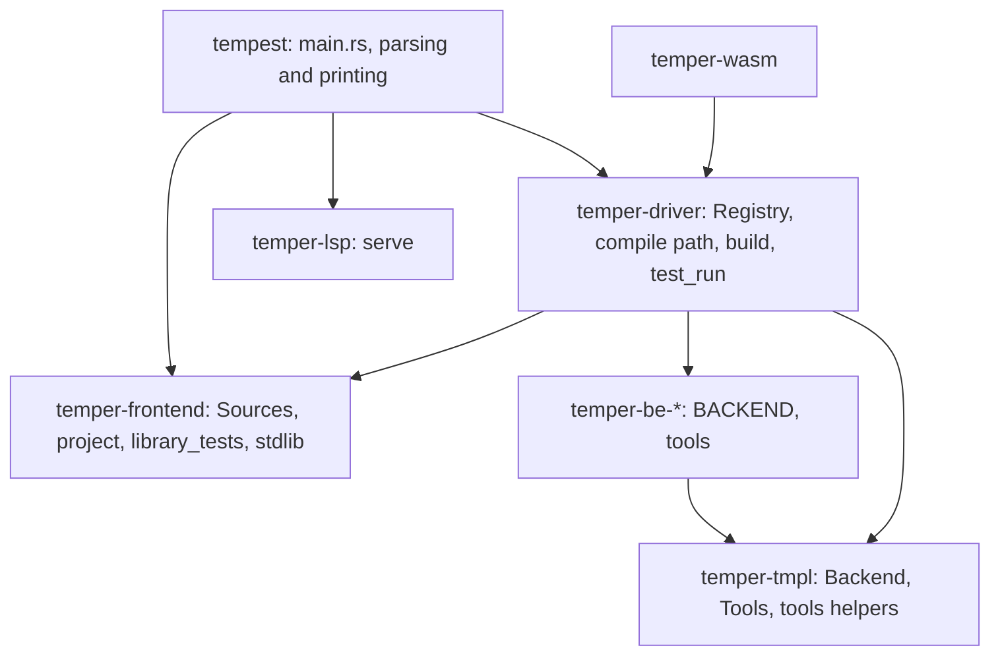
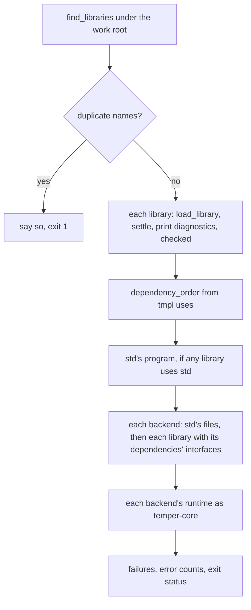
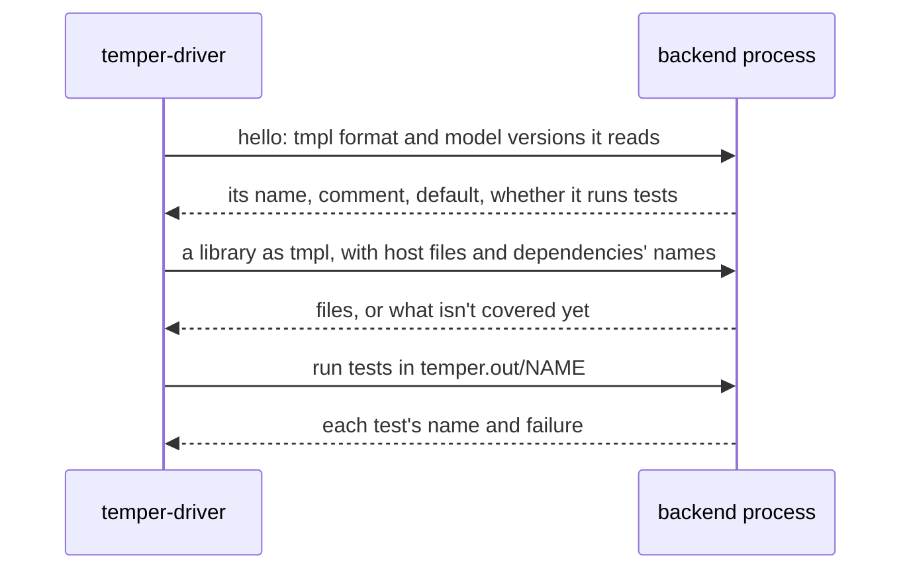

# The tempest command in detail

The `tempest` command is what people run: `build`, `test`, `lsp`, and
one command per backend. It's a thin layer of argument parsing and
output over library crates that do the work, chiefly `temper-driver`,
which holds the registry of backends, the compile path from a settled
library to each backend's files, `build`, and running tests with each
language's tools. This page is the long companion to
[7. The tempest command](../07-cli.md): the decisions behind each part,
with what they cost, the main types and functions, the tests that pin
them, and what's weak or planned.

## Contents

- [Where it sits](#where-it-sits)
- [Decisions](#decisions)
  - [A thin command over library crates](#a-thin-command-over-library-crates)
  - [Arguments parsed by hand](#arguments-parsed-by-hand)
  - [Exit codes](#exit-codes)
  - [One Sources value for every read](#one-sources-value-for-every-read)
  - [Finding libraries as Kotlin does, ignore files as git does](#finding-libraries-as-kotlin-does-ignore-files-as-git-does)
  - [Configs read, not run](#configs-read-not-run)
  - [std built into the binary](#std-built-into-the-binary)
  - [A registry built at startup, from cargo features](#a-registry-built-at-startup-from-cargo-features)
  - [A backend is a struct of function pointers](#a-backend-is-a-struct-of-function-pointers)
  - [One compile path](#one-compile-path)
  - [Each library settled on its own, with what it imports](#each-library-settled-on-its-own-with-what-it-imports)
  - [Kotlin's output layout](#kotlins-output-layout)
  - [Errors never stop a command](#errors-never-stop-a-command)
  - [Tests on the interpreter by default](#tests-on-the-interpreter-by-default)
  - [Each language's own tools, without package managers where possible](#each-languages-own-tools-without-package-managers-where-possible)
- [The commands, step by step](#the-commands-step-by-step)
  - [build](#build)
  - [test on the interpreter](#test-on-the-interpreter)
  - [test -b BACKEND](#test--b-backend)
  - [One backend's files](#one-backends-files)
  - [lsp](#lsp)
- [Main types and functions](#main-types-and-functions)
- [Dynamic backends (planned)](#dynamic-backends-planned)
- [Parity with Kotlin's temper](#parity-with-kotlins-temper)
- [Tests](#tests)
- [Known weaknesses and planned changes](#known-weaknesses-and-planned-changes)

## Where it sits

Three crates share the work the command exposes:

- [`temper-frontend`](../../../crates/temper-frontend/src/lib.rs) reads
  sources ([`Sources`](../../../crates/temper-frontend/src/sources.rs)),
  finds and loads libraries
  ([`project`](../../../crates/temper-frontend/src/project.rs)), holds
  std ([`stdlib`](../../../crates/temper-frontend/src/stdlib.rs)), and
  runs tests on the interpreter
  ([`library_tests`](../../../crates/temper-frontend/src/library_tests.rs)).
- [`temper-driver`](../../../crates/temper-driver/src/lib.rs) knows the
  backends: the [`Registry`](../../../crates/temper-driver/src/lib.rs),
  the compile path, [`build`](../../../crates/temper-driver/src/build.rs),
  and [`test_run`](../../../crates/temper-driver/src/test_run.rs).
- [`tempest`](../../../crates/tempest/src/main.rs) parses arguments,
  picks `Sources`, calls the others, and prints.

## Decisions

### A thin command over library crates

**Chosen:** `main.rs` only parses and prints. Everything a tool could
reuse lives in a library crate: `temper-driver` for the backends,
`temper-lsp` for the server, `temper-frontend` for libraries and the
interpreter's tests. The split came in a300d3b, when the playground's
wasm needed the same compile path as `build`.

**Alternatives:** keep it all in the `tempest` crate (as it was), or one
big "tooling" crate like Kotlin's.

**Pros:** the wasm, the language server, and tests call the same code as
the command, without a process in between. The driver's dependency on
each backend is a cargo feature, so a build without some backends is one
flag. The command's own code is about 450 lines.

**Cons:** the line isn't clean yet. Running tests on the interpreter
([`test_dir`](../../../crates/temper-frontend/src/library_tests.rs)) is
in the frontend, while running them with a backend is split between the
driver ([`run`](../../../crates/temper-driver/src/test_run.rs)) and the
command ([`test_on`](../../../crates/tempest/src/main.rs), which keeps
the tally of tests not run). `watch` would need both and copy that.

**Kotlin:** `cli` parses (kotlinx-cli's `ArgParser`, one `Subcommand`
each), `tooling`'s `BuildHarness` and `Watcher` run builds, and each
`be-*` module runs its tools through `be`'s `CliTool` and `Specifics`.
Much the same layering, with more of it.

**Status:** tempest's choice.

### Arguments parsed by hand

**Chosen:** each command parses its own arguments in a `while let` loop
over `args` ([`test`](../../../crates/tempest/src/main.rs),
[`build_command`](../../../crates/tempest/src/main.rs),
[`generate`](../../../crates/tempest/src/main.rs)), with one `USAGE`
text.

**Alternatives:** clap, or a small shared option parser.

**Pros:** no dependency, in line with the dependency policy
([notes/code-style.md](../../../notes/code-style.md#dependencies)); the
small binary stays small and builds fast; there are only a handful of
flags.

**Cons:** the three loops repeat `--std` and `-b` handling; no
`--flag=value`, no per-command help, no `--version`; and the flags drift
from Kotlin's (`test` takes a positional `DIR` where Kotlin's takes
`-w`). A parser shared by the commands would fix the first without a
crate.

**Status:** tempest's choice; design.md asks for Kotlin's "flags and
output formats, so scripts keep working"
([notes/design.md](../../../notes/design.md#11-cli-watch-and-language-server)),
which isn't met yet ([parity](#parity-with-kotlins-temper)).

### Exit codes

**Chosen:** 0 for success, 1 for failure (errors in the code, a failed
or unrun test, a library that didn't build), 2 for a usage error. A
backend name that exists but wasn't built in is 1, with "built without
the X backend"; an unknown one is 2 ([`named`](../../../crates/tempest/src/main.rs)).

**Kotlin:** 0 or 1 (`GENERIC_ERROR_EXIT_CODE`); bad arguments are
kotlinx-cli's to handle.

**Cons:** a panic is also 1. [`main`](../../../crates/tempest/src/main.rs)
runs the command on a thread with a 64 MiB stack and maps a panicked
thread to `ExitCode::FAILURE`, so a compiler bug looks like a failing
test to a script. And the released binaries are built with the `small`
profile, which sets `panic = "abort"`, so they don't reach that line at
all: a panic aborts the process.

**Status:** tempest's choice.

### One Sources value for every read

**Chosen:** the compiler never touches the file system. Every read and
directory listing goes through one
[`Sources`](../../../crates/temper-frontend/src/sources.rs), a table of
layers, each a [`Source`](../../../crates/temper-frontend/src/sources.rs)
mounted at a path prefix: the disk, std built in, or files in memory.
A path goes to the layers with the longest prefix it's under; among
layers at one prefix, the first that has a file wins, and listings
merge. [`standard`](../../../crates/temper-frontend/src/sources.rs) is
the disk with std built in; [`with_std_dir`](../../../crates/temper-frontend/src/sources.rs)
mounts a directory at std's root instead (`--std DIR`);
[`memory`](../../../crates/temper-frontend/src/sources.rs) is for the
wasm and tests.

**Alternatives:** `std::fs` calls throughout, with the wasm and editors
special-cased.

**Pros:** the playground, the language server's unsaved buffers, and
tests are one more layer, not a second code path. Tests run on files in
memory without temporary directories.

**Cons:** paths are `/`-joined strings, not `Path`s, so Windows paths
are converted at the edges
([`slashed`](../../../crates/temper-frontend/src/project.rs)), and
`work_root` still calls `std::path::absolute` on what it's given, which
means little for a memory layer.

**Kotlin:** comparable. Its language server stacks a `MemoryFileSystem`
over a `RealFileSystem` in a `LayeredFileSystem`
(`ServerBuildManager.kt`).

**Status:** tempest's choice, from design.md §11.

### Finding libraries as Kotlin does, ignore files as git does

**Chosen:** from the directory given,
[`work_root`](../../../crates/temper-frontend/src/project.rs) takes the
nearest directory holding `temper.out`, or else the highest holding a
`config.temper.md`, or else the directory itself. Under it,
[`find_libraries`](../../../crates/temper-frontend/src/project.rs) makes
each directory with a `config.temper.md` a library, its `.temper` and
`.temper.md` files below it (but not under another library) its
sources, and its other files host code for `@connected` declarations.
It skips `temper.out`, `temper.keep`, dot-directories, and whatever
`.gitignore` files list: the work root's, those below it, and those above
it up to the git repository's root, read as git reads them by tempest's
own matcher ([`IgnoreFile`](../../../crates/temper-frontend/src/ignore.rs),
[`ignored`](../../../crates/temper-frontend/src/ignore.rs)).

**Alternatives:** Kotlin's rule, the one ignore file `--ignorefile`
names, or else the nearest `.gitignore` at or above the start; the
`ignore` crate.

**Pros:** what git ignores, tempest ignores, so a `node_modules` or a
build directory anywhere in the tree is skipped. No dependency.

**Cons:** it differs from Kotlin's on trees with nested ignore files,
and there's no `--ignorefile` to match Kotlin's behavior. The scan
reads every directory under the work root, every time; that's fine for
one command, but the language server repeats it on every pause
([page 9's detail](09-language-server.md#units-and-staying-current)).
Kotlin also builds files outside any library as one more library;
tempest leaves them out.

**Status:** the work-root rule and library names are Kotlin's
(`libraryNameFor`); the ignore-file reading is tempest's choice.

### Configs read, not run

**Chosen:** a library's `config.temper.md` is read line by line
([`Config`](../../../crates/temper-frontend/src/project.rs)): each
`export let KEY = "VALUE";` line is a setting. The name is the `name`
setting, or else the first line as a slug, or else the root's path, or
else `unnamed`, as Kotlin's `libraryNameFor` decides; two libraries of
one name stop the command
([`duplicate_names`](../../../crates/temper-frontend/src/project.rs)).

**Alternatives:** Kotlin's way: settle and run the config as Temper.

**Pros:** cheap and dependency-free; finding libraries needs no settling.

**Cons:** a config that computes a value, or spans lines, isn't
understood; nothing warns. Every library we know of writes plain lines.

**Status:** tempest's choice, a deliberate shortcut.

### std built into the binary

**Chosen:** std's sources are compiled in with `include_str!`
([`FILES`](../../../crates/temper-frontend/src/stdlib.rs)) under the
path prefix [`DIR`](../../../crates/temper-frontend/src/stdlib.rs),
`-std-`, which no library's files are likely to share. A test checks
that `FILES` lists every vendored file. `--std DIR` reads another copy.
For backends, std is also a library of its own
([`program`](../../../crates/temper-frontend/src/stdlib.rs)), settled
from [`MODULES`](../../../crates/temper-frontend/src/stdlib.rs) once per
`build` and translated once per backend.

**Pros:** one file to install; the wasm gets std the same way.

**Cons:** a library's own imports of std's modules settle again inside
it, every time, as any import does
([below](#each-library-settled-on-its-own-with-what-it-imports)).

**Kotlin:** keeps std as resources inside its jar
(`frontend/src/commonMain/resources/std/`), so it's built in there too.

### A registry built at startup, from cargo features

**Chosen:** [`Registry::built_in`](../../../crates/temper-driver/src/lib.rs)
makes a `Vec<&'static Backend>` of each backend crate's `BACKEND`, one
per cargo feature (`cpp`, `csharp`, `java`, `js`, `lua`, `py`, `rust`),
all on by default. [`KNOWN`](../../../crates/temper-driver/src/lib.rs)
lists every name, built in or not, so a build without one can say so
([`lacks`](../../../crates/temper-driver/src/lib.rs)).
[`defaults`](../../../crates/temper-driver/src/lib.rs) gives what
`build` writes without `-b`: each backend's `default` flag, all but C++,
as Kotlin's defaults.

**Alternatives:** a `const` array; a `match` on names in the command
(as before the split); discovery at run time.

**Pros:** one list, in one place, read by `build`, `test -b`, the
one-backend commands, and the wasm. Being a `Vec` built at startup, not a
fixed table, it can later take backends found at run time
([below](#dynamic-backends-planned)). The frontend and tmpl never list
backends.

**Cons:** `KNOWN` is a second list, kept by hand, and the wasm numbers
backends by it in one call and by the registry in others
([page 8's detail](08-playground.md#the-wasm-api)).

**Kotlin:** a JSON list of JVM class names (`plugin-list.json`, made by
Gradle, with proprietary backends added from submodules), loaded
reflectively, and changeable with the `TEMPER_PLUGINS` environment
variable (`supported-backends/SupportedBackends.kt`).

**Status:** tempest's choice; that backends are pluggable and the
frontend never lists them is in [notes/design.md](../../../notes/design.md).

### A backend is a struct of function pointers

**Chosen:** a backend is a [`Backend`](../../../crates/temper-tmpl/src/backend.rs)
value: its name, its line comment, its runtime's files, its naming rules,
`translate` (a `fn`), whether it's a default, and optionally its
[`Tools`](../../../crates/temper-tmpl/src/backend.rs): `prepare` and
`test`, two more `fn`s. Each backend crate exports one as a `const`.

**Alternatives:** a `Backend` trait with `dyn` objects.

**Pros:** a `const` needs no allocation or registration code; fields
can differ by target (no runtime and no tools in wasm) with `cfg!`;
and it's plain data, easy to read.

**Cons:** `&'static` everywhere, and `fn` pointers carry no state, so a
backend that lives in another process can't be one of these as is. The
naming rules are Rust data the driver applies itself
([`interface`](../../../crates/temper-driver/src/lib.rs)), which an
outside backend couldn't provide.

**Status:** tempest's choice (7aba29c, "Describe each backend once").

### One compile path

**Chosen:** from a settled library to files, every caller uses the
driver's functions:

- [`checked`](../../../crates/temper-driver/src/lib.rs): `to_tmpl`,
  then [`validate`](../../../crates/temper-tmpl/src/validate.rs) against
  the full profile, so a translation bug is caught before any backend;
- [`with_std`](../../../crates/temper-driver/src/lib.rs): if the
  program uses std ([`uses_std`](../../../crates/temper-driver/src/lib.rs)),
  std's [`interface`](../../../crates/temper-driver/src/lib.rs) for the
  backend, so the library spells std's names as std's own naming gives
  them; std's program is asked for only then;
- [`translate`](../../../crates/temper-driver/src/lib.rs): the backend's
  `translate`, with a source-map prefix
  ([`sources_prefix`](../../../crates/temper-driver/src/lib.rs)) where
  files are written.

**Pros:** the one-backend commands, `build`, and the playground give the
same output for the same library.

**Cons:** `build` doesn't call `with_std`; it sets `interfaces` itself,
std's first and then each dependency's, in dependency order. The
effect is the same, but it's a second spelling of the step. A single
`compile(program, backend, dependencies)` would serve all three.
Validation runs on every library, every time, but not on std's program,
which `build` takes from `stdlib::program` directly.

### Each library settled on its own, with what it imports

**Chosen:** each library is loaded
([`load_library`](../../../crates/temper-frontend/src/project.rs)) with
the files of every module it imports, from std or from other libraries
of its work root ([`load_imports`](../../../crates/temper-frontend/src/project.rs)),
and settled as one. Its tmpl's `uses` sections then say what it uses of
each other library, with that library's version from its config, and
`build` orders the libraries by them (`dependency_order`), so each
backend names a library with its dependencies' interfaces.

**Alternatives:** settle each library once and hand importers its
exported interface; this is the plan
([notes/library-cache.md](../../../notes/library-cache.md)).

**Pros:** simple, and correct for every library we test with; nothing
is cached, so nothing can be stale.

**Cons:** the audit's top architecture finding. A library is settled
again inside each library that imports it, so cost grows with import
depth, and its errors are reported once per importer, under the
importer's name (`program` prints and counts every diagnostic of the
settled whole). The interpreter's tests drop imported libraries' tests
by matching module directories to library roots
([`library_of`](../../../crates/temper-frontend/src/project.rs)), and
`to_tmpl` works out which declarations belong to which library from
paths too. Std's imported modules settle again in each library, the same
way.

**Planned:** first, report each diagnostic once, under its own library;
then settle each library once (the library cache), which also lets the
language server re-analyze less.

### Kotlin's output layout

**Chosen:** `temper.out/BACKEND/LIBRARY/…`, each backend's layout and
package files as Kotlin writes them (`pyproject.toml`, `Cargo.toml`,
`package.json`, `pom.xml`, the `.csproj`s, a rockspec), std's output
beside the libraries as `std`, and the runtime as `temper-core`, copied
from the backend's `runtime` files. A library's directory is emptied
first, so no stale file survives a rename. C++ also gets a
`CMakeLists.txt` per library, which Kotlin doesn't write.

**Pros:** what's built can replace Kotlin's output, and tests compare
them file by file ([Tests](#tests)).

**Cons:** the runtime files say `0.6.0` but carry tempest's patches, so
packages need runtime API that the published `0.6.0` lacks (the audit's
A1). Emptying a directory is the one destructive step; it's limited to
the library's own directory under `temper.out`.

**Status:** Kotlin's layout is part of the public API tempest keeps
([notes/api-compat.md](../../../notes/api-compat.md), each backend's
"Layout").

### Errors never stop a command

**Chosen:** every error is reported, the code is still translated and
written (each error becomes tmpl's `Error`, which fails where it runs),
and tests still run; a test fails only if it reaches an error. The exit
status is 1 whenever there were errors. What tmpl doesn't cover yet
fails that library, with the first reason (`LIBRARY: BACKEND: why`), and
with `--verbose` every gap ([`gaps`](../../../crates/temper-frontend/src/to_tmpl.rs)).

**Kotlin:** the same for build and test (92f1d04 matched it); tempest
goes further in type errors, which run where the language allows
(4272843).

**Status:** Kotlin's behavior; see
[notes/kotlin-differences.md](../../../notes/kotlin-differences.md) for
where tempest keeps more local.

### Tests on the interpreter by default

**Chosen:** `tempest test` without `-b` runs tests on the interpreter,
in process, writing no files; `-b interp` names it, as Kotlin's does.

**Kotlin:** `temper test` requires `-b`.

**Pros:** the edit-and-test loop takes milliseconds, not a package
build.

**Cons:** no step limit: the interpreter's tests run with no fuel
(`test_library` passes `None`), and output collects in memory, so an
infinite loop with output grows until killed (the audit's D1). The
playground's wasm passes `FUEL`.

### Each language's own tools, without package managers where possible

**Chosen:** `test -b BACKEND` builds as `build` does, then runs each
library's tests with what that backend's `tools` module says
([notes/test-speed.md](../../../notes/test-speed.md#tempest-test--b)):

| Backend | Runs | Overridden by |
|---|---|---|
| C++ | CMake on the generated `CMakeLists.txt`, then the test program | `CMAKE`, `CXX` |
| C# | `dotnet test --logger:junit`, then `build-server shutdown` | `DOTNET` |
| Java | `javac` against JUnit 5's jars in `~/.m2`, and a small launcher runner | `JAVAC`, `JAVA` |
| JS | Mocha with its xunit reporter, packages linked into `node_modules` (`prepare`) | `MOCHA` |
| Lua | `tests/init-test.lua` with LuaUnit written beside (`prepare`) | `LUA` |
| Python | `python3 -B -m temper_core.testing result.xml` | `PYTHON` |
| Rust | `cargo test --offline`, one shared target directory | `CARGO` |

Results come back as JUnit XML where the tool writes it
([`junit_file`](../../../crates/temper-tmpl/src/tools.rs), [`junit`](../../../crates/temper-tmpl/src/tools.rs)),
or from `cargo test`'s lines, into the same
[`Tally`](../../../crates/temper-frontend/src/library_tests.rs) as the
interpreter's, so both print alike.

**Alternatives:** Kotlin's package path: Maven, `dotnet`, npm, pip, and
cargo on each package.

**Pros:** works offline; Java doesn't need Maven's network; failures
read the same on every backend.

**Cons:** it isn't what users' package managers do, so a broken package
file can pass here (the plan keeps the package path in CI to catch that;
not built yet). Java needs JUnit's jars already in `~/.m2`. No tool run
has a timeout, so a generated test that hangs hangs the command. Only a
tool's last 40 lines are kept for "no results". The functional tests in
each backend crate mostly run their own commands, not these (audit F3).
And the helpers (process running, JUnit) live in `temper-tmpl`, the IR
crate, because every backend crate depends only on it; a small
`temper-backend` crate would be tidier (audit B6). Kotlin's `be` mixes
these too.

**Status:** tempest's choice, from the test-speed proposal; the fast
paths there (one process per backend, cached runtimes) aren't built.

## The commands, step by step

### build

[`build`](../../../crates/temper-driver/src/build.rs) takes `Sources`,
the work root, the backends, [`Options`](../../../crates/temper-driver/src/build.rs)
(`verbose`, `no_connected`), and two writers, and gives a
[`Built`](../../../crates/temper-driver/src/build.rs): each library's
result per backend, each library's test count, and error counts.
`Built::ok` is the exit status. A library's program also takes its
config's version, its dependencies' versions, and its host files, with
`--no-connected` choosing Temper implementations over host code.

### test on the interpreter

[`test_dir`](../../../crates/temper-frontend/src/library_tests.rs)
finds libraries as `build` does, then for each,
[`test_library`](../../../crates/temper-frontend/src/library_tests.rs)
settles it, drops tests of imported libraries, and
[`run_settled_tests`](../../../crates/temper-frontend/src/library_tests.rs)
runs them, reading the JUnit report that std's `testing` writes back
with [`parse_junit`](../../../crates/temper-frontend/src/library_tests.rs)
into a [`LibraryTests`](../../../crates/temper-frontend/src/library_tests.rs).
Only failures print, unless `-v`, then Kotlin's summary,
`Tests passed: N of M`, with "not run" and "unexpected" counts
([`Tally::summary`](../../../crates/temper-frontend/src/library_tests.rs)).

### test -b BACKEND

[`test_on`](../../../crates/tempest/src/main.rs) builds for one backend,
counts tests of libraries that didn't build as not run, and calls
[`run`](../../../crates/temper-driver/src/test_run.rs) in `test_run`,
which runs the backend's `prepare` once and its `test` per library with
tests, as [`Tested`](../../../crates/temper-tmpl/src/backend.rs) values.
A library whose tool gives no results fails, with the tool's output.

### One backend's files

`tempest py FILE...` and the others
([`generate`](../../../crates/tempest/src/main.rs)) build the files as
one library named after the first, print each generated file after a
`# ==> PATH` line in the language's comment, or with `--out DIR`, write
them, with JS's source map. They make their
[`Library`](../../../crates/temper-frontend/src/library.rs) directly, not
through `find_libraries`, so there's no config, version, or host code.

### lsp

[`lsp`](../../../crates/tempest/src/main.rs) hands stdin and stdout to
[`serve`](../../../crates/temper-lsp/src/lib.rs), with `--std DIR` if
given; [page 9's detail](09-language-server.md) covers the rest.

## Main types and functions

| Item | Where | What |
|---|---|---|
| [`Registry`](../../../crates/temper-driver/src/lib.rs) | driver | The backends this run has: `built_in`, `all`, `get`, `defaults`, `lacks` |
| [`KNOWN`](../../../crates/temper-driver/src/lib.rs) | driver | Every backend's name, alphabetically |
| [`Backend`](../../../crates/temper-tmpl/src/backend.rs) | tmpl | A backend as tools see it |
| [`Tools`](../../../crates/temper-tmpl/src/backend.rs), [`Prepare`](../../../crates/temper-tmpl/src/backend.rs), [`TestResults`](../../../crates/temper-tmpl/src/backend.rs) | tmpl | How a backend runs tests |
| [`OutFile`](../../../crates/temper-tmpl/src/backend.rs) | tmpl | A generated file: path and text |
| [`checked`](../../../crates/temper-driver/src/lib.rs), [`with_std`](../../../crates/temper-driver/src/lib.rs), [`translate`](../../../crates/temper-driver/src/lib.rs) | driver | The compile path |
| [`build`](../../../crates/temper-driver/src/build.rs), [`Options`](../../../crates/temper-driver/src/build.rs), [`Built`](../../../crates/temper-driver/src/build.rs), [`error_count`](../../../crates/temper-driver/src/build.rs) | driver | `tempest build` |
| [`run`](../../../crates/temper-driver/src/test_run.rs) | driver | Tests with a backend's tools |
| [`tool`](../../../crates/temper-tmpl/src/tools.rs), [`output`](../../../crates/temper-tmpl/src/tools.rs), [`Case`](../../../crates/temper-tmpl/src/tools.rs) | tmpl | Finding and running tools, reading JUnit |
| [`Sources`](../../../crates/temper-frontend/src/sources.rs), [`Entry`](../../../crates/temper-frontend/src/sources.rs) | frontend | Where every read goes |
| [`LibrarySources`](../../../crates/temper-frontend/src/project.rs), [`Config`](../../../crates/temper-frontend/src/project.rs), [`CONFIG_FILE`](../../../crates/temper-frontend/src/project.rs) | frontend | A library found on disk |
| [`test_dir`](../../../crates/temper-frontend/src/library_tests.rs), [`Tally`](../../../crates/temper-frontend/src/library_tests.rs), [`write_located_diagnostics`](../../../crates/temper-frontend/src/library_tests.rs) | frontend | Tests on the interpreter, the summary, and `path:line:column` diagnostics |

## Dynamic backends (planned)

The registry is a list built at startup so that backends not built in
can join it later. The plan: first as **external processes**, each given
a library as tmpl in a versioned, serialized form and answering with its
files (and running its tests), so a backend can live in its own
repository and language; **DLLs** only if processes prove too slow; the
**wasm** build keeps a fixed list. The user put this off on 2026-10-30
([notes/tmpl/overview.md](../../../notes/tmpl/overview.md)); nothing is
built.

**Why processes first:** a backend in any language, crash-isolated, with
no ABI to keep stable; tmpl's text form already reads back exactly and
starts with its versions (`tmpl 1 model 1`,
[`FORMAT_VERSION`](../../../crates/temper-tmpl/src/text/mod.rs)).
**Against:** start-up and serialization per library. **DLLs** would cut
that, at the price of a C ABI, unsafety, and one build per platform.
**Kotlin's** plugins are JVM classes on the class path, so they share its
process and its language.

What has to change first, found while writing this:

- **Naming.** The driver names each dependency's declarations with the
  backend's Rust [`NamingRules`](../../../crates/temper-tmpl/src/naming.rs)
  ([`interface`](../../../crates/temper-driver/src/lib.rs)). An outside
  backend must either name them itself, given its dependencies' tmpl,
  or send its rules as data.
- **What's not in tmpl's text.** A [`Program`](../../../crates/temper-tmpl/src/lib.rs)'s
  `host` (host files and `--no-connected`) and `interfaces` aren't
  written by tmpl's text form, so the protocol needs them beside it.
- **The descriptor.** `Registry` holds `&'static Backend` with `fn`
  pointers; a backend found at run time needs an owned descriptor and a
  way to call it.
- **Tools.** The `Tools` contract (results as names and failures) fits a
  process well; it would be the `test` message.

## Parity with Kotlin's temper

| Kotlin | tempest | Gap |
|---|---|---|
| `build` | `build` | No `--ignorefile` or `--log-format`; ignore files read differently ([above](#finding-libraries-as-kotlin-does-ignore-files-as-git-does)) |
| `test -b …` | `test [-b …] [DIR]` | One backend at a time; no `--library`; defaults to the interpreter; `DIR` where Kotlin takes `-w` |
| `serve --port N` | `lsp` | stdio, not a TCP port the client opens; no semantic tokens ([page 9's detail](09-language-server.md#kotlins-language-server)) |
| `watch` | none | Planned: a loop around `build` or `test` ([page 8's detail](08-playground.md#watch-planned)) |
| `init` | none | Writes a new project's skeleton |
| `repl` | none | Interactive, with stage dumps |
| `run` | none | Loads a built library |
| `doc` | none | Documentation for the libraries |
| `version`, `license`, `licenses` | none | |
| none | `py`, `rust`, `js`, `java`, `csharp`, `cpp`, `lua` | One backend's files for given source files |

`init`, `watch`, `repl`, and doc generation are switch-over milestone 6
([notes/switch-over.md](../../../notes/switch-over.md)).

## Tests

- **The command line**, [`cli.rs`](../../../crates/tempest/tests/cli.rs):
  usage errors and exit codes (`usage`, `backends_left_out`); each
  backend's printed and written files; `build_writes_temper_out`,
  `build_reads_host_code`, `build_needs_libraries_with_names_of_their_own`;
  `test_a_library` and `built_in_std`; tests through each backend's tools
  on a small library (`test_a_library_on_each_backend`, skipped where a
  tool is missing unless `TEMPEST_REQUIRE_CHECKERS` is set);
  `tests_of_a_library_that_does_not_build_count`; and
  `errors_fail_only_where_they_run`.
- **Kotlin's layout**, [`kotlin_layout.rs`](../../../crates/tempest/tests/kotlin_layout.rs):
  `temper.out` for the functional tests against a record of Kotlin's
  (`kotlin-out.txt`), with every allowed difference listed with its
  reason, and a check that each allowance is still used.
- **The driver**, [`dependencies.rs`](../../../crates/temper-driver/tests/dependencies.rs):
  a dependency on another library in each backend's package files;
  [`runtimes.rs`](../../../crates/temper-driver/tests/runtimes.rs): each
  built-in runtime is the vendored one.
- **The interpreter's tests**, [`library_tests.rs`](../../../crates/temper-frontend/tests/library_tests.rs):
  passing and failing tests, quiet output, the work root and skipped
  directories, `.gitignore` files, not-run tests and errors, std built
  in or from a directory, a library in memory, library names, imports
  between libraries, and duplicate names.
- **JUnit reading**: unit tests in [`tools.rs`](../../../crates/temper-tmpl/src/tools.rs).
- **Real libraries**, nightly: each library in
  `.github/nightly-libraries.json` on the backends it passes on.

Not covered: Windows paths (CI is Linux), a tool that hangs, a config
that isn't plain lines, nested ignore files against Kotlin's reading,
and diagnostics reported once per importer (which is current behavior,
not pinned).

## Known weaknesses and planned changes

- **Imported libraries settle again in each importer**, and their
  errors print once per importer. First fix: each diagnostic once, under
  its own library; then the library cache.
- **No step limit or output cap** for `test` on the interpreter; a
  default budget and `--fuel` are planned.
- **Panics** abort the released binary and exit 1 otherwise; a distinct
  exit code and unwinding would let tools tell bugs from failures.
- **No timeouts** on test tools.
- **Test orchestration in three crates**; moving both paths into the
  driver would give `watch` one function to call.
- **Two spellings of the std step** (`with_std` and `build`'s own).
- **Tool helpers in `temper-tmpl`**, which could move to a small crate
  of their own.
- **Parity:** `init`, `watch`, `repl`, `run`, `doc`, `version`; Kotlin's
  flags; multiple `-b` for `test`.
- **Runtime version:** output names `temper-core` 0.6.0 but needs
  tempest's patched runtimes; a distinct pre-release version is one
  option.
- **Dynamic backends:** naming, host files, and the descriptor first
  ([above](#dynamic-backends-planned)).
