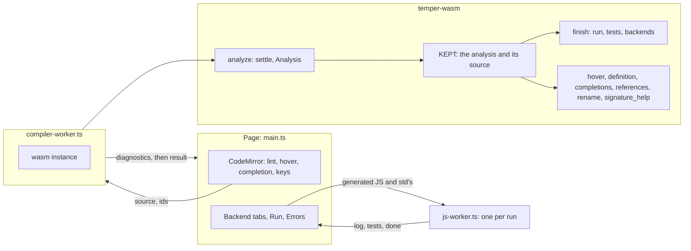
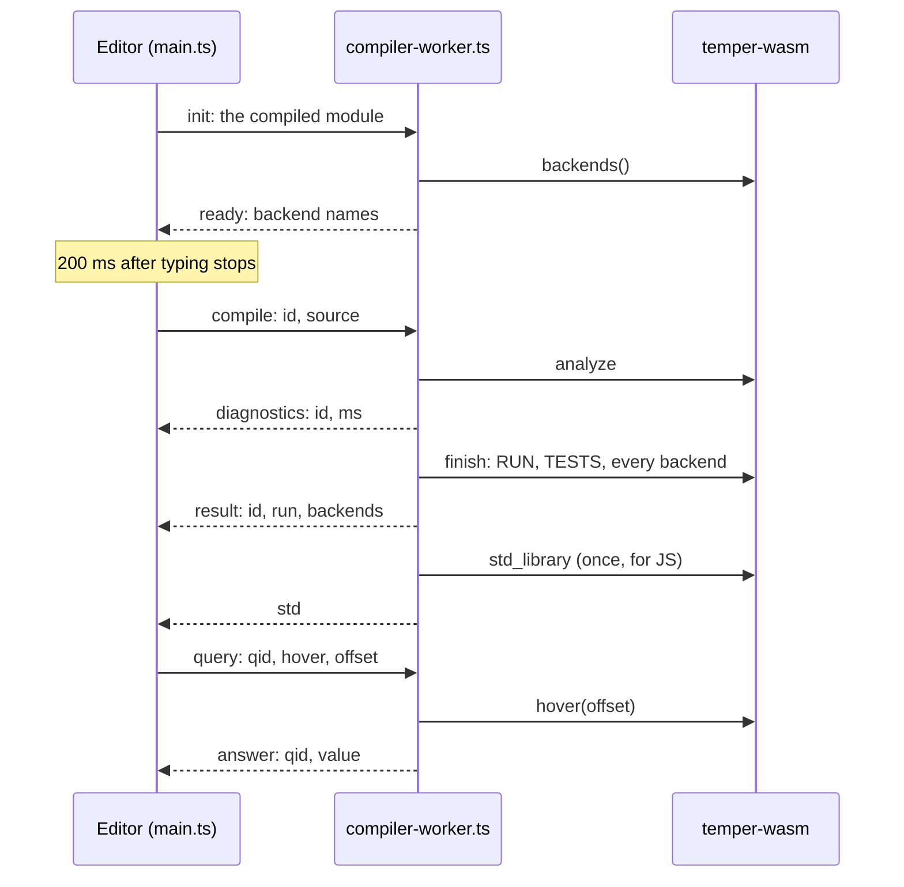
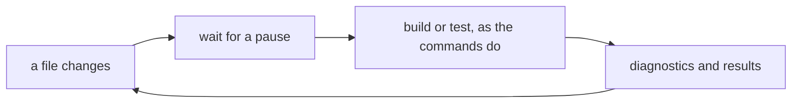

# Wasm and the playground in detail

The playground runs the whole compiler in a browser tab, with no
server: type Temper, and see diagnostics, the interpreter's run and
tests, the generated JavaScript's run beside it, and all seven backends'
code, as you type, with hover, go to definition, completion, references,
rename, and signature help in the editor. Two parts make it:
[`temper-wasm`](../../../crates/temper-wasm/src/lib.rs), the compiler
as a wasm module with a small C ABI, and `site/playground/`, a
TypeScript page on CodeMirror 6 with two kinds of web worker. This page
is the long companion to
[8. Wasm, the playground, watch, and a language server](../08-playground.md):
the decisions behind them, with what they cost, the main types and
functions, the tests, and what's weak or planned, including `watch`.

## Contents

- [Where it sits](#where-it-sits)
- [Decisions](#decisions)
  - [The whole compiler in the browser](#the-whole-compiler-in-the-browser)
  - [A plain C ABI, not wasm-bindgen](#a-plain-c-abi-not-wasm-bindgen)
  - [JSON written by hand](#json-written-by-hand)
  - [Analyze first, then finish](#analyze-first-then-finish)
  - [One kept analysis, queries over it](#one-kept-analysis-queries-over-it)
  - [std's tmpl kept, its imported modules settled again](#stds-tmpl-kept-its-imported-modules-settled-again)
  - [Limits: fuel, a stale timer, a fresh instance](#limits-fuel-a-stale-timer-a-fresh-instance)
  - [Small wasm: no runtimes, tools, or web client](#small-wasm-no-runtimes-tools-or-web-client)
  - [A worker for the compiler, one per JavaScript run](#a-worker-for-the-compiler-one-per-javascript-run)
  - [CodeMirror 6, with a stream language](#codemirror-6-with-a-stream-language)
  - [Queries wait for the text on screen](#queries-wait-for-the-text-on-screen)
  - [Permalinks in the URL fragment](#permalinks-in-the-url-fragment)
  - [One build script, published by Pages](#one-build-script-published-by-pages)
- [The wasm API](#the-wasm-api)
- [The page's messages](#the-pages-messages)
- [Main types and functions](#main-types-and-functions)
- [Sizes](#sizes)
- [Watch (planned)](#watch-planned)
- [Tests](#tests)
- [Known weaknesses and planned changes](#known-weaknesses-and-planned-changes)

## Where it sits

The wasm sits on the same crates as `tempest`: it settles with the
frontend, answers queries with [`temper-analysis`](../../../crates/temper-analysis/src/lib.rs),
and compiles through `temper-driver`'s
[compile path](07-cli.md#one-compile-path), with the same
[`Registry`](../../../crates/temper-driver/src/lib.rs).

## Decisions

### The whole compiler in the browser

**Chosen:** compile `temper-wasm` for `wasm32-unknown-unknown` and run
everything client-side: settling, the interpreter, and all seven
backends.

**Alternatives:** a compile server behind the page; a port of parts to
JavaScript.

**Pros:** nothing to host or secure beyond static files; it works
offline once loaded; source never leaves the browser; answers come in
milliseconds with no network round trip. It also proves the compiler is
portable: no threads, no file system, no process spawning in the core.

**Cons:** a download of about 4 MB (1.3 MB gzipped), compiled once per
visit; generated code can't be run except JavaScript (in the page) and
Temper (on the interpreter); std's `net` can't make requests.

**Kotlin:** Kotlin Temper's playground, play.temperlang.dev, is a hosted
service outside its repository, so there's no code here to compare. A
JVM compiler can't run in a tab without a heavy port.

**Status:** switch-over milestone 5, done
([notes/switch-over.md](../../../notes/switch-over.md)).

### A plain C ABI, not wasm-bindgen

**Chosen:** `#[unsafe(no_mangle)] extern "C"` functions on numbers.
JavaScript calls [`alloc`](../../../crates/temper-wasm/src/lib.rs) for
a buffer, writes UTF-8 into the module's memory, calls a function, and
reads the result as UTF-8 from [`output_ptr`](../../../crates/temper-wasm/src/lib.rs)
and [`output_len`](../../../crates/temper-wasm/src/lib.rs). Input and
output live in two thread-locals, `INPUT` and `OUTPUT`;
[`with_source`](../../../crates/temper-wasm/src/lib.rs) accepts only
the buffer `alloc` gave out. The module imports nothing.

**Alternatives:** wasm-bindgen and its generated glue; the component
model.

**Pros:** no dependency and no generated JavaScript; the module loads
with `new WebAssembly.Instance(m, {})`; the ABI is a dozen functions,
easy to read in [`compiler-worker.ts`](../../../site/playground/src/compiler-worker.ts),
and also what `compat/measure_size.py` loads.

**Cons:** every result is a string to parse; the page narrows the JSON
by hand ([`api.ts`](../../../site/playground/src/api.ts)); one output
buffer means one call at a time, which a worker gives anyway.

**Status:** tempest's choice, from the dependency policy
([notes/code-style.md](../../../notes/code-style.md#dependencies)).

### JSON written by hand

**Chosen:** results are JSON strings built with `write!` and a small
`json_string`, not serde.

**Pros:** no serde in the wasm, which stays smaller and builds faster.

**Cons:** a second JSON writer beside `temper-tmpl`'s source maps' (and
serde in the language server), and shapes kept in step by hand with
`api.ts` and its narrowing functions. A typo in a key is caught only
when the page reads it.

### Analyze first, then finish

**Chosen:** [`compile`](../../../crates/temper-wasm/src/lib.rs) does
everything in one call, but the page calls it in two halves:
[`analyze`](../../../crates/temper-wasm/src/lib.rs) settles the source
and returns only `{"diagnostics": [...]}`, then
[`finish`](../../../crates/temper-wasm/src/lib.rs) runs the program and
its tests (options `RUN` and `TESTS`) and translates for each backend in
a mask, over what `analyze` kept. [`compile_into`](../../../crates/temper-wasm/src/lib.rs)
glues the halves for tests and for anyone wanting one call.

**Pros:** errors show as soon as settling ends, before the slower run
and seven translations.

**Cons:** the worker still makes both calls in one turn
(`compile` in `compiler-worker.ts`), so an editor query sent after the
diagnostics waits for the backends. And every pause in typing translates
all seven, whichever tab is showing.

### One kept analysis, queries over it

**Chosen:** `analyze` keeps an [`Analysis`](../../../crates/temper-analysis/src/lib.rs)
and the source in a thread-local, `KEPT` (a `Kept`). The query exports,
[`hover`](../../../crates/temper-wasm/src/lib.rs),
[`definition`](../../../crates/temper-wasm/src/lib.rs),
[`completions`](../../../crates/temper-wasm/src/lib.rs),
[`references`](../../../crates/temper-wasm/src/lib.rs),
[`rename`](../../../crates/temper-wasm/src/lib.rs), and
[`signature_help`](../../../crates/temper-wasm/src/lib.rs), each take a
UTF-16 offset, convert it with [`byte_offset`](../../../crates/temper-analysis/src/lib.rs),
ask the analysis, and convert spans back
([`Position`](../../../crates/temper-analysis/src/lib.rs), `utf16_span`).
Nothing is settled again for a query.

**Pros:** answers in microseconds to milliseconds; the playground and the
language server share every query
([page 9's detail](09-language-server.md#temper-analysis)).

**Cons:** one source, one file: answers for other files (std's) are
filtered out, except a definition in std, which comes with std's file
text so the page can show it. A second copy of the edge conversions
lives in the language server.

### std's tmpl kept, its imported modules settled again

**Chosen:** std as a tmpl program, which backends need for std's names
and `std_library` translates, is settled once and kept for the page's
life ([`std_program`](../../../crates/temper-wasm/src/lib.rs), leaked
to `'static`).

**Cons:** the source's own imports of std's modules are loaded into its
library and settled with it on every compile (`load_imports` in
`analyze_into`), as in every other tool: the same root as imported
libraries settling again in each importer
([page 7's detail](07-cli.md#each-library-settled-on-its-own-with-what-it-imports)).
The library cache would fix both.

### Limits: fuel, a stale timer, a fresh instance

**Chosen:** three guards, from the inside out.

- **Fuel:** runs and tests stop after
  [`FUEL`](../../../crates/temper-frontend/src/interp.rs), 50 million
  steps, as that run's failure.
- **A stale timer:** if a compile is still busy `STALE_MS` (1.5 s) after
  a newer one started waiting, the page replaces the worker
  ([`sendNext`](../../../site/playground/src/main.ts),
  [`startWorker`](../../../site/playground/src/main.ts)). This covers
  what fuel doesn't: settling, which has no budget.
- **A fresh instance:** a panic traps (the `small` profile aborts on
  panic), which leaves the instance unusable; the worker drops it and
  makes a new one for the next request.

**Plus a big stack:** [`build.rs`](../../../crates/temper-wasm/build.rs)
links the module with a 16 MiB stack instead of 1 MiB, for the settle
loop's and the interpreter's recursion, as the native binaries use a
64 MiB thread.

**Cons:** a slow compile with nothing waiting runs to the end; the stale
timer can't tell slow from stuck.

### Small wasm: no runtimes, tools, or web client

**Chosen:** each backend's `BACKEND` has no runtime files and no tools
under wasm (`cfg!(target_family = "wasm")`), and `temper-frontend` is
built without `net`, so std's requests fail with "web client not
supported here". Backends are cargo features here too.

**Pros:** the runtimes' sources and the HTTP stack would add megabytes
for nothing the page uses; the JavaScript runtime the page needs is
bundled by esbuild from `vendor/temper/be-js/` instead.

### A worker for the compiler, one per JavaScript run

**Chosen:** the page compiles the wasm module once
(`WebAssembly.compileStreaming`) and posts it to a module worker,
[`compiler-worker.ts`](../../../site/playground/src/compiler-worker.ts),
which instantiates it ([`instantiate`](../../../site/playground/src/compiler-worker.ts)).
Generated JavaScript runs in a new worker per run,
[`js-worker.ts`](../../../site/playground/src/js-worker.ts), stopped
after `JS_RUN_MS` (5 s) ([`runJs`](../../../site/playground/src/main.ts)).
Its modules become blob URLs with imports rewritten to the library's,
std's (from [`std_library`](../../../crates/temper-wasm/src/lib.rs),
sent once), and the bundled runtime's; tests register with an `it` of
its own, as under Mocha. The page shows both runs and whether they agree
([`compareRuns`](../../../site/playground/src/main.ts)).

**Pros:** typing never waits on the compiler; a runaway program can be
killed by terminating its worker; the two runs check the interpreter
against a backend on every keystroke.

**Cons:** the JavaScript run uses its own small test runner, not Mocha,
so it's a third way tests run besides the interpreter and
`tempest test -b js`.

### CodeMirror 6, with a stream language

**Chosen:** CodeMirror 6's modules, pinned in `package.json`: lint
(`setDiagnostics`) for errors, `hoverTooltip`, `autocompletion` with
the wasm's completions as its only source, two `StateField`s for
reference marks and the signature tooltip, a keymap for F12, Shift+F12,
F2, and Escape, and Ctrl or Cmd and click for definitions. Temper is
highlighted by a small stream language,
[`temper`](../../../site/playground/src/temper-language.ts); the
generated code by CodeMirror's legacy modes, in one read-only viewer
whose language is swapped per file.

**Alternatives:** Monaco, VS Code's editor, would bring its LSP-shaped
APIs but is several times larger; the notes don't record weighing it. A
Lezer grammar, or tempest's own tokens from the wasm, would highlight
more exactly than a stream language.

**Pros:** small and modular; every feature is an extension added in one
place in [`main.ts`](../../../site/playground/src/main.ts).

**Cons:** the stream language is a third list of keywords beside the
VS Code grammar and `temper-analysis`; `editors/vscode/check_grammar.py`
checks all three agree.

### Queries wait for the text on screen

**Chosen:** before a query, [`ask`](../../../site/playground/src/main.ts)
waits ([`settledNow`](../../../site/playground/src/main.ts)) until the
worker's last analysis is of the editor's current text, compiling soon
if not, for at most `QUERY_WAIT_MS` (3 s); it gives up with no answer
rather than answering at the wrong positions. A replaced worker answers
`null` to what it had pending ([`dropQueries`](../../../site/playground/src/main.ts)).

**Pros:** positions always match; no stale hover.

**Cons:** right after a keystroke, a hover waits for a whole compile
(debounce, settle, and today the backends too).

### Permalinks in the URL fragment

**Chosen:** the source goes into the URL's fragment, `#c=` and base64url
of its UTF-8 compressed with `deflate-raw` where the browser has
`CompressionStream`, else `#s=` and the UTF-8 alone
([`encode`](../../../site/playground/src/share.ts),
[`decode`](../../../site/playground/src/share.ts)). It updates a second
after typing ([`updateHash`](../../../site/playground/src/main.ts)),
with `replaceState` so history isn't flooded; an example's own source
clears it. Share copies the link.

**Alternatives:** short links stored on a server; the query string.

**Pros:** no server and nothing stored; the fragment isn't sent to the
host, so shared code stays between the people sharing it.

**Cons:** long URLs for long programs; a link names no compiler
version, so an old link compiles with today's tempest, which may
differ.

### One build script, published by Pages

**Chosen:** [`build.py`](../../../site/playground/build.py) builds the
wasm (`small` profile), installs the pinned npm packages with `npm ci`,
type-checks the page and the workers with `tsc` separately, bundles and
minifies with esbuild (examples as text, the JS runtime aliased in, the
build's commit and wasm sizes defined in), writes the bundled packages'
licenses, and stamps every URL the page loads with `?v=` and a hash of
the built files, so a normal reload picks up a new build. CI runs it
with `--skip-wasm` after its own wasm build. The Pages workflow builds
and publishes it on each push to `main` that touches the site, the
crates, vendored Temper, or the README, under a 32-hex path taken from
the README's playground link, with `robots.txt` and `noindex` keeping
crawlers out.

**Pros:** one script locally and in CI; caches never serve a mix of
builds.

**Cons:** the unguessable path is privacy by obscurity, which is what
it's meant to be until the team decides to publish.

## The wasm API

| Export | Takes | Gives |
|---|---|---|
| [`alloc`](../../../crates/temper-wasm/src/lib.rs) | a length | a buffer for the next input |
| [`analyze`](../../../crates/temper-wasm/src/lib.rs) | source, options | `{"diagnostics": [...]}`, keeping the analysis |
| [`finish`](../../../crates/temper-wasm/src/lib.rs) | options, backend mask | `{"run": ..., "backends": {...}}` |
| [`compile`](../../../crates/temper-wasm/src/lib.rs) | source, options, mask | both halves in one object |
| [`hover`](../../../crates/temper-wasm/src/lib.rs), [`definition`](../../../crates/temper-wasm/src/lib.rs), [`completions`](../../../crates/temper-wasm/src/lib.rs), [`references`](../../../crates/temper-wasm/src/lib.rs), [`signature_help`](../../../crates/temper-wasm/src/lib.rs) | a UTF-16 offset | the answer, or `null` |
| [`rename`](../../../crates/temper-wasm/src/lib.rs) | an offset, the new name (empty to check) | edits, or `{"error": ...}` |
| [`backends`](../../../crates/temper-wasm/src/lib.rs) | | the built-in backends' names, in mask order |
| [`std_library`](../../../crates/temper-wasm/src/lib.rs) | a backend's place in `backends` | std's files for it, kept |
| [`parse`](../../../crates/temper-wasm/src/lib.rs), [`run`](../../../crates/temper-wasm/src/lib.rs), [`generate`](../../../crates/temper-wasm/src/lib.rs) | source (and a backend for `generate`) | the older single-purpose calls |
| [`output_ptr`](../../../crates/temper-wasm/src/lib.rs), [`output_len`](../../../crates/temper-wasm/src/lib.rs) | | where the last result is |

Options are bits: [`MARKDOWN`](../../../crates/temper-wasm/src/lib.rs)
for literate source, [`RUN`](../../../crates/temper-wasm/src/lib.rs),
and [`TESTS`](../../../crates/temper-wasm/src/lib.rs). Positions are
UTF-16 code units, with line and column from 1 for diagnostics;
diagnostics in std's files carry no position.

Two numberings live here: `compile`'s mask and `std_library` count by
the backends built in (`backends`), but `generate` counts by
[`KNOWN`](../../../crates/temper-driver/src/lib.rs), all seven. They
agree only in a build with every backend, which is the only one the
page uses. Names in the JSON would remove the question.

## The page's messages

The page keeps one request `busy` and at most one `waiting`; a newer
request replaces the waiting one, and answers for older ids are dropped
([`onCompiler`](../../../site/playground/src/main.ts)). Message types are
in [`api.ts`](../../../site/playground/src/api.ts), with a narrowing
function for each JSON shape ([`toCompileResult`](../../../site/playground/src/api.ts),
[`toDiagnostics`](../../../site/playground/src/api.ts),
[`toHover`](../../../site/playground/src/api.ts), and the rest).

## Main types and functions

Rust, in [`temper-wasm`](../../../crates/temper-wasm/src/lib.rs):

- [`analyze_into`](../../../crates/temper-wasm/src/lib.rs) and
  [`finish_into`](../../../crates/temper-wasm/src/lib.rs): the halves,
  into a `String`, callable natively by tests.
- `finish_settled`: the run, tests with a [`Tally`](../../../crates/temper-frontend/src/library_tests.rs),
  and each backend through `program` (which is `checked`, with
  diagnostics before any error) and `generate_with` (`with_std`, then
  `translate`, with `../` as the source-map prefix).
- [`translate`](../../../crates/temper-wasm/src/lib.rs) and
  [`files_json`](../../../crates/temper-wasm/src/lib.rs): `generate`'s
  work, before and as JSON.
- [`built_in`](../../../crates/temper-wasm/src/lib.rs): the registry's
  names.

TypeScript, in `site/playground/src/`:

- [`main.ts`](../../../site/playground/src/main.ts): the editor and its
  extensions; [`requestCompile`](../../../site/playground/src/main.ts),
  [`sendNext`](../../../site/playground/src/main.ts), and
  [`onCompiler`](../../../site/playground/src/main.ts) for the worker;
  [`showDiagnostics`](../../../site/playground/src/main.ts);
  [`hover`](../../../site/playground/src/main.ts),
  [`goToDefinition`](../../../site/playground/src/main.ts) (std's files
  shown read-only in the output pane),
  [`findReferences`](../../../site/playground/src/main.ts),
  [`renameAt`](../../../site/playground/src/main.ts),
  [`updateSignature`](../../../site/playground/src/main.ts), and
  [`complete`](../../../site/playground/src/main.ts).
- [`compiler-worker.ts`](../../../site/playground/src/compiler-worker.ts):
  [`compile`](../../../site/playground/src/compiler-worker.ts),
  [`query`](../../../site/playground/src/compiler-worker.ts), and
  [`sendStd`](../../../site/playground/src/compiler-worker.ts).
- [`js-worker.ts`](../../../site/playground/src/js-worker.ts): `run`,
  with the `Modules` that rewrite imports.
- [`share.ts`](../../../site/playground/src/share.ts): permalinks.
- [`examples.ts`](../../../site/playground/src/examples.ts): the
  [`examples`](../../../site/playground/src/examples.ts), from
  `examples/*.temper`, each titled by its first comment.

## Sizes

`compat/measure_size.py` records the wasm's size in
[notes/size-and-speed.csv](../../../notes/size-and-speed.csv) as
`wasm-small` and `wasm-small-gzip`: 4,214,709 bytes and 1,363,094
gzipped at 75e0d51 (2026-11-06), up from 434 KiB on 2026-10-22, when it
only settled and ran. The backends are most of it: on 2026-11-03, the
seven came to about 1.8 MiB and what only they use (much of tmpl) to
about 0.5 MiB, against 1.25 MiB for the wasm without them
(`backend-NAME-wasm`, `backends-shared-wasm`, `wasm-small-no-backends`).
The page prints the size it loaded in its footer.

## Watch (planned)

`watch` doesn't exist yet. The design
([notes/design.md](../../../notes/design.md#11-cli-watch-and-language-server))
leans to the simplest thing: if building a library takes tens of
milliseconds, `watch` is a loop that reruns `build` or `test` on each
change, printing what [`Analysis::diagnostics`](../../../crates/temper-analysis/src/lib.rs)
gives, and keeps nothing in memory between runs.

**Why it might be enough:** each build allocates its own arenas and drops
them, so memory stays flat by construction; Kotlin's watch mode kept
earlier builds alive, which design.md names as a reason not to keep
anything. **What it needs:** a way to notice changes (a file-watching
crate, which the dependency policy names as a likely candidate, or
polling), and test orchestration callable from the driver rather than
spread over three crates ([page 7's detail](07-cli.md#a-thin-command-over-library-crates)).
**If it isn't fast enough:** rebuild only the changed library and those
that import it, keeping unchanged libraries' exported summaries, which
is the library cache again.

**Kotlin:** `temper watch` keeps a `BuildHarness` and a `Watcher` alive,
rebuilding on file events and optionally testing with `--test-backend`,
with `--limit` on builds.

## Tests

- **The wasm crate's own tests**, natively, in `temper-wasm`'s
  `tests` module: `generates_as_natively` (each backend's output for the
  covered functional tests equals its native golden), `compiles_with_positions`
  (UTF-16 offsets), `compiles_with_narrow_syntax_errors` (one deleted
  `)` is one error, and the rest is still typed), `answers_queries_in_utf16`
  (past an emoji and an error), `answers_editing_queries` (references,
  rename, signature help, a definition in std), `compiles_runs_and_tests`,
  `generates_std`, and `runs_with_built_in_std`.
- **The queries** themselves:
  [`analysis.rs`](../../../crates/temper-analysis/tests/analysis.rs)
  ([page 9's detail](09-language-server.md#tests)).
- **Every bundled example**, in
  [`examples.rs`](../../../crates/temper-wasm/tests/examples.rs):
  `compile_into` with `RUN | TESTS` and every backend, as the page
  calls it, with no diagnostics, each backend's files, and the
  interpreter's output and tests' results pinned.
- **The wasm build** in CI (`cargo build --profile small --target
  wasm32-unknown-unknown`), and the page type-checked and bundled.
- **The page in a browser:**
  [`smoke.mjs`](../../../site/playground/smoke.mjs) serves the build and
  drives headless Chromium (the docs site's playwright-core): each
  example fills all seven backends' tabs, has no error diagnostics, and
  runs, with the interpreter's and the JavaScript's runs agreeing; a
  hover shows a type; an edit survives a reload through the permalink;
  and the Temper link leads to `../`. Console errors and failed requests
  fail it. CI runs it after the docs' Chromium is installed.

Not covered: worker replacement, query waiting, and the other editor
features (completion, rename, go to definition) are tested in the
browser only by hand, though the wasm tests cover their answers.

## Known weaknesses and planned changes

- **All seven backends on every pause**, and queries queued behind them.
  Separate worker turns for `analyze` and `finish`, and translating the
  tab in view (and JavaScript, for Run) first, would make both faster.
- **Imported std modules settle on every compile.** The library cache.
- **No budget for settling**; the stale timer is the only guard.
- **Two backend numberings** in the API.
- **Hand-written JSON** on both sides, kept in step by hand.
- **The smoke test runs on CI's build, not the published page**; one
  after each Pages deploy would catch a broken deploy too.
- **Permalinks name no compiler version.**
- **`watch`** is planned, as a loop first.
