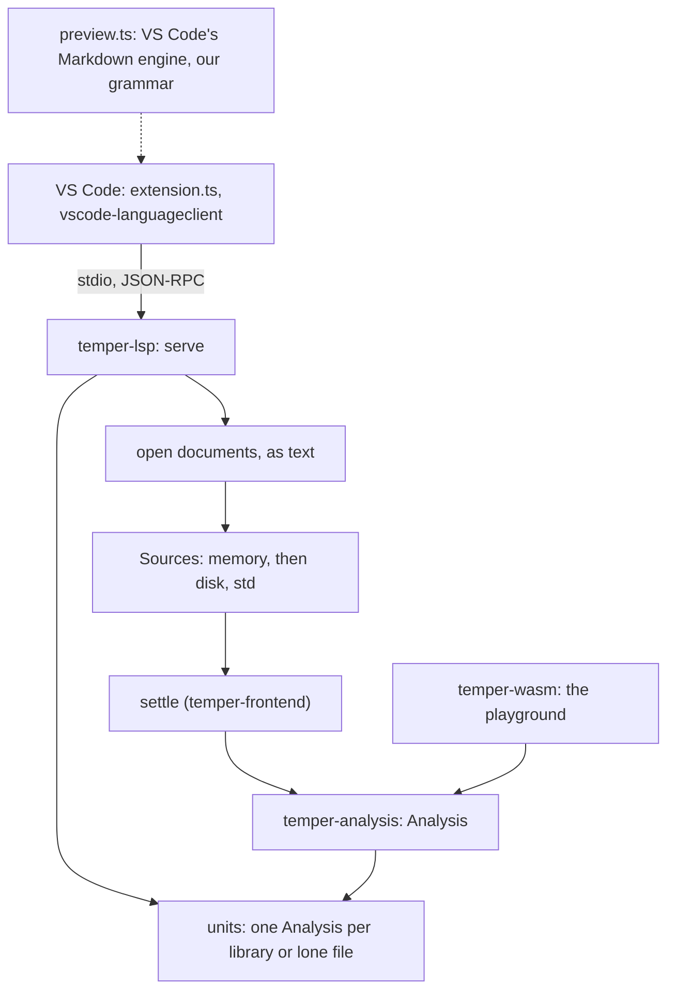
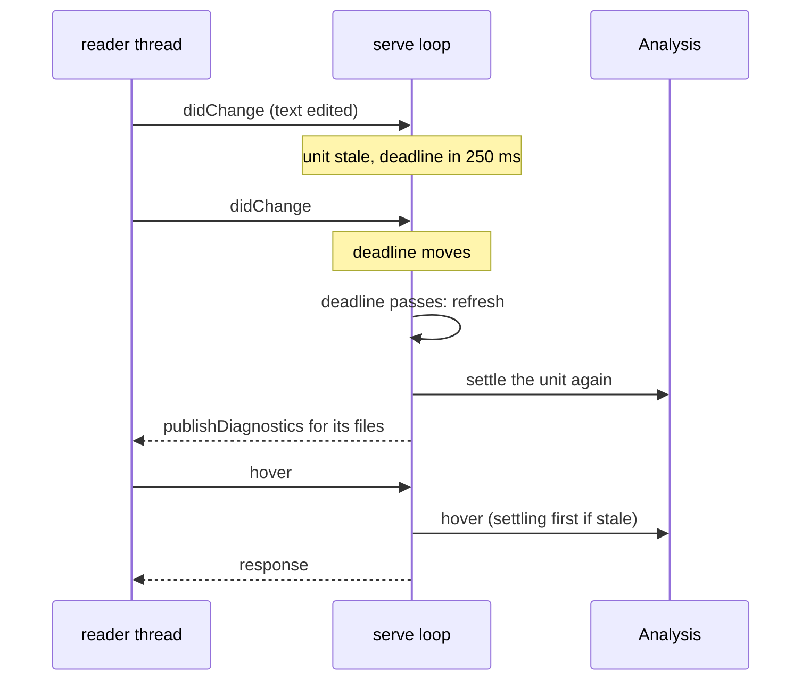
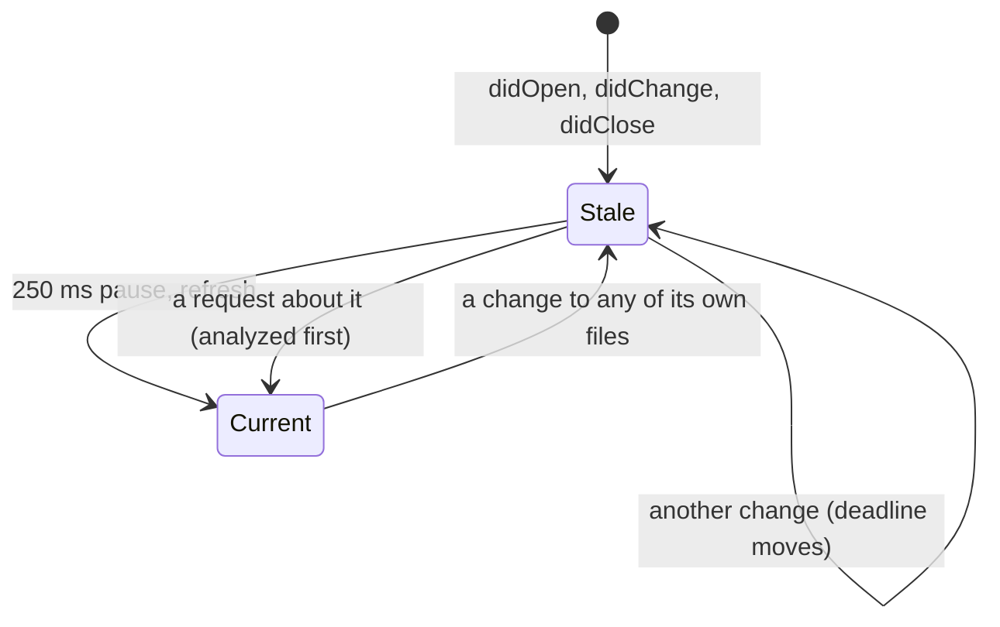

# The language server and editors in detail

Three parts give editors Temper: [`temper-analysis`](../../../crates/temper-analysis/src/lib.rs)
answers questions about a settled library (diagnostics, hover, go to
definition, completion, references, rename, outlines, and signature
help); [`temper-lsp`](../../../crates/temper-lsp/src/lib.rs) serves
those answers over the Language Server Protocol as `tempest lsp`; and
`editors/vscode/` is a VS Code extension that starts it, highlights
Temper with TextMate grammars, and previews literate Temper. The
playground uses the same analysis through wasm. This page is the long
companion to [9. The language server and editors](../09-language-server.md):
the decisions behind each part, with what they cost, the main types and
functions, the tests that pin them, and what's weak or planned.

## Contents

- [Where it sits](#where-it-sits)
- [temper-analysis](#temper-analysis)
  - [Queries over what settling worked out](#queries-over-what-settling-worked-out)
  - [A crate over the frontend only](#a-crate-over-the-frontend-only)
  - [Bytes inside, editors' units at the edge](#bytes-inside-editors-units-at-the-edge)
  - [Finding what's at a position](#finding-whats-at-a-position)
  - [Reading the text where code is unfinished](#reading-the-text-where-code-is-unfinished)
  - [The analysis's types and functions](#the-analysiss-types-and-functions)
- [temper-lsp](#temper-lsp)
  - [One synchronous loop](#one-synchronous-loop)
  - [lsp-types and serde_json, framing by hand](#lsp-types-and-serde_json-framing-by-hand)
  - [Incremental sync, documents in memory](#incremental-sync-documents-in-memory)
  - [Units and staying current](#units-and-staying-current)
  - [The whole library settled again on each pause](#the-whole-library-settled-again-on-each-pause)
  - [std written to a temporary directory](#std-written-to-a-temporary-directory)
  - [URIs converted by hand](#uris-converted-by-hand)
  - [Panics caught per request and analysis](#panics-caught-per-request-and-analysis)
  - [Messages and capabilities](#messages-and-capabilities)
  - [Kotlin's language server](#kotlins-language-server)
- [The VS Code extension](#the-vs-code-extension)
  - [vscode-languageclient](#vscode-languageclient)
  - [Finding the server](#finding-the-server)
  - [Packages per platform, with tempest bundled](#packages-per-platform-with-tempest-bundled)
  - [A version per build](#a-version-per-build)
  - [TextMate grammars](#textmate-grammars)
  - [The Markdown preview](#the-markdown-preview)
  - [Scrolling in step](#scrolling-in-step)
  - [The extension's types and functions](#the-extensions-types-and-functions)
- [Tests](#tests)
- [Known weaknesses and planned changes](#known-weaknesses-and-planned-changes)

## Where it sits

## temper-analysis

### Queries over what settling worked out

**Chosen:** an [`Analysis`](../../../crates/temper-analysis/src/lib.rs)
owns one [`Settled`](../../../crates/temper-frontend/src/settle.rs)
library and answers every question from what the settle loop already
recorded: each name's symbol ([`Scopes`](../../../crates/temper-frontend/src/scope.rs)),
each member read's resolution and each declaration's and expression's
type ([`Typing`](../../../crates/temper-frontend/src/typing.rs)), and
each node's span. [`Analysis::new`](../../../crates/temper-analysis/src/lib.rs)
adds only two indexes: each node's parent, and each declaration's
symbol.

**Alternatives:** a separate index built for the editor (rust-analyzer's
approach, incremental queries over a database), or re-running parts of
settling per question.

**Pros:** the editor and the compiler can't disagree; nothing is
settled again for a question; and because settling recovers from errors
and keeps going, later code still has types to show. Small: the crate is
about 2,000 lines.

**Cons:** every answer needs a fresh settle of the whole unit after an
edit ([below](#the-whole-library-settled-again-on-each-pause)); each
query walks a file's tree from its root to find the position (no span
index), and references walk every file. Fine for libraries of the size
we have; unmeasured beyond them.

**Kotlin:** its language server builds with the same harness as
`temper build`, and answers hover, definition, and completion from the
build's results; much the same idea.

**Status:** design.md §11 ("completions, hover and go-to-definition come
from bindings and types already computed by the settle loop").

### A crate over the frontend only

**Chosen:** the queries live in their own crate, which depends only on
`temper-frontend` and `temper-syntax` (moved out of the wasm in
e04aaf2). Both the wasm and `temper-lsp` use it.

**Pros:** the playground and the language server give the same answers,
from the same code; the crate doesn't pull in tmpl or backends.

**Cons:** backend-aware answers (a declaration's output in each
language, backend naming hints) would need an optional feature later; the
crate's docs mention it, nothing more.

### Bytes inside, editors' units at the edge

**Chosen:** every query takes and gives byte offsets within one file.
Editors count UTF-16 code units, so callers convert once:
[`Position`](../../../crates/temper-analysis/src/lib.rs) (`of` gives
UTF-16 offset, line, and column) and
[`byte_offset`](../../../crates/temper-analysis/src/lib.rs). The wasm
converts offsets; the server converts LSP's lines and characters
([`offset_at`](../../../crates/temper-lsp/src/lib.rs),
[`position`](../../../crates/temper-lsp/src/lib.rs),
[`range`](../../../crates/temper-lsp/src/lib.rs)).

**Pros:** the frontend's spans stay bytes, as everything else in it.

**Cons:** two edge layers with their own conversions and their own
result shapes. Conversions scan from the start of the file or line each
time, which is linear but simple. LSP 3.17 lets a server offer UTF-8
positions; the server doesn't, so UTF-16 is converted even for clients
that could take bytes.

### Finding what's at a position

`target` walks the file's tree and picks the node at the position,
preferring a span the position is inside over one it ends, then names,
then smaller spans. `name_target` says whether a node is a name: a use,
a declaration's name, or a member after `.`. Then:

- [`hover`](../../../crates/temper-analysis/src/lib.rs) shows a name's
  [`DeclKind`](../../../crates/temper-analysis/src/lib.rs), its type
  or signature with parameter names (a generic class's type arguments
  filled in), and its doc comment, a builtin's from core; for other
  code, the smallest typed expression's type.
- [`definition`](../../../crates/temper-analysis/src/lib.rs) follows a
  name to its declaration, and through imports to what they import
  (`imported`, at most eight hops), into std's files too.
  [`core_definition`](../../../crates/temper-analysis/src/builtins.rs)
  finds a builtin's declaration in core, which isn't one of the
  library's files: a builtin type, function, or value by its `export`
  line ([`core_declaration`](../../../crates/temper-frontend/src/typing/core_members.rs)),
  and a member by the type that has it (the receiver's type, through
  generic arguments, `?`, and bounds; the type named, for a static; or
  `Console`, for `console`), then the builtin types it extends, nearest
  first ([`core_member_declarations`](../../../crates/temper-frontend/src/typing/core_members.rs),
  from the spans `core_members` already parses). Hover takes the
  nearest of these with a `/** … */` right before it, past decorators'
  lines, so `List`'s undocumented `length` shows `Listed`'s doc. A
  builtin core doesn't declare, as `panic`, has no location.
- [`completions`](../../../crates/temper-analysis/src/lib.rs) lists
  names in scope at the position, innermost first, builtins last; after
  `.`, the members of the expression's type
  ([`members_of`](../../../crates/temper-analysis/src/members.rs),
  [`builtin_members`](../../../crates/temper-frontend/src/typing/core_members.rs)
  for builtin types); after a type's name, its statics.
- [`references`](../../../crates/temper-analysis/src/references.rs) finds
  every name that resolves to the same declaration, across the unit's
  files; [`rename`](../../../crates/temper-analysis/src/references.rs)
  turns them into [`Edit`](../../../crates/temper-analysis/src/references.rs)s,
  and also renames object literals' keys for a constructor property.
  [`prepare_rename`](../../../crates/temper-analysis/src/references.rs)
  refuses builtins, std, non-identifiers, and
  [`KEYWORDS`](../../../crates/temper-analysis/src/references.rs).
- [`document_symbols`](../../../crates/temper-analysis/src/symbols.rs)
  gives a file's declarations as [`DocSymbol`](../../../crates/temper-analysis/src/symbols.rs)s,
  classes with their members.
- [`diagnostics`](../../../crates/temper-analysis/src/lib.rs) gives each
  as a [`Problem`](../../../crates/temper-analysis/src/lib.rs) in its
  file; a "no member" error spans `obj.name`, as Kotlin's does, and is
  narrowed to the name.

Rename and references stop at the unit: a rename in one library doesn't
reach libraries that import it.

### Reading the text where code is unfinished

**Chosen:** while a call or object literal is being typed, it hasn't
settled into one yet, so [`signature_help`](../../../crates/temper-analysis/src/signatures.rs)
and completion of an object literal's property names read the brackets
open at the position from the source text
([`open_brackets`](../../../crates/temper-analysis/src/signatures.rs),
which skips strings with `${…}` and comments as the lexer does), then
resolve the callee or class from names in scope and known types.
Completion after `.` likewise falls back to a local's declared type when
the code is too broken to type.

**Alternatives:** wait for the tree; or keep partial nodes from the
parser for the editor.

**Pros:** help appears while typing, which is when it's wanted.

**Cons:** a second, small reading of the syntax beside the lexer, which
can drift from it; it's tested by examples, not compared with the lexer.

### The analysis's types and functions

| Item | What |
|---|---|
| [`Analysis`](../../../crates/temper-analysis/src/lib.rs) | One settled library and the indexes queries need; `settled` is public |
| [`Problem`](../../../crates/temper-analysis/src/lib.rs), [`Hover`](../../../crates/temper-analysis/src/lib.rs), [`Location`](../../../crates/temper-analysis/src/lib.rs), [`Completion`](../../../crates/temper-analysis/src/lib.rs) | Answers, in bytes |
| [`DeclKind`](../../../crates/temper-analysis/src/lib.rs) | What a declaration is, with its `label` |
| [`SignatureHelp`](../../../crates/temper-analysis/src/signatures.rs), [`DocSymbol`](../../../crates/temper-analysis/src/symbols.rs), [`Edit`](../../../crates/temper-analysis/src/references.rs) | Answers of the other queries |
| [`is_std`](../../../crates/temper-analysis/src/lib.rs) | Whether a file is std's |
| [`Receiver`](../../../crates/temper-analysis/src/members.rs), [`Subst`](../../../crates/temper-analysis/src/members.rs) | Internal: what has members, and type arguments by parameter |

## temper-lsp

### One synchronous loop

**Chosen:** [`serve`](../../../crates/temper-lsp/src/lib.rs) is one
plain loop. A thread reads messages ([`read_message`](../../../crates/temper-lsp/src/lib.rs))
and sends them over a channel; the loop waits for the next message or
the debounce deadline, whichever comes first (`recv_timeout`), and
handles each in turn. No async runtime.

**Alternatives:** `tower-lsp` (async, on tokio); `lsp-server`, the sync
transport rust-analyzer uses.

**Pros:** easy to follow, no async runtime (which the dependency policy
avoids), and analysis is CPU-bound anyway.

**Cons:** one thing at a time: a request that arrives during a settle
waits for it, `$/cancelRequest` is ignored, and nothing can be answered
from the last analysis while the next runs. `lsp-server` would have
given the framing and the same model for free; framing is about 40
lines, so it was written instead.

**Status:** tempest's choice.

### lsp-types and serde_json, framing by hand

**Chosen:** messages are `serde_json` values; params and results are
`lsp-types` structs, deserialized per method (`params`, `answer`); the
`Content-Length` framing is [`read_message`](../../../crates/temper-lsp/src/lib.rs)
and [`write_message`](../../../crates/temper-lsp/src/lib.rs).

**Pros:** the protocol's types are checked by the compiler; only the
native `tempest` carries these crates, not the wasm.

**Cons:** three dependencies (with serde's derive macros through
`lsp-types`) in a project that had one;
[notes/code-style.md](../../../notes/code-style.md#dependencies) still
says one.

**Status:** added for the preview (2026-11-07,
[notes/switch-over.md](../../../notes/switch-over.md)).

### Incremental sync, documents in memory

**Chosen:** the server asks for incremental sync; each change replaces a
range of the document's text ([`apply_change`](../../../crates/temper-lsp/src/lib.rs)),
or all of it without a range. Open documents are a memory layer of
[`Sources`](../../../crates/temper-frontend/src/sources.rs) in front of
the disk (`sources`), so settling sees unsaved text in every open file
of a library.

**Pros:** small messages while typing; any number of unsaved files.

**Cons:** document versions are ignored, both coming in and in published
diagnostics (`version: None`), so a slow analysis's diagnostics can land
on newer text. The memory layer is rebuilt by cloning every open
document's text for each analysis.

### Units and staying current

**Chosen:** a *unit* is what's settled together: the library around a
file, found as `tempest build` finds libraries
([`work_root`](../../../crates/temper-frontend/src/project.rs),
[`find_libraries`](../../../crates/temper-frontend/src/project.rs),
[`library_of`](../../../crates/temper-frontend/src/project.rs)), or the
file alone if it's in none. One `Analysis` answers for all the unit's
files.

- A change marks the unit's files stale and sets the deadline 250 ms
  ahead (`touch`); opening a document analyzes at once.
- When the deadline passes, `refresh` analyzes each open, stale
  document's unit (`analyze`) and publishes diagnostics for each of the
  unit's own files, clearing those that no longer have any.
- A request about a stale file analyzes its unit first (`current`), so
  answers always match the text.
- A unit that takes over a file (a lone file now inside a library)
  replaces the old one; closing a lone file drops its unit and clears
  its diagnostics.

**Cons:** each `analyze` finds the work root and walks the whole work
root again to find libraries, reading every `.gitignore`, on every
pause. Staleness follows a unit's own files only: a library that
imports another settles the other's modules inside it, but an edit to
the other's open file doesn't mark the importer stale, so the importer's
answers lag until it's edited itself. And only open documents trigger
work: the server doesn't watch the disk, so a `git checkout` shows
nothing until something open changes.

### The whole library settled again on each pause

**Chosen:** no incrementality: each refresh settles the unit from
scratch, as `tempest build` would.

**Alternatives:** settle only what changed, reusing the rest; or the
library cache, which would at least keep imported libraries settled
([notes/library-cache.md](../../../notes/library-cache.md)).

**Pros:** nothing to invalidate, so nothing stale; memory stays flat,
since each settle's arena replaces the last.

**Cons:** cost grows with the library and everything it imports, std's
modules included, each time. Switch-over notes it as "fast enough for
the libraries we have"; there's no recorded measurement of latency.

**Status:** tempest's choice for the preview; incremental settling is
open.

### std written to a temporary directory

**Chosen:** std and core are built into the binary, so they have no
files an editor can open. A definition into std or core writes std's
sources and core's ([`corelib::FILES`](../../../crates/temper-frontend/src/corelib.rs),
under `core/`), once, read-only (0444 under the usual umask), to
`tempest-std-HASH` in the system's temporary directory (an FNV hash of
every path and text, so each std and core version gets its own), and
points there (`write_std`, `location_uri`). With `--std DIR`, std's
point into `DIR`; core's still go to the temporary copy. VS Code
ignores file permissions unless `files.readonlyFromPermissions` is set,
and `files.readonlyInclude` globs match only inside a workspace, so the
extension marks these editors read-only for the session as they become
active ([`readonly.ts`](../../../editors/vscode/src/readonly.ts)).

**Alternatives:** a custom URI scheme, served by the extension as a
virtual document.

**Pros:** works in every editor, with no client code.

**Cons:** files left in the temporary directory, never cleaned.
Kotlin's server writes its log to a temporary file and wonders about the
same in a comment.

### URIs converted by hand

**Chosen:** [`uri_to_path`](../../../crates/temper-lsp/src/lib.rs) and
[`path_to_uri`](../../../crates/temper-lsp/src/lib.rs) convert `file:`
URIs themselves: percent escapes decoded, an authority skipped, a Windows
drive found by its position, `..` resolved lexically. A document's own
URI is kept as the editor sent it, for replies.

**Pros:** no URL crate.

**Cons:** untested for UNC paths, lowercase or escaped drive letters
from other clients, and symlinks; a URI that isn't `file:` (an untitled
buffer) passes through as a "path", whose directory is `.`, so the
server looks for libraries from its working directory. The VS Code
extension sends only `file:` documents, so a diff's old side (`git:`)
or an untitled buffer isn't analyzed and flagged; other clients may
send them. Tests before claiming Windows support (audit D5).

### Panics caught per request and analysis

**Chosen:** each request ([`handle`](../../../crates/temper-lsp/src/lib.rs))
and each analysis ([`analyze`](../../../crates/temper-lsp/src/lib.rs):
reading the library, settling it, and its diagnostics) runs under
`catch_unwind`. A request that panics gets an error response (-32603,
"internal error (a bug in tempest) in METHOD: MESSAGE"); an analysis
that panics publishes that as an error on the document at its start,
drops the unit's analysis, which no longer fits the text, and returns
nothing, so a question about the document answers null and the next
one tries again. The panic hook's message, with where it happened, and
a `tempest lsp:` line go to stderr, the server's log in an editor. The
server goes on serving.

This needs unwinding: the `small` profile, which the released binaries
and VS Code packages use, aborted on panic until 2026-11-09 and now
unwinds, as release always did. It made the small binary 11.6% bigger
(7,211,544 to 8,047,128 bytes on Linux x64, 3,154,295 to 3,562,419
gzipped). The playground's wasm, which can't unwind, keeps aborting
under a profile of its own, `small-wasm`, and is unchanged.

**Rejected:** analysis in a child process, which survives anything,
aborts and stack overflows too, but costs a process and a copy of the
sources per pause; keeping `abort` and letting the editor restart the
server, which loses every open document's state and shows nothing about
why. A stack overflow still aborts: Rust can't catch one.

**Test hook:** [`serve_with_hook`](../../../crates/temper-lsp/src/lib.rs),
hidden from the docs, makes analyses of units whose open documents
contain a marker panic, and the request `tempest/testPanic` too.

### Messages and capabilities

| Message | What the server does |
|---|---|
| `initialize` | Its capabilities (below); any other request before it fails (-32002) |
| `initialized` and unknown notifications | Nothing |
| `textDocument/didOpen`, `didChange`, `didClose` | Keep documents; mark units stale |
| `textDocument/hover` | A Markdown block, `kind name: type`, then the doc comment |
| `textDocument/definition` | One location, std's and core's in the temporary copy |
| `textDocument/completion` | Items with kinds and types; triggered by `.` |
| `textDocument/references` | Locations across the unit |
| `textDocument/prepareRename`, `rename` | A range and placeholder, then a workspace edit; refusals fail with -32803 |
| `textDocument/documentSymbol` | Nested symbols |
| `textDocument/signatureHelp` | One signature, its active parameter; triggered by `(` and `,` |
| `shutdown`, then `exit` | Exit 0; `exit` without `shutdown`, or input ending, exits 1 |
| anything else | -32601, and the server goes on |

### Kotlin's language server

`temper serve --port N` (in `langserver/`) is built on lsp4j and
connects out to a TCP port that the client listens on, rather than
stdio. It offers incremental sync, hover, definition, completion on `.`,
semantic tokens (full and delta, with `--tokens add|full|none`), and
workspace folders; it keeps a build manager per work root, with a memory
file system layered over the real one, the same idea as tempest's
`Sources`, and waits 200 ms for changes to settle. Tempest adds
references, rename, outlines, and signature help, and lacks semantic
tokens and workspace-folder changes. The switch-over plan calls Kotlin's
server "flaky, slow, and uses a lot of memory" as the reason for a new
one ([notes/switch-over.md](../../../notes/switch-over.md)).

## The VS Code extension

### vscode-languageclient

**Chosen:** [`extension.ts`](../../../editors/vscode/src/extension.ts)
starts `tempest lsp` with Microsoft's `vscode-languageclient`, for the
`temper` and `temper-markdown` languages, in the first workspace folder.
The client does the syncing and maps VS Code's providers to requests.
[`activate`](../../../editors/vscode/src/extension.ts) also registers
"Restart Language Server", restarts when `temper.server.*` changes, and
returns an [`Api`](../../../editors/vscode/src/extension.ts) for tests.

**Pros:** the standard client; nothing protocol-shaped written twice.

**Cons:** bundled into `out/extension.js` with esbuild, so its size is
the extension's. One server runs, in the first workspace folder; it
finds each file's library from the file, so other folders work, but an
untitled buffer's search starts there.

### Finding the server

**Chosen:** [`search`](../../../editors/vscode/src/server.ts) looks, in
order: `temper.server.path` alone if it's set (a path that must be a
file, or a name looked up on `PATH`); then the `tempest` bundled in the
package's `bin/`; then `tempest` on `PATH`, with Windows' `PATHEXT`
spellings and `Path`. Only a file that's there counts. None found, or
one that doesn't start, is an error notification naming what was tried
([`notFound`](../../../editors/vscode/src/server.ts),
[`notStarted`](../../../editors/vscode/src/server.ts)), with a button to
the setting.

**Pros:** a missing server is said plainly, not as a spawn error; a
developer's build wins when set.

**Cons:** no check that the server found matches the extension: the
server reports no version, so a stale `tempest` on `PATH` just behaves
differently.

### Packages per platform, with tempest bundled

**Chosen:** [`build.py`](../../../editors/vscode/build.py) type-checks,
bundles with esbuild, runs the unit tests and the grammar check, and
packages with `vsce` from a staging directory holding only what ships:
a universal `temper-VERSION.vsix` without tempest, and one per platform
(linux, darwin, and win32, each x64 and arm64) with it in `bin/`. It
then checks each package holds what it should, and that the bundled
binary is executable. The Binaries workflow builds all six from its
release binaries.

**Kotlin:** its tutorial offers a `.vsix` per platform that bundles
Temper, the same shape.

**Pros:** install one file and it works, with no separate download.

**Cons:** six large packages per build; not on the Marketplace yet.

### A version per build

**Chosen:** each build's version is `package.json`'s major and minor
with the minutes since 2026 as the patch, the same for every package of
one build, so a new `.vsix` always replaces an installed older one.

**Pros:** "Install from VSIX" never keeps an old build by mistake.

**Cons:** the version says nothing about the tempest inside; two builds
in one minute share one; a Marketplace release will want real versions.

### TextMate grammars

**Chosen:** `syntaxes/temper.tmLanguage.json` for `.temper`, and
`syntaxes/temper-markdown.tmLanguage.json` for literate `.temper.md`,
which embeds Temper in fenced blocks (untagged or tagged `temper`) and
indented blocks, as the
[literate split](../../../crates/temper-syntax/src/literate.rs) reads
them, and uses VS Code's Markdown grammar for the prose. Blocks tagged
`temper inert`, which aren't compiled, are Temper too, scoped
`meta.embedded.block.temper.inert`, with `inert` on the fence scoped
`storage.modifier.inert.temper`; the extension
([`inert.ts`](../../../editors/vscode/src/inert.ts)) tints their lines
and labels the fence "inert", with a hover, "Not compiled: shown for
reading only", from the same fence scan the preview uses
([`inertBlocks`](../../../editors/vscode/src/page.ts)); the theme colors
are `temper.inertBlockBackground` and `temper.inertLabelForeground`. The
language server doesn't analyze them, as the compiler doesn't. Nothing can run
VS Code's TextMate engine offline, so [`check_grammar.py`](../../../editors/vscode/check_grammar.py)
checks structure, scopes samples with a small TextMate tokenizer of its
own, and checks that the keywords match the playground's and
`temper-analysis`'s `KEYWORDS`.

**Alternatives:** semantic tokens from the server (Kotlin's server has
them) or a tree-sitter grammar.

**Pros:** instant highlighting before the server answers; no server
needed for colors.

**Cons:** indented blocks are approximated line by line; and there are
now three tokenizers of the grammar's kind (`check_grammar.py`'s, the
preview's [`tokenize`](../../../editors/vscode/src/highlight.ts), and
the playground's stream language) and four keyword lists, kept equal by
the check.

### The Markdown preview

**Chosen:** VS Code's own Markdown preview skips `.temper.md`, which is
its own language, so the extension has a preview of its own
([`preview.ts`](../../../editors/vscode/src/preview.ts)): VS Code's
Markdown engine renders the document (the built-in `markdown.api.render`
command), [`highlightCodeBlocks`](../../../editors/vscode/src/page.ts)
highlights its Temper blocks with the editor's grammar, and a webview
shows it ([`page`](../../../editors/vscode/src/page.ts)) under a strict
CSP: scripts only with a nonce, nothing remote, command URIs off.
Updates come 150 ms after typing pauses, newest render wins. Clicked
links go through [`linkTarget`](../../../editors/vscode/src/page.ts):
fragments scroll, web and mail links open outside, files open in VS
Code (with `#L12` as a line), and other schemes are refused.

**Alternatives:** contribute a markdown-it plugin to the built-in
preview, which applies only to Markdown's own language; render with a
Markdown library of our own.

**Pros:** the same rendering as VS Code's preview, with no Markdown
dependency; the preview is safe for untrusted documents.

**Cons:** needs VS Code's built-in Markdown extension enabled. The
engine keeps only a fence's first word (`temper`), so `inert` blocks
are found in the source by their fence's line (`data-line`) and marked
there: tinted, with an "inert" label in the corner, as in the editor and
on the docs site.

### Scrolling in step

The engine marks each block with its first source line (`data-line`).
[`ordered`](../../../editors/vscode/src/sync.ts) keeps the marks in
order of both line and offset; [`topForLine`](../../../editors/vscode/src/sync.ts)
and its inverse [`lineForTop`](../../../editors/vscode/src/sync.ts)
interpolate between them, so a scroll synced one way doesn't drift
when synced back. The editor's visible range moves the preview; the
preview's scroll moves the editor (`reveal`). Each side ignores scrolls
for 200 ms after causing one, so neither echoes. A mark at the last line
lets the preview reach the bottom; images that load later re-pin the
line in view. The messages are typed in
[`messages.ts`](../../../editors/vscode/src/messages.ts)
([`ToPreview`](../../../editors/vscode/src/messages.ts),
[`FromPreview`](../../../editors/vscode/src/messages.ts)).

### The extension's types and functions

- [`activate`](../../../editors/vscode/src/extension.ts), `start`, `stop`, and
  [`Api`](../../../editors/vscode/src/extension.ts) in `extension.ts`.
- [`search`](../../../editors/vscode/src/server.ts),
  [`Found`](../../../editors/vscode/src/server.ts),
  [`Where`](../../../editors/vscode/src/server.ts), and
  [`Search`](../../../editors/vscode/src/server.ts) in `server.ts`:
  plain Node, so its tests run without VS Code.
- [`Previews`](../../../editors/vscode/src/preview.ts),
  [`registerPreview`](../../../editors/vscode/src/preview.ts), and
  [`PreviewHook`](../../../editors/vscode/src/preview.ts) in `preview.ts`.
- [`tokenize`](../../../editors/vscode/src/highlight.ts),
  [`highlight`](../../../editors/vscode/src/highlight.ts), and
  [`Grammar`](../../../editors/vscode/src/highlight.ts) in
  `highlight.ts`.
- [`body`](../../../editors/vscode/src/page.ts) and
  [`fragmentLine`](../../../editors/vscode/src/page.ts) in `page.ts`.
- The webview's script, [`preview.ts`](../../../editors/vscode/webview/preview.ts)
  in `webview/`: [`scrollToLine`](../../../editors/vscode/webview/preview.ts)
  and [`blocks`](../../../editors/vscode/webview/preview.ts).

## Tests

- **The queries**, [`analysis.rs`](../../../crates/temper-analysis/tests/analysis.rs):
  hover on locals, declarations, parameters, members, and calls;
  definitions, also into std and core (builtin types, functions, and
  values; members through generic receivers, supertypes, statics, and
  `console`); builtins' doc comments on hover; completions, of builtin types' members,
  after any expression, and of object literals' keys; diagnostics tight
  and all there, also past a broken bracket; UTF-16 at the boundary;
  "no member" spanning just the name; references within and across
  files; rename, also of object literals' keys; outlines; signature help.
- **The server**, [`lsp.rs`](../../../crates/temper-lsp/tests/lsp.rs): a
  scripted JSON-RPC session over a loopback socket on a two-file library
  (`a_session`: capabilities, unsaved errors, incremental edits, hover,
  definition, completion, references, rename and its refusals, outlines,
  signature help, unknown requests); UTF-16 positions in a lone file;
  `exit` without `shutdown`; definition into std; definition and hover
  into core, its file read-only; panics in an analysis
  and a request becoming internal errors, with the server answering
  after them (`panics_become_internal_errors`). Unit tests in
  [`lib.rs`](../../../crates/temper-lsp/src/lib.rs): UTF-16 positions,
  URIs, incremental changes, and framing.
- **The extension**, in a real VS Code ([`suite.ts`](../../../editors/vscode/test/suite.ts),
  run by [`run.ts`](../../../editors/vscode/test/run.ts) with
  `@vscode/test-electron`, VS Code pinned, against the platform package
  as built): it uses the bundled tempest; diagnostics for unsaved text
  and an incremental edit; none for an untitled document, as only
  `file:` documents go to the server; hover; definition in the other file;
  definition of a builtin (`Int`), opening core's read-only file at its
  line; completion; rename across both files; and the preview's headings,
  highlighted Temper, a relative image, a live update, and scrolling
  both ways. CI runs it under xvfb.
- **Without VS Code:** [`server.test.ts`](../../../editors/vscode/src/server.test.ts)
  (lookup order, Windows names, messages, a missing setting) and
  [`page.test.ts`](../../../editors/vscode/src/page.test.ts)
  (tokenizing, escaping, which blocks are highlighted, links, the CSP,
  scroll mapping), under Node's test runner; and
  [`check_grammar.py`](../../../editors/vscode/check_grammar.py).

Not covered: a real panic (the hook stands in for one); cross-library staleness; disk
changes to closed files; non-`file:` URIs; Windows paths; latency on a
large library; and references, outlines, and signature help through VS
Code itself (they're covered at the protocol level).

## Known weaknesses and planned changes

- **A stack overflow ends the server**, as Rust aborts on one; deep
  input is bounded where it's known to recurse (the parser's and the
  interpreter's limits), but not everywhere.
- **State after a caught panic** isn't checked: a panic in the middle of
  a request may leave the server's tables half-updated
  (`AssertUnwindSafe`); a unit stale or missing is analyzed again.
- **Library discovery on every pause**; cache it per work root, and
  invalidate on file events.
- **Importers don't go stale** when an imported library's open file
  changes; track each unit's read set, or settle libraries once (the
  library cache).
- **No file watching**; `workspace/didChangeWatchedFiles` for sources,
  configs, and ignore files.
- **One thing at a time**, no cancellation; a worker thread for analysis
  with generation numbers.
- **Whole-library settles**, unmeasured; record latency on the real
  libraries, then decide between the library cache and incremental
  settling.
- **Versions ignored**, in sync and in published diagnostics.
- **Hand-written URI handling**; tests for Windows forms first.
- **No version handshake** between the extension and the server.
- **No semantic tokens**, which Kotlin's server has, and which would
  also let the playground and the preview drop their own tokenizers.
- **std's copy** is never cleaned from the temporary directory.
