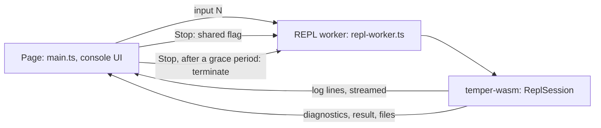

# An online REPL: design plan

A plan for a REPL in the browser, beside the web playground
(`site/playground`, on the wasm build in `crates/temper-wasm`). It builds
on the CLI REPL ([repl.md](repl.md)) and its shared session. Written
before the decisions below, which override it where they differ; the
open questions it ended with are at the end, with their answers.

## Decisions and status

- **A separate REPL tab**, not a console under the editor: the page
  shows either the editor or the REPL. The editor's code can still be
  the REPL's input 0.
- **`translate(n, lang)` shows the translation in the REPL's output**,
  as in the CLI; a side-by-side view of all seven languages may come
  later.
- **Share doesn't include the REPL** for now, so the questions about
  shared links and persistence wait.
- **The other recommendations stand:** a per-input step limit with
  "keep going" on the public page; Enter adds a new line on phones,
  with a Run button; network off; Stop by terminate-and-replay first.
- **As much language-server help as possible in the REPL,** in the
  browser (CodeMirror with `temper-analysis`) and in the terminal
  (completion, hints, highlighting).

**Chunk 1, done:** the session API in `temper-wasm`
([docs/internals/detail/08-playground.md](../docs/internals/detail/08-playground.md#the-repls-api)).

- `repl_start(ptr, len, fuel)`, `repl_input(ptr, len, fuel)`,
  `repl_complete(ptr, len)`, and `repl_reset()`, over
  `ReplSession`. Each input's answer is JSON: its events in order,
  each with the CLI's text (logs too), its value, and `out_of_steps`.
  `repl_complete` also gives the inputs a typed or pasted buffer splits
  into, as the CLI's `Chunker` splits piped lines, and the brackets
  open, for the next line's indent.
- **Steps per input** are an argument, so "keep going" is the page
  running the same text again, as the next input, with more. An input
  that ran out says `out_of_steps`.
- **Imports:** `env.host_log`, each logged line as it's logged (up to
  64 KiB per input, then a `truncated` event), and `env.host_now`, the
  clock, which std's `temporal` now uses on wasm
  (`temper-os/src/host.rs`, the only unsafe code for it). Every
  instance needs both, so the compiler's worker passes them too.
- **Memory:** the module's memory is capped at 1 GiB (`build.rs`), so
  a runaway allocation traps.
- **Tests:** the CLI REPL's transcripts (temper-frontend's and
  temper-driver's `tests/repl/*.cases`) through the API, typed into a
  cell a line at a time as the page would
  (`crates/temper-wasm/tests/repl.rs`); unit tests of the exports for
  streaming, keep going, cut logs, and Enter's answer.
- **Not yet:** `repl_translate` and `repl_describe` (structured
  output for panes); a stop flag (chunk 5). `repl_query` came in
  chunk 3. A panic traps in wasm (the
  `small-wasm` profile aborts), so the page restores a session by
  replaying it, as for Stop. The REPL's tools settle std's tmpl apart
  from the compiler's copy, once per session's first `translate`.

**Chunk 2, done:** the REPL tab
([docs/tools/playground.md](../docs/tools/playground.md#the-repl-tab),
[the internals](../docs/internals/detail/08-playground.md#the-repl-tab)).

- **Editor** and **REPL** in the top bar swap the page's main area.
  `repl-worker.ts` holds a second instance, started when the tab is
  first shown; `repl.ts` has the cell, the transcript, and the replay.
- **Keys:** Enter runs once `repl_complete` says the text is whole,
  else adds a line indented by its open brackets; Shift+Enter a line;
  Ctrl or Cmd+Enter and Run always run; Up and Down on the first and
  last line walk history (`localStorage`); Escape stops. On a coarse
  pointer, Enter only adds lines. Brackets don't close themselves in
  the cell, or Enter would run `{}`.
- **Transcript:** each event as the CLI prints it, by `textContent`,
  styled by kind, in an `aria-live` log; logs stream, then the answer
  replaces them.
- **Steps:** 50M per input; "Keep going" runs the same text, as the
  next input, with ten times as many.
- **Stop and traps:** a new worker replays the earlier inputs quietly,
  each with its steps, or 1 for one that ran out or was stopped, so it
  fails at once and the numbering holds. An input that traps again as
  it replays is left out. A changed editor restarts the session, with
  replay, the next time the tab is used.
- **`help()`'s footer** names the page's keys.
- **Tests:** `smoke.mjs` runs a sum, a multi-line function, a streamed
  log, Stop with replay and numbering, "Keep going", and `translate`.
- **Left for chunk 3:** done there, but `translate` in panes, which
  waits.
- **Tests in input 0** (2026-11-11): they run once, after it,
  reporting each failure and `tempest test`'s summary; the tab shows
  input 0's block when it says more than logs, once per editor code.
  The session keeps their source for `runTests()` (chunk 3).
  Tests in later inputs are still refused. The smoke test checks
  that the first example's tests pass as input 0.

**Chunk 3, done for now** (2026-11-11):

- **`repl_query(kind, at, ptr, len)`**: completion, hover, and
  signature help for the cell's text against the session, from
  temper-analysis's `pending_*` queries, as `tempest repl`'s Tab and
  hint: the text is lexed, never settled or run, so it's quick per
  keystroke and runs no user code. New there: `pending_hover`, and
  `pending_argument_completions` (`describe`'s steps, `translate`'s
  languages, `help`'s names), moved from the CLI so both share it.
- **The cell:** CodeMirror completion (opens with nothing picked, so
  Enter still runs; Down or Up picks, Enter accepts), hover, Ctrl or
  Cmd+I for hover from the keyboard, and signature help on `(` and
  `,`, with the editor's tooltip builders. While an input runs, the
  cell has no help, rather than queuing behind it.
- **`runTests()`**, a REPL function in the CLI and the page:
  input 0's tests settled again as a hidden round after the latest
  input, once the calling input ends, so names mean the newest
  declarations; same failure lines and summary. A changed signature
  gives type errors, located in input 0; old instances keep old
  classes. Named `runTests`, not `test`, as std's `test("name") {}`
  declares tests.
- **Transcript:** capped at 300 inputs, the oldest dropped with a
  note; output past 40 lines folds behind "Show all"; `interactive#N`
  links scroll to that input and put it in the cell.
- **Left:** `translate` in panes; sharing and persistence (chunk 4);
  the stop flag (chunk 5); help for what the cell's text declares
  itself, and members of expressions (`f(x).`), which need a
  speculative settle.

The CLI REPL's decisions hold here too:

- one growing REPL library of chained inputs, with shadowing for
  redefinition;
- results printed as `interactive#N: value`;
- `help`, `describe`, and `translate` as Temper functions, with no `:`
  commands at first;
- robust: errors never end the session, and a Stop button (the
  browser's Ctrl-C) interrupts a run and keeps the session.

## 1. What it's like to use

### Where it lives: a console under the editor, plus a REPL-first view

The playground today is an editor on the left and tabs on the right
(one per backend, then Run and Errors). The REPL adds a **Console** below
the editor, collapsed to one input line until used:

- The editor's source is the session's input 0, so console inputs can
  call what the editor declares (repl.md, section 5). Editing the
  editor starts a new session at the next console input, replaying the
  console's inputs after it (see "Persistence"), with a note in the
  transcript: `-- editor changed; 3 inputs replayed --`.
- A **REPL-first view**, `#repl` in the URL (or a toggle in the top
  bar), hides the editor and gives the console the left pane, for the
  tutorial's REPL chapters and for people who just want to try things.
  Same page, same bundle, one layout class; no second page to build,
  test, or publish.

Recommended: both, console first; the REPL-first view is a layout
switch, cheap once the console exists.

### The input cell

A small CodeMirror 6 editor, with the playground's Temper stream
language (`temper-language.ts`) for highlighting, so the console and the
editor color code alike.

- **Enter runs** when the input is complete, by the same rule as the
  CLI (open brackets, an open string, or only comments mean wait), asked
  of the worker or done in TypeScript over the same token kinds; if
  incomplete, Enter inserts a newline with the indent. **Shift+Enter**
  always inserts a newline; **Ctrl/Cmd+Enter** always runs.
- **Multi-line editing** is free: the cell is an editor, so a whole
  multi-line input is one buffer (what the CLI gets from a line-editing
  crate's validator).
- **History:** Up at the first line and Down at the last move through
  past inputs, as in browser devtools consoles; per-viewer history kept
  in `localStorage` (try/catch, capped at a few hundred entries),
  separate from the session itself.
- **Completion, hover, and signature help** come from the same
  `temper-analysis` queries the editor uses, over the session (names
  from every input, then std and builtins), plus the REPL functions'
  arguments: `describe(_, "` offers steps, `translate(_, "` backends,
  `help("` topics.
- **Escape** or **Stop** stops a run; the input cell stays editable
  during a run, and the next input waits for it.

### Output

Each input shows as a block in the transcript:

```
$ let box = { width: 1.5, height: 0.5 };
interactive#1: void
$ box.width + box.hieght
interactive#2:1:11: error: No member hieght in Box
  box.width + box.hieght
                  ^^^^^^
interactive#2: fail
```

- The echoed input, highlighted, then diagnostics, then what it logged
  (streamed as it's logged, not at the end), then the result line, in
  the CLI's exact text, so transcripts match and tests share cases.
- **Links:** `interactive#N` labels link to that input's block;
  positions in input 0 (the editor) move the editor's cursor there and
  mark the span, as the Errors tab does; positions in std open std's
  read-only file as go-to-definition does. Clicking an earlier input
  copies it into the input cell (Alt+click to run it again).
- Long output folds after about 40 lines, with "show all"; values print
  with the CLI renderer's depth and length limits and cycle marker.
- Errors red and warnings yellow, from the page's theme tokens, light
  and dark; color is styling, never baked into the text, so copying
  gives plain text.

### `translate`, seven languages at once

`translate(n)` with no backend is the showcase: the result is a block
of seven panes, alphabetical by language name (C++, C#, Java,
JavaScript, Lua, Python, Rust), side by side on wide screens (a grid,
two to four columns by width) and as tabs on narrow ones, each with
its own highlighting and a copy button. `translate(n, "py")` shows one.
The CLI prints the same files as text; the page gets structured output
(section 2, "The wire format") and lays it out. `describe` output is
plain monospace, folded when long.

### Sharing a transcript

The playground shares source as `#c=` (deflate-raw, base64url) in the
fragment (`share.ts`). A REPL share adds the console's inputs:

- `#c=...` stays the editor source; a new `&r=...` carries the inputs,
  encoded the same way (a JSON array of strings, compressed). Only
  inputs are shared, never outputs: opening the link replays them,
  which keeps links small and honest (no forged output).
- Opening a link with inputs shows them as pending blocks with a
  **Replay** button, rather than running on load: a link runs nothing
  until the viewer asks (and a link with a long loop doesn't hang a
  visitor's tab on open). Open question whether to auto-run short ones.
- Fragment length: a soft cap (say 32 KB encoded) with a message past
  it, since some chat apps and browsers truncate long URLs.
- "Copy transcript" also copies the text as the CLI would print it, for
  pasting into issues and docs.

### Phones

Below the playground's narrow breakpoint, the panes stack: editor,
then console, then tabs, or in the REPL-first view only the console.
The input cell pins to the bottom above the keyboard
(`visualViewport` resize), with a row of buttons for what a phone
keyboard lacks: Run, Stop, history Up and Down, Tab (completion), and
newline. Enter inserts a newline on touch devices (soft keyboards make
Enter-to-run error-prone); Run runs. `translate`'s grid becomes tabs.
16px side gutters, no horizontal page scroll; code blocks scroll
inside themselves.

## 2. Architecture



### The session in wasm

`ReplSession` lives in `temper-frontend` (the CLI REPL's work), so the
wasm gets it with no new compiler code. `temper-wasm` adds a thin C ABI
in the style of its existing exports (plain C ABI and hand-written JSON,
not wasm-bindgen):

- `repl_start(ptr, len, options)`: a new session, with the editor's
  source as input 0 (empty for the REPL-first view); returns input 0's
  diagnostics and result.
- `repl_input(ptr, len)`: settles, types, and runs one input; returns
  `{"n": 3, "diagnostics": [...], "output": [...], "result": "...",
  "failed": false}`.
- `repl_complete(ptr, len)`: is the text a complete input (for Enter)?
- `repl_query(kind, at, ptr, len)`: hover, completions, and signature
  help against the session plus the text being typed, as if it were the
  next input (settled speculatively and dropped).
- `repl_translate(n, mask)` and `repl_describe(n, step)`: also reachable
  as Temper calls; these give the page structured JSON
  (`{"files": [...]}` per backend) to lay out, where the CLI gets text.
- `repl_reset()`.

**The wire format** for REPL function results: when an input's value
is a `translate` or `describe` result, the session marks it, and the
JSON carries `{"kind": "translate", "backends": {...}}` beside the plain
text. One rendering in Rust (the text), structure for the page.

### Its own worker

A new `repl-worker.ts`, separate from the compiler worker:

- The compiler worker answers the editor as you type, and drops stale
  requests and gets replaced when slow; a REPL session is long-lived
  state, which those replacements would throw away. Two workers keep
  each simple. The cost is a second wasm instance (memory: the module
  is compiled once on the page and posted to both, as today, so only the
  instance's heap is extra, tens of MB).
- The worker has no DOM, so user code can't touch the page (section 3).
- Log lines stream from the worker as they're logged (the interpreter's
  streaming sink, as `interp::run_streaming`, calling an imported
  `host_log` the worker turns into a `postMessage`), so a long loop's
  output appears while it runs.

### Stopping a run

Two levels, as the CLI has a signal flag:

1. **A shared flag (preferred).** The interpreter already checks fuel
   at every step; the CLI REPL plans an interrupt flag there. In wasm,
   the flag is a word in the module's memory that the fuel check reads.
   The page writes it through a `SharedArrayBuffer` view of a shared
   `WebAssembly.Memory`, which needs **cross-origin isolation** (COOP
   `same-origin` and COEP `require-corp` headers). GitHub Pages can't set
   headers; a service worker can add them (the `coi-serviceworker`
   approach, written in-house, a few dozen lines), at the cost of a
   reload on first visit. Also needs the wasm built with shared memory
   (`+atomics`, a nightly or build-std matter for Rust today), which is
   a real cost. A lighter variant: the fuel check calls an imported
   `host_should_stop()` every N steps (say 100,000), which can't see a
   `postMessage` while the worker is busy, but **can** read a
   `SharedArrayBuffer` the worker was given, without the wasm memory
   being shared. That needs cross-origin isolation but not a threaded
   wasm build. Recommended for the flag.
2. **Terminate and restore (fallback, and always for settling).** If
   the flag isn't available, or a run doesn't stop within about 1 s of
   Stop (settling has no fuel; a panic traps), the page terminates the
   worker, starts a fresh one, and replays the session's inputs before
   the stopped one, without their output, marking the stopped input
   `interactive#N: stopped`. Replay costs a settle of each input again
   plus their runs; side effects of earlier inputs run again, which is
   fine for a browser sandbox with no I/O, but an input that ran 10
   seconds is 10 seconds again. So replay skips running inputs whose
   values nothing later uses? Too clever for a first version: replay
   everything, with a progress note, and let a known slow input be
   marked so replay settles it but doesn't run it (then its names read
   as "no value", the failed-declaration rule from repl.md).

Fuel: no fuel by default, as the CLI, since Stop exists; but a
**default cap per input on the public page** (the playground's 50
million steps, raised on request with a "keep going" button that
reruns with more) protects people who don't notice the Stop button, and
phones' batteries. Open question.

### Persistence across reloads

The session's state is in wasm memory and can't be saved directly, so
persistence is **the inputs**, replayed:

- The page keeps the transcript's inputs (and the editor source) in
  `sessionStorage` per tab (`localStorage` for history only), and on
  reload offers "Restore 12 inputs" rather than replaying silently.
- The URL fragment already holds the editor source; it could hold the
  inputs too, as a share link does, updated as the playground updates
  its fragment today, so reload restores without storage. Recommended:
  the fragment, same as sharing, so reload and share are one mechanism;
  storage only as a size fallback.
- Replay is also how a changed editor source carries the console on.

### Async in the browser's event loop

The interpreter has its own task queue (repl.md: promises shared across
inputs, ready tasks run after each input, waiting ones parked). In the
worker, an input's call returns when its ready tasks are done; anything
parked waits for a later input, exactly as in the CLI. Nothing in std
waits on the outside world in the browser build today (no net, no
timers), so the wasm never needs to yield to the JS event loop
mid-input. If timers or fetch come later (below), a parked task that
waits on a host event is resumed by a `repl_wake()` call when the host
event arrives, posting its log lines as an unsolicited block
(`interactive#4 (async): got 5`), the same as a later input completing
a promise. `help("unresolved")` lists what's waiting.

### Memory limits

- wasm32 caps a module's memory at 4 GiB; the page should cap far lower.
  Build with a `--max-memory` (say 1 GiB) so a runaway allocation traps
  instead of pushing a phone tab into the OS's killer; a trap is handled
  as a crash (terminate and restore, without the input that trapped).
- The session grows with each input (tree, scopes, interpreter globals).
  Show the instance's memory in the console footer, as the playground
  shows its wasm size; past a threshold (say 512 MiB), suggest a reset.
- Log output per input capped as the playground's 64 KiB, then a note;
  the transcript in the DOM capped (oldest blocks collapsed to their
  input line past a few hundred).

### std in the browser

| Module | In the browser |
|---|---|
| core types, `strings`, `json`, `regex`, `testing` | work as in the CLI |
| `temporal` (`Date.today()`) | `std::time::SystemTime::now()` panics on `wasm32-unknown-unknown`, so `today_utc` must come from an imported host clock (`Date.now()`) on wasm. Check; fix in the first chunk. |
| `net` | off today ("web client not supported here") |
| random, if std gains it | an imported `crypto.getRandomValues` |

**Net via fetch** is possible: a small `web_client` for wasm that calls
an imported `host_fetch`, resolving a promise through `repl_wake()`.
It needs the async path above, and the security questions below.
Recommended: not in the first version.

## 3. Security and isolation

- **User code never runs as JavaScript in the REPL.** The interpreter
  runs Temper in wasm, in a worker with no DOM, no cookies, and no
  access to the page's storage. Its only exits are the imports the
  worker gives it (log, clock, stop flag). That's a strong sandbox by
  construction: the browser's wasm sandbox plus a narrow import list.
- **The playground's Run already runs generated JavaScript** in a worker
  (`js-worker.ts`), which can call `fetch` and `importScripts`. The
  REPL needn't add that: `translate` shows code, it doesn't run it. If
  a later "run this input's JavaScript" button comes, it reuses the
  existing JS worker and its rules.
- **The compile-time allowlist** (what a library may do at compile time)
  is about the compiler acting on the machine it runs on. In the
  browser, compile time and run time are the same sandboxed worker, so
  the allowlist adds nothing for safety here; it still matters for
  agreeing with the CLI about which programs compile. Keep it enforced
  the same way, so a transcript behaves alike in both.
- **Net, if added:** a browser fetch from the page's origin sends no
  credentials if made with `credentials: "omit"` and is bound by CORS,
  so it can only read responses from servers that allow any origin.
  That limits harm (no reading private intranet pages without CORS,
  no cookies sent), but a public page that fetches on a shared link's
  replay could be used to make visitors' browsers hit a URL. Mitigations:
  links never run on open (Replay is a click); requests only on an
  explicit input; a per-session request cap (say 20 per input, 100 per
  session) and a size cap on responses; `credentials: "omit"`,
  `referrerPolicy: "no-referrer"`, `mode: "cors"`; and a visible log
  line per request. Even so: an open question, off by default.
- **Abuse limits on a public static page** are about the visitor's own
  tab, since there's no server: fuel per input, memory cap, output
  caps, Stop, and no auto-run of shared links. Nothing is sent
  anywhere, so there's no server load to abuse.
- **Shared links are data.** Inputs from a fragment are shown as text
  (escaped, never as HTML) and run only on Replay. Output rendering
  never uses `innerHTML` with program output.
- **Cross-origin isolation** headers (if the stop flag needs them) also
  block cross-origin embeds without CORP; check the page loads only
  same-origin assets (it bundles everything today) and that the docs
  site linking in is unaffected.

## 4. Size and speed

- **Size:** the session reuses the frontend, interpreter, analysis, and
  driver already in the wasm (4.2 MB, 1.36 MB gzipped). New code is the
  incremental settle entry, the persistent interpreter, the value
  renderer, `help`'s topics, and the C ABI: likely tens of KiB, under
  2% of the module. `compat/measure_size.py` already tracks
  `wasm-small`; record before and after the REPL chunk, and keep the
  budget explicit (say under 100 KiB gzipped added).
- **Startup:** the page already compiles the module once
  (`WebAssembly.compileStreaming`) and posts it to the compiler worker;
  the REPL worker gets the same `Module`, so a second instantiation is
  cheap (milliseconds), with no second download or compile. Start the
  REPL worker lazily, on first focus of the console, so the playground's
  first load doesn't pay for it.
- **std:** settled std is cached in the instance (`std_program`); the
  first import in a session pays for it once (as the playground's first
  compile does). The REPL worker could settle std in the background
  after starting, so the first `import("std/...")` doesn't wait.
- **Per input:** incremental settling touches only the new input, so an
  input should answer in a few milliseconds; measure p50 and p95 per
  input over a 50-input transcript, and a replay of 50 inputs, in the
  smoke test's timings.
- **Caching:** the wasm URL is already versioned (`?v=BUILD_VERSION`);
  Pages' default caching is short. A content hash in the file name with
  long caching would make repeat visits instant; a cheap improvement for
  the whole playground, not just the REPL.

## 5. Testing

- **Shared transcript cases:** the CLI's `repl.cases` (repl.md, section
  5) run through `temper-wasm`'s `repl_*` API in a Rust test, as
  `crates/temper-wasm/tests/examples.rs` does for examples. Same cases,
  same expected text: the browser and the CLI can't drift.
- **`smoke.mjs`, extended** (headless Chromium, the build served as
  Pages nests it): open the console; run `let x = 2;` then `x * 21`
  and check `interactive#2: 42`; a multi-line input with Enter inside
  brackets; an error input then a good one (the session survives); Up
  recalls history; `translate(1)` shows seven panes with code;
  `while (true) {}` then Stop shows `stopped` within 2 s and the next
  input still sees `x`; a share link with inputs replays on click and
  matches; reload restores; the REPL-first view at phone width (375 px)
  has no horizontal scroll. Throughout, no console errors or failed
  requests, as now.
- **Stop fallback:** a test that forces the terminate path (an input
  that loops in settling, if one can be built, or a test hook) and
  checks the replay.
- **Sizes:** the existing size check in CI catches growth.

## 6. A plan in chunks

After the CLI REPL's chunks 1 to 3 land (incremental settling, the
persistent interpreter, `tempest repl` plain), and ideally 5 (`help`,
`describe`, `translate`). Each chunk commits on its own.

1. **wasm session API.** `repl_start`, `repl_input`, `repl_complete`,
   `repl_reset` in `temper-wasm`; streaming log through an imported
   host function; the host clock for `temporal` on wasm; a memory cap.
   Tests: `repl.cases` through the wasm API. Docs: the wasm API section.
2. **Console in the playground.** `repl-worker.ts`, the console pane
   with a CodeMirror input cell, Enter rules, history, transcript
   rendering with links into the editor, Stop by terminate-and-replay
   only. Smoke tests for the basics.
3. **Queries and REPL functions in the page.** Completion, hover, and
   signature help in the cell; `translate` in seven panes; `describe`.
4. **Sharing, persistence, and the REPL-first view,** including the
   phone layout and the soft-keyboard button row.
5. **Stop by a shared flag,** if cross-origin isolation on Pages works
   out: the service-worker headers, `host_should_stop`, and tests for
   both stop paths.
6. **Later, if wanted:** fetch-backed `net` with limits; the language
   server's evaluation on the same session.

## Open questions

Answered under "Decisions and status" above, where they're settled.

- **Console layout:** console under the editor plus a REPL-first view
  (recommended), or only one of them?
- **Editor as input 0:** should the console run against the editor's
  code (recommended), or be a separate, clean session by default?
- **Fuel on the public page:** a default per-input cap with "keep
  going" (recommended), or none, as the CLI?
- **Stop:** is a service worker for cross-origin isolation acceptable on
  the public site (one reload on first visit), or stay with
  terminate-and-replay?
- **Shared links:** replay on a click (recommended), or auto-run small
  ones?
- **Persistence:** inputs in the URL fragment (recommended, the same as
  sharing), in `sessionStorage`, or not at all?
- **Net in the browser:** leave std `net` off (recommended for now), or
  plan fetch with CORS and caps?
- **Touch Enter:** newline on touch devices with a Run button
  (recommended), or run as on desktop?
- **Hashed asset names** with long caching for the whole playground: in
  this work or separately?
